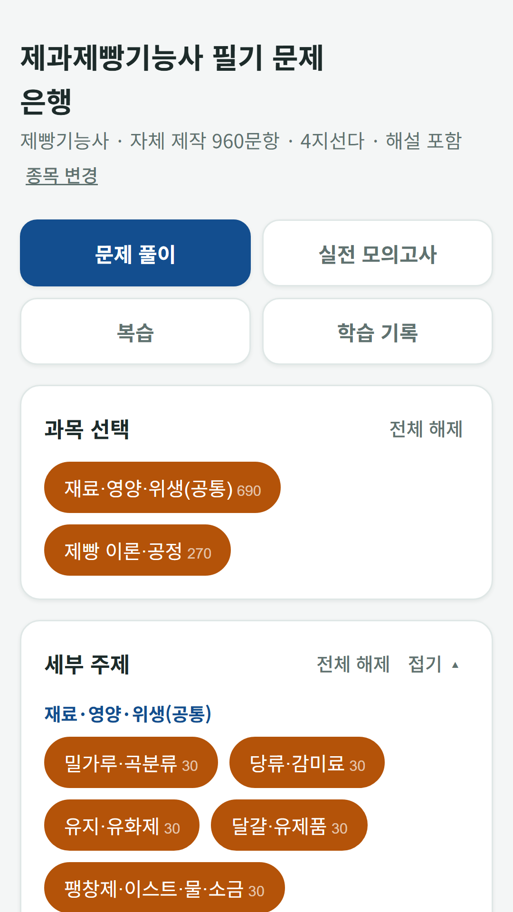
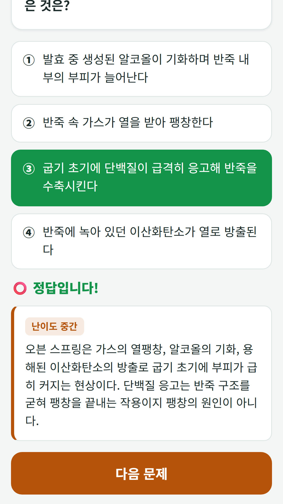
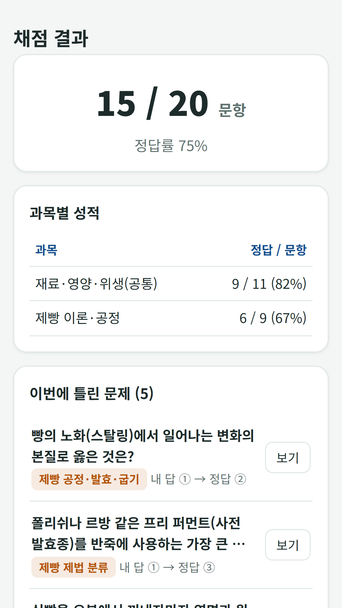

## Info
> **Baking Exam Bank** is a free question bank for the Korean confectionery and bread-making license written exams: 1,200 questions with explanations, calculation questions and a 60-question, 60-minute mock exam. Free with ads on Google Play. Korean language only.
{: .prompt-info }

## About the App
This is a free question bank for people studying for the Korean confectionery (제과기능사) and bread-making (제빵기능사) license written exams. It has 1,200 four-choice questions built on the exam standards, including calculation questions such as dough temperature and formulas.

One honest note: the whole app, including the questions and explanations, is in Korean only.

- **License types** — confectionery and bread-making
- **Common plus type-specific questions** — common questions on ingredients, nutrition and hygiene, with production theory and process questions for each license added
- **Full mock exam** — 60 questions in 60 minutes, passing at 60 out of 100

## How to Use
- **Practice** — choose a subject, a topic and a difficulty to drill just the range you want, with the answer and explanation shown right away
- **Full mock exam** — the same number of questions, time limit and pass rule as the real exam, graded as you go or after you finish
- **Review** — missed questions are saved to a wrong-answer notebook automatically, and you can star questions to revisit
- **Study record** — cumulative accuracy, accuracy by subject and a record of each attempt

## Features
- Recently answered questions are held back so the questions come up evenly
- Adjustable text size (normal, large, extra large)

It is free to use and contains ads (one ad every 25 questions, plus a banner).

The questions and explanations were written from scratch based on the published exam standards, laws and textbooks. They are not real exam questions and may contain errors, so use them as a study aid. The app is not affiliated with the exam's administering body.

{: w="360" }
{: w="360" }
{: w="360" }

## Download
- Google Play: <https://play.google.com/store/apps/details?id=com.fadongkwon.bake_quiz>

{: w="200" .normal }

## Launched Alongside
These apps came out on Google Play on the same day.

- [Care Worker Exam Bank](/posts/care-quiz/) — 1,500 questions and a mock exam for the Korean care worker test
- [Beautician Exam Bank](/posts/beauty-quiz/) — 1,800 questions and a mock exam for the Korean beautician written test
- [Korean Cook Exam Bank](/posts/cook-quiz/) — Korean, Western, Chinese and Japanese cook license written test
- [Forklift Excavator Exam Bank](/posts/heavy-quiz/) — Forklift and excavator operator license written test
- [Korean Driving Test Bank](/posts/drive-quiz/) — 965 public question-bank items and a mock exam for the Korean driving test

I post updates here and on [Instagram (@fadongkwon.soft)](https://www.instagram.com/fadongkwon.soft/).
