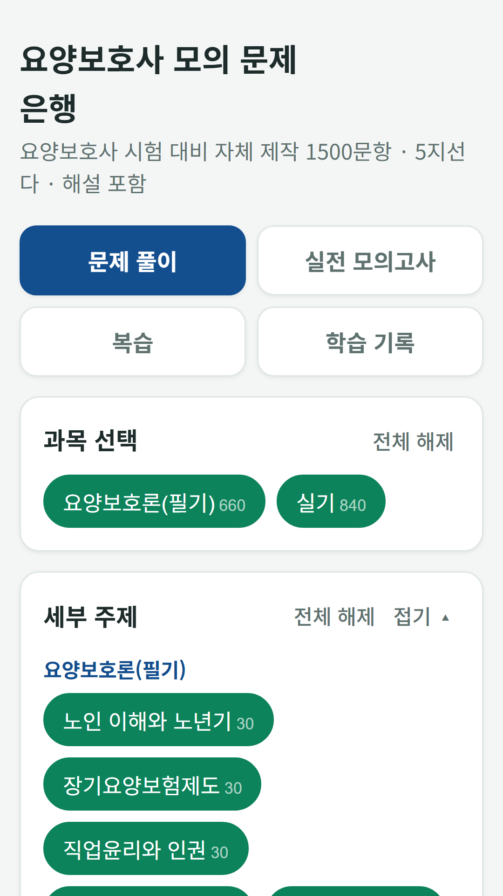
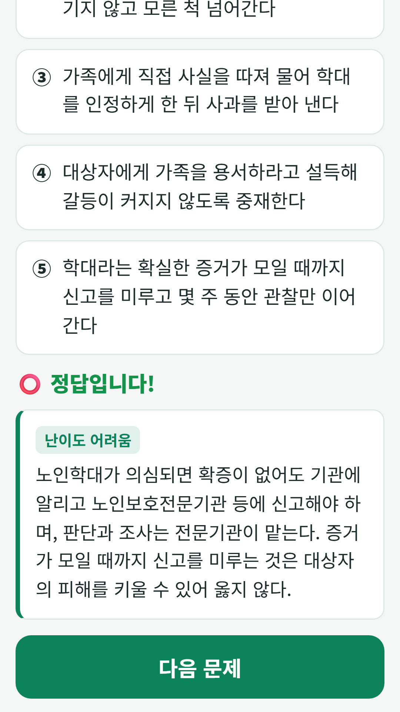
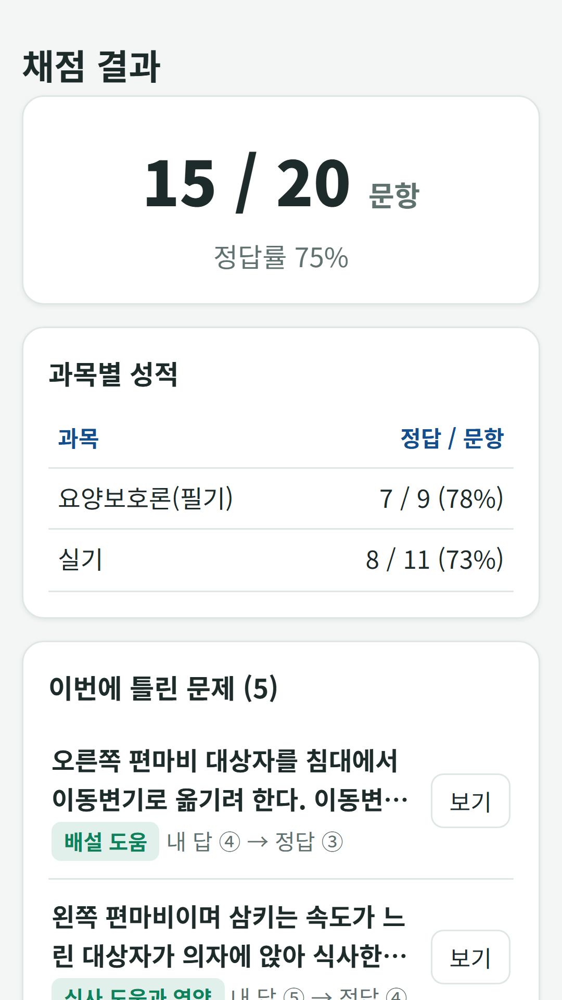

## Info
> **Care Worker Exam Bank** is a free question bank for the Korean care worker license exam: 1,500 questions with explanations, a full-length mock exam with the real question count and time limit, wrong-answer notes and study stats. Free with ads on Google Play. Korean language only.
{: .prompt-info }

## About the App
This is a free question bank for people studying for the Korean care worker license exam (요양보호사). It has 1,500 five-choice questions built on the 2026 revised standard textbook, and an 80-question, 90-minute mock exam that mirrors the real test.

One honest note: the whole app, including the questions and explanations, is in Korean only.

- **1,500 questions** — 660 in the written part (care theory) and 840 in the practical part
- **Full mock exam** — 35 written plus 45 practical questions, passing when you score 60 or more in each part

## How to Use
- **Practice** — choose a subject, a topic and a difficulty to drill just the range you want, with the answer and explanation shown right away
- **Full mock exam** — the same number of questions, time limit and pass rule as the real exam, graded as you go or after you finish
- **Review** — missed questions are saved to a wrong-answer notebook automatically, and you can star questions to revisit
- **Study record** — cumulative accuracy, accuracy by subject and a record of each attempt

## Features
- Recently answered questions are held back so the questions come up evenly
- Adjustable text size (normal, large, extra large)

It is free to use and contains ads (one ad every 25 questions, plus a banner).

The questions and explanations were written from scratch based on the published exam standards, laws and textbooks. They are not real exam questions and may contain errors, so use them as a study aid. The app is not affiliated with the exam's administering body.

{: w="360" }
{: w="360" }
{: w="360" }

## Download
- Google Play: <https://play.google.com/store/apps/details?id=com.fadongkwon.care_quiz>

{: w="200" .normal }

## Launched Alongside
These apps came out on Google Play on the same day.

- [Beautician Exam Bank](/posts/beauty-quiz/) — 1,800 questions and a mock exam for the Korean beautician written test
- [Korean Cook Exam Bank](/posts/cook-quiz/) — Korean, Western, Chinese and Japanese cook license written test
- [Baking Exam Bank](/posts/bake-quiz/) — Confectionery and bread-making license written test, with calculation questions
- [Forklift Excavator Exam Bank](/posts/heavy-quiz/) — Forklift and excavator operator license written test
- [Korean Driving Test Bank](/posts/drive-quiz/) — 965 public question-bank items and a mock exam for the Korean driving test

I post updates here and on [Instagram (@fadongkwon.soft)](https://www.instagram.com/fadongkwon.soft/).
