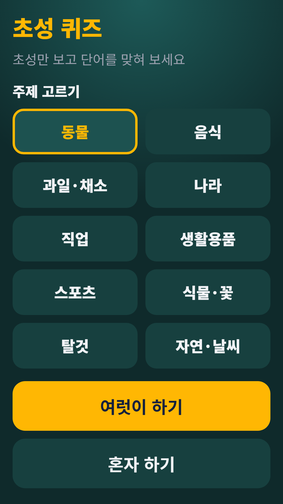
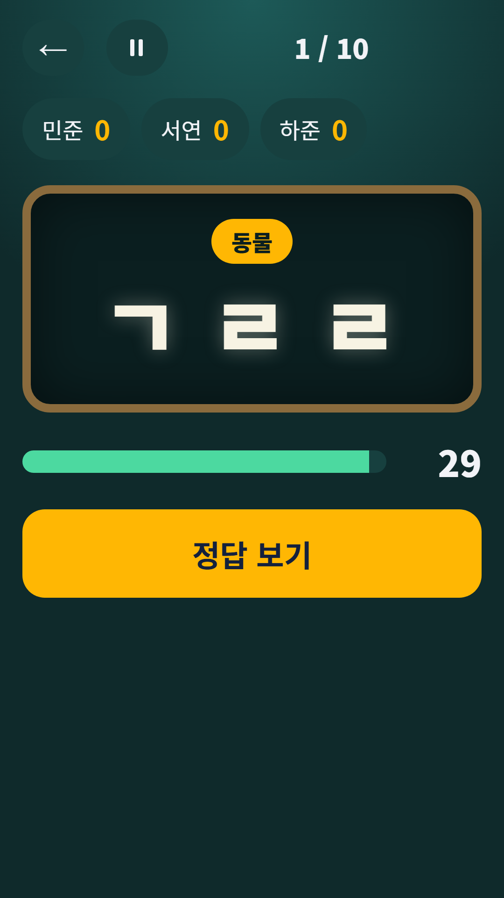
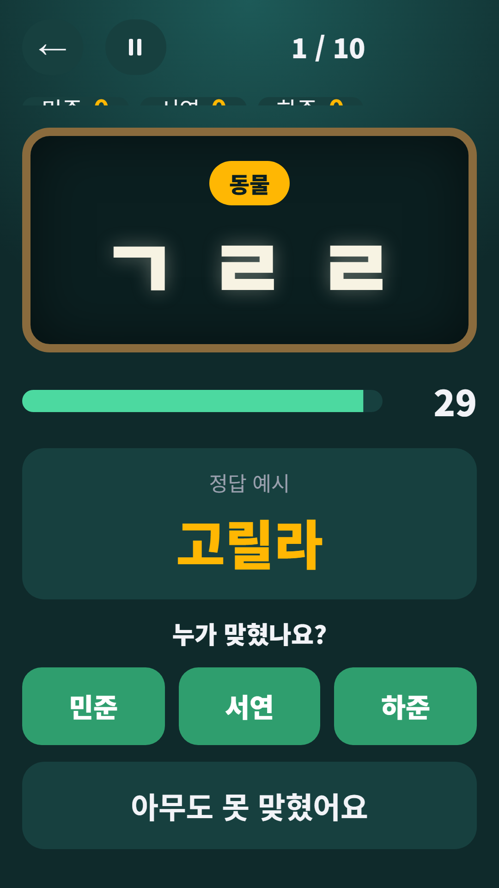

## Info
> **Chosung Quiz: Korean Initials** — Guess Korean words from their initial consonants. Play solo or with a group. The words are in Korean. Free to play on Google Play, with ads.
{: .prompt-info }

## About the Game
Guess the Korean word from its initial consonants (chosung). Play with friends on one phone or practice alone.

One honest note: the words are in Korean, so you need to read Hangul to play.

## How to Play
- Pick a topic on the home screen, then tap **Play with a group** or **Play solo**
- In group mode, set the number of questions (5, 10 or 15) and the time (15, 30 or 60 seconds) and add team or player names. Show the answer, then tap who got it. The scoreboard ranks everyone, with ties and a shared win
- In solo mode you get 10 questions, 20 seconds each. Type a word that matches the initials. Any word from the topic list with the same initials counts. Hints cost points, and you can skip
- A wrong answer comes with the reason, and you can try again before time runs out

## Features
- 10 topics: animals, food, fruit and vegetables, countries, jobs, household items, sports, plants and flowers, vehicles, nature and weather
- Score by speed, and your best score per topic is saved
- Pause anytime
- Large chalkboard-style letters that are easy to read

It is free to play and contains ads.

{: w="360" }
{: w="360" }
{: w="360" }

## Gameplay Video


## Download
- Google Play: <https://play.google.com/store/apps/details?id=com.fadongkwon.chosung_quiz>

{: w="200" .normal }

## Launched Alongside
These apps came out on Google Play on the same day.

- [FDK Lucky Pick](/posts/hub-party/) — Roulette, ladder, draw lots and four more party tools
- [Ladder Game](/posts/ladder/) — Type names and prizes, then draw the ladder
- [Draw Lots](/posts/draw-lots/) — Pass the phone and pick a slip
- [Penalty Wheel](/posts/penalty-roulette/) — Spin the wheel to pick a dare
- [FDK Daily Quiz](/posts/hub-edu/) — One question a day in six subjects (in Korean)

I post updates here and on [Instagram (@fadongkwon.soft)](https://www.instagram.com/fadongkwon.soft/).
