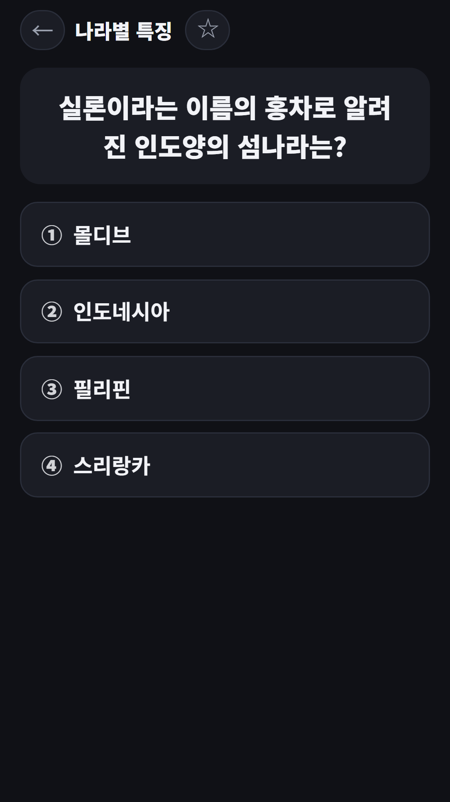

## Info
> **Daily World Geography Quiz (Korean)** — One world geography question a day with a short explanation. Korean language only. Free to play on Google Play, with ads.
{: .prompt-info }

## About the Game
Daily World Geography Quiz asks one geography question a day. Pick from four choices, see the answer at once and read a short explanation. Keep going with extra questions whenever you like.

One honest note: the whole app, including the questions and explanations, is in Korean only. It is made for Korean learners who can read Korean and for native Korean speakers who enjoy geography trivia.

## How to Play
- Answer **today's question** on the home screen. It is the same for everyone, and answering it builds your daily streak
- Pick one of four choices and the app grades it immediately, with an explanation
- Tap **one more question** to keep playing with extra questions
- In **past questions** you can see today's record, a wrong-answer notebook and favorites with a star
- **Stats** shows your current and best streak, questions solved, accuracy and accuracy by category
- The brag button shares today's result

## Features
- 270 original questions in 7 categories: capitals, flags, continents and oceans, mountains and rivers, climate, country facts and World Heritage sites
- Instant grading with an explanation for every question
- Wrong-answer notebook and starred favorites
- Streak and accuracy-by-category stats

It is free to play and contains ads.

{: w="360" }
{: w="360" }
{: w="360" }

## Gameplay Video


## Download
- Google Play: <https://play.google.com/store/apps/details?id=com.fadongkwon.daily_geo>

{: w="200" .normal }

## Launched Alongside
These apps came out on Google Play on the same day.

- [FDK Daily Quiz](/posts/hub-edu/) — One question a day in six subjects (in Korean)
- [Chosung Quiz](/posts/chosung-quiz/) — Guess Korean words from their initials
- [Care Worker Exam Bank](/posts/care-quiz/) — 1,500 questions and a mock exam for the Korean care worker test
- [Korean Driving Test Bank](/posts/drive-quiz/) — 965 public question-bank items and a mock exam for the Korean driving test

I post updates here and on [Instagram (@fadongkwon.soft)](https://www.instagram.com/fadongkwon.soft/).
