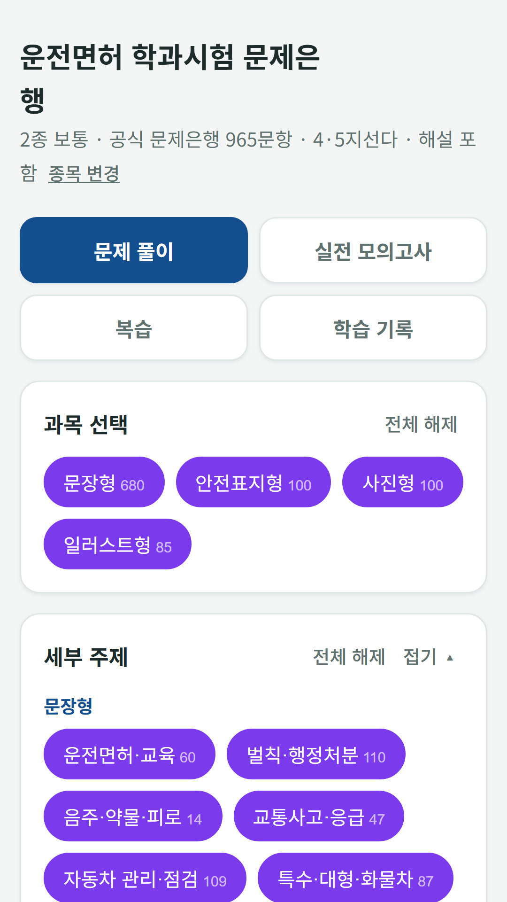
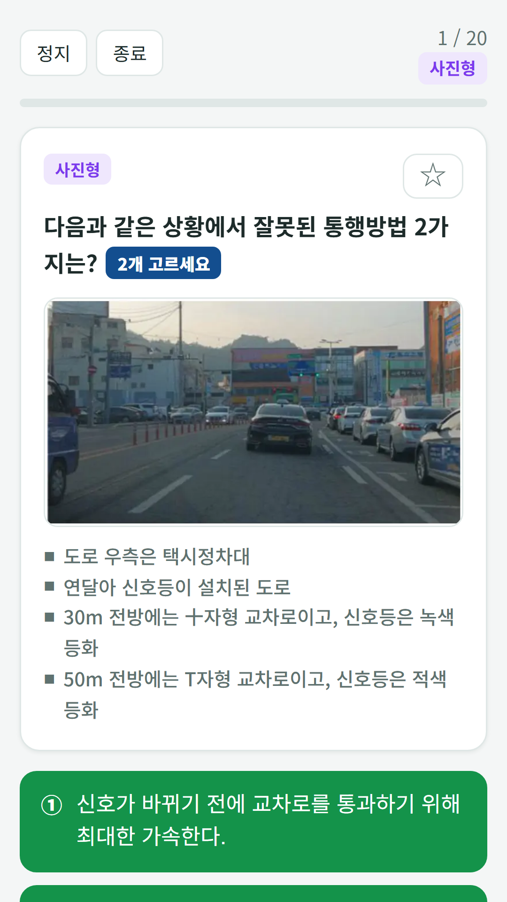
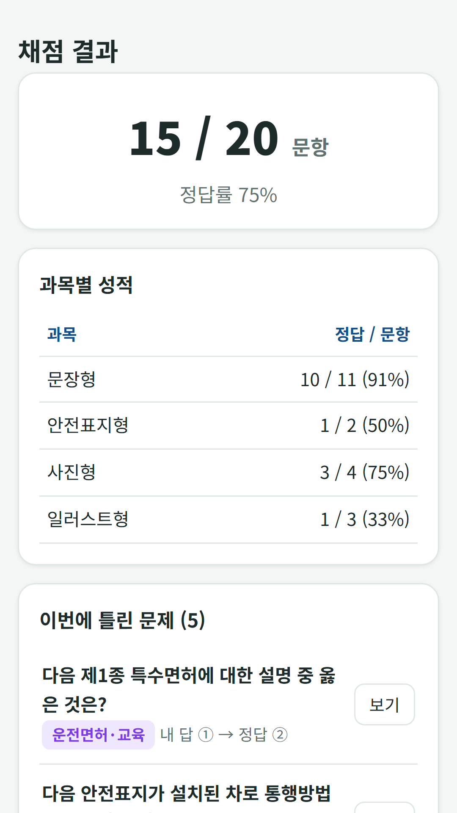

## Info
> **Korean Driving Test Bank** is a free question bank for the Korean driver's license written test: 965 items from the public question bank with explanations, plus a mock exam with the real time limit. Free with ads on Google Play. Korean language only.
{: .prompt-info }

## About the App
This is a free question bank for people studying for the Korean driver's license written test. It contains the items of the Korea Road Traffic Authority's public question bank in force since March 9, 2026, with answers and explanations. The 35 video-based questions are left out because they need footage.

One honest note: the whole app, including the questions and explanations, is in Korean only.

- **965 questions** — 680 text-based, 100 road-sign, 100 photo-based and 85 illustration-based
- **Question formats** — four- or five-choice, and pick-two questions need both correct answers, as in the real test
- **Full mock exam** — 40 questions (without the video question) in 40 minutes, scored out of 100
- **Pass marks by license** — 70 for Class 1 (regular, large, special) and 60 for Class 2 regular

## How to Use
- **Practice** — choose a question type and a topic to drill, and check the answer and explanation
- **Full mock exam** — the same format and time limit as the real test, scored out of 100
- **Review** — missed questions are saved to a wrong-answer notebook automatically, and you can star questions to revisit
- **Study record** — cumulative accuracy, accuracy by question type and a record of each attempt

## Features
- Four question types: text-based, road sign, photo-based and illustration-based
- Items from the public question bank, with answers and explanations
- Adjustable text size (normal, large, extra large)

It is free to use and contains ads (one ad every 25 questions, plus a banner).

Question source: the Korea Road Traffic Authority's driver's license written test question bank (in force since March 9, 2026), published on the Public Data Portal. This app is a study aid and is not affiliated with the Korea Road Traffic Authority.

{: w="360" }
{: w="360" }
{: w="360" }

## Download
- Google Play: <https://play.google.com/store/apps/details?id=com.fadongkwon.drive_quiz>

{: w="200" .normal }

## Launched Alongside
These apps came out on Google Play on the same day.

- [Care Worker Exam Bank](/posts/care-quiz/) — 1,500 questions and a mock exam for the Korean care worker test
- [Beautician Exam Bank](/posts/beauty-quiz/) — 1,800 questions and a mock exam for the Korean beautician written test
- [Korean Cook Exam Bank](/posts/cook-quiz/) — Korean, Western, Chinese and Japanese cook license written test
- [Baking Exam Bank](/posts/bake-quiz/) — Confectionery and bread-making license written test, with calculation questions
- [Forklift Excavator Exam Bank](/posts/heavy-quiz/) — Forklift and excavator operator license written test

I post updates here and on [Instagram (@fadongkwon.soft)](https://www.instagram.com/fadongkwon.soft/).
