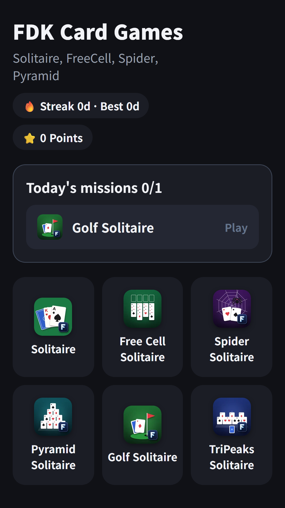
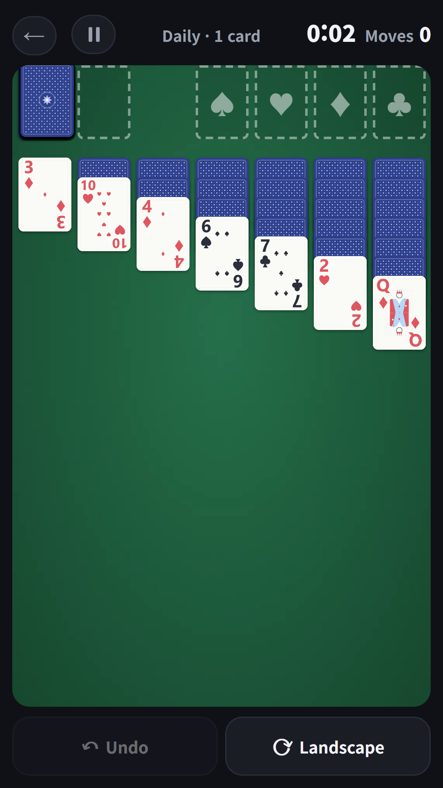
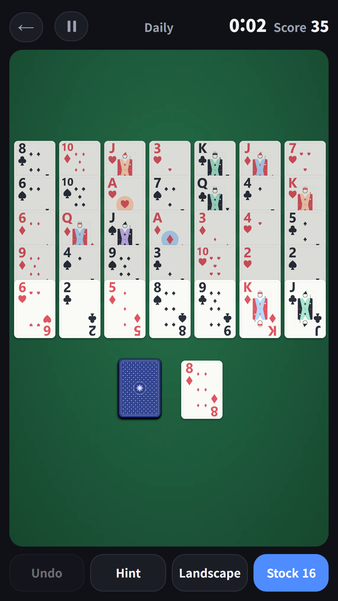

## Info
> **FDK Card Games: Solitaire** — Solitaire, FreeCell, Spider, Pyramid, Golf Solitaire and TriPeaks in one app, with a daily deal. Free to play on Google Play, with ads.
{: .prompt-info }

## About the Game
FDK Card Games brings six classic card games together in one app: Solitaire (Klondike), FreeCell, Spider, Pyramid, Golf Solitaire and TriPeaks. Pick any of them from the home screen without installing a separate app for each.

There is a daily deal with the same card layout for everyone, plus free play. Chase records with your clear time and score.

## How to Play
- Tap the card game you want on the home screen
- The **daily deal** has the same card layout for everyone, and free play is there too
- In FreeCell you can pick a deal number and replay the same deal
- In Spider you choose one, two or four suits for the difficulty
- In Pyramid you pair cards that add up to 13
- In Golf Solitaire and TriPeaks you clear cards one rank higher or lower, and only solvable deals are dealt

## Features
- Six card games in one app
- A daily deal with the same layout for everyone, plus free play
- Chase records with your clear time and score
- Landscape mode, a four-color deck option and resume support
- Today's mission, streak and points on the home screen

## The 6 Games Inside
Solitaire, FreeCell, Spider and Pyramid have their own write-ups.

- [Solitaire](/posts/solitaire/) · [FreeCell](/posts/freecell/) · [Spider](/posts/spider/) · [Pyramid](/posts/pyramid/) · Golf Solitaire · TriPeaks

It is free to play and contains ads.

{: w="360" }
{: w="360" }
{: w="360" }

## Gameplay Video


## Download
- Google Play: <https://play.google.com/store/apps/details?id=com.fadongkwon.hub_card>

{: w="200" .normal }

## Launched Alongside
These apps came out on Google Play on the same day.

- [FDK Lucky Pick](/posts/hub-party/) — Roulette, ladder, draw lots and four more party tools
- [FDK Lucky Lab](/posts/hub-fortune/) — Saju, lotto picks and tarot in one app
- [FDK Daily Quiz](/posts/hub-edu/) — One question a day in six subjects (in Korean)
- [Daily World Geography Quiz](/posts/daily-geo/) — One world geography question a day (in Korean)

I post updates here and on [Instagram (@fadongkwon.soft)](https://www.instagram.com/fadongkwon.soft/).
