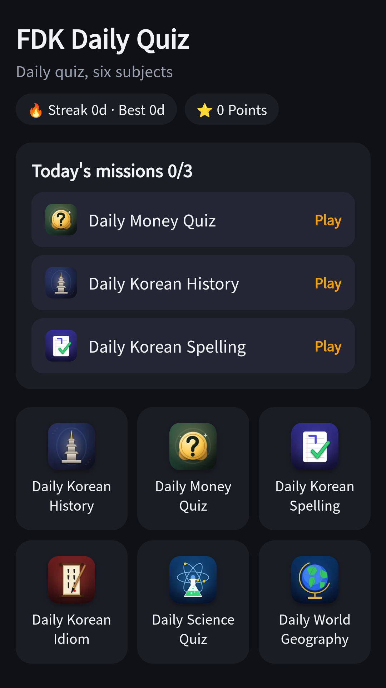
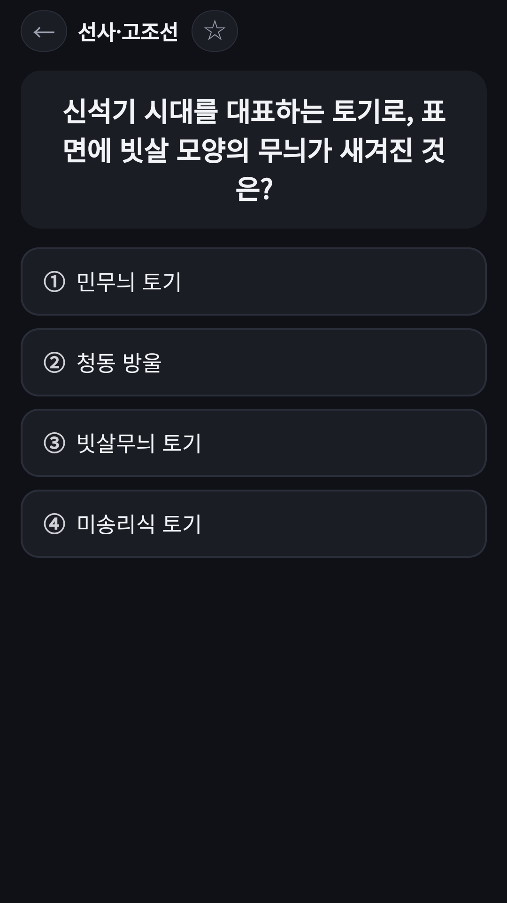
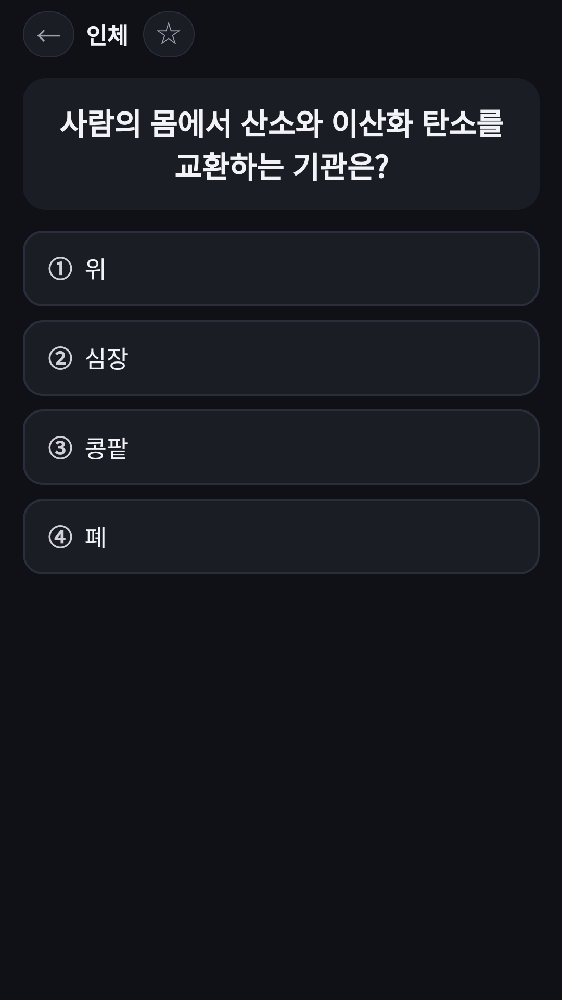

## Info
> **FDK Daily Quiz: Daily Trivia** — One question a day in six subjects, with explanations and a wrong-answer notebook. The questions are in Korean. Free to use on Google Play, with ads.
{: .prompt-info }

## About the App
FDK Daily Quiz gives you one question a day in each of six subjects: Korean history, economics, Korean spelling, four-character idioms, science and world geography. Pick a subject on the home screen without installing a separate app for each.

One honest note: the questions and explanations are in Korean. It is a study aid for reference and is not official exam material.

## How to Use
- Tap the subject you want to play on the home screen
- Three subjects become today's missions each day, and clearing them all builds a streak
- Pick an answer and see the correct answer with an explanation right away
- Retry missed questions in the wrong-answer notebook

## Features
- Six subjects: Korean history, economics, spelling, idioms, science and world geography
- Instant answers with explanations
- A wrong-answer notebook to retry missed questions
- Three daily missions picked each day, with a streak

## The 6 Subjects Inside
Each subject has its own write-up.

- [Daily Korean History](/posts/daily-history/) · [Daily Money Quiz](/posts/daily-econ/) · [Daily Korean Spelling](/posts/daily-spelling/) · [Daily Korean Idiom Quiz](/posts/daily-idiom/)
- [Daily Science Quiz](/posts/daily-science/) · [Daily World Geography Quiz](/posts/daily-geo/)

It is free to play and contains ads.

{: w="360" }
{: w="360" }
{: w="360" }

## Gameplay Video


## Download
- Google Play: <https://play.google.com/store/apps/details?id=com.fadongkwon.hub_edu>
- Apps in Toss: <https://fadongkwon.com/toss/hub-edu/> — open it on your phone and it connects straight into the Toss app.

{: w="200" .normal }

## Launched Alongside
These apps came out on Google Play on the same day.

- [Daily World Geography Quiz](/posts/daily-geo/) — One world geography question a day (in Korean)
- [Chosung Quiz](/posts/chosung-quiz/) — Guess Korean words from their initials
- [Care Worker Exam Bank](/posts/care-quiz/) — 1,500 questions and a mock exam for the Korean care worker test
- [Korean Driving Test Bank](/posts/drive-quiz/) — 965 public question-bank items and a mock exam for the Korean driving test
- [FDK Lucky Lab](/posts/hub-fortune/) — Saju, lotto picks and tarot in one app

I post updates here and on [Instagram (@fadongkwon.soft)](https://www.instagram.com/fadongkwon.soft/).
