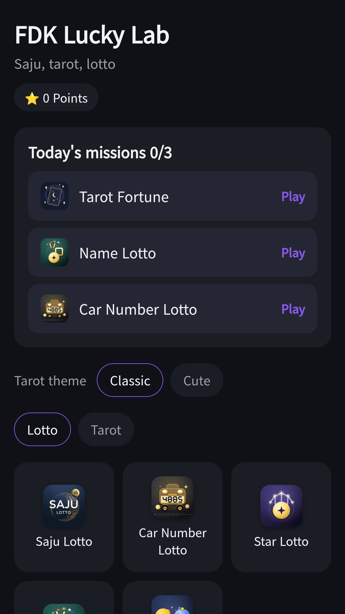
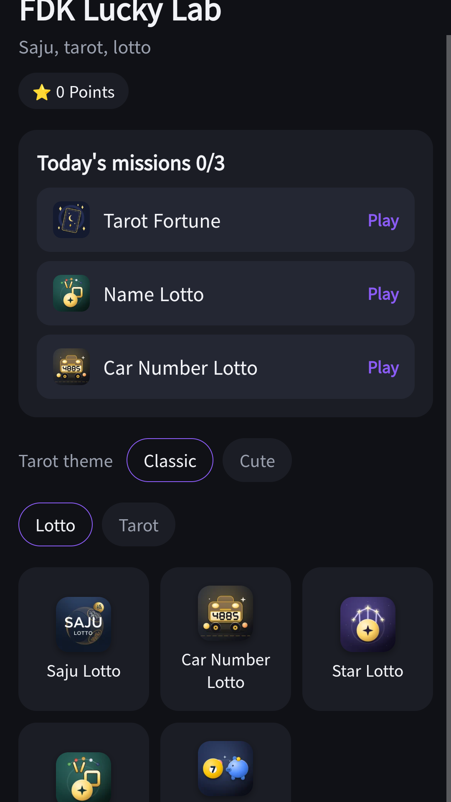
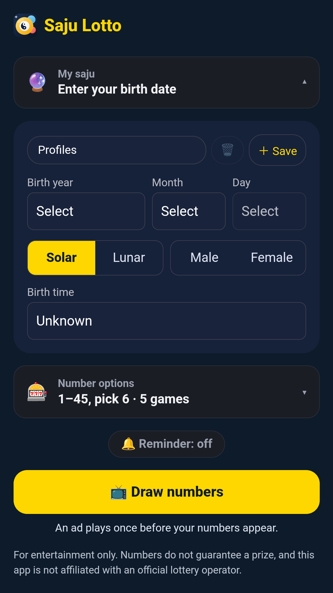
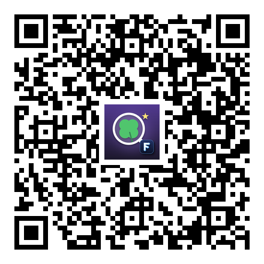

## Info
> **FDK Lucky Lab: Saju & Tarot** — Saju, car number, zodiac and name lotto picks, lotto savings and tarot in one app. For entertainment only. Free to use on Google Play, with ads.
{: .prompt-info }

## About the App
FDK Lucky Lab brings Saju Lotto, Car Number Lotto, Zodiac Lotto, Name Lotto, Lotto Savings and Tarot together in one app. Enter your birth date, name, car number and zodiac sign once and reuse them in every menu.

It is entertainment only. It does not guarantee any lottery win, and the numbers are for reference.

## How to Use
- Tap the menu you want on the home screen
- Enter your birth date, name, car number and zodiac sign once and every menu reuses them
- Get number picks from four lotto menus: Saju, car number, zodiac and name
- Send a number you like to the **Lotto Savings** calculator to compare
- Tarot has a Classic theme and a Cute theme you can switch between

## Features
- Four lotto pick menus, Lotto Savings and Tarot in one app
- One shared profile that you fill in once
- Fortunes show only the basis calculated from your input, with no made-up interpretations
- A daily mission picked by date, with a streak record

## The 6 Menus Inside
Each menu has its own write-up.

- [Saju Lotto](/posts/saju-lotto/) · [Car Number Lotto](/posts/car-lotto/) · [Star Sign Lotto](/posts/star-lotto/) · [Name Lotto](/posts/name-lotto/)
- [Save Instead of Lotto](/posts/lotto-saving/) · [Tarot Fortune](/posts/tarot-fortune/)

It is free to play and contains ads.

{: w="360" }
{: w="360" }
{: w="360" }

## Gameplay Video


## Download
- Google Play: <https://play.google.com/store/apps/details?id=com.fadongkwon.hub_fortune>
- Apps in Toss: <https://fadongkwon.com/toss/hub-fortune/> — open it on your phone and it connects straight into the Toss app.

{: w="200" .normal }

## Launched Alongside
These apps came out on Google Play on the same day.

- [FDK Card Games](/posts/hub-card/) — Solitaire, FreeCell, Spider and three more card games
- [FDK Daily Quiz](/posts/hub-edu/) — One question a day in six subjects (in Korean)
- [FDK Lucky Pick](/posts/hub-party/) — Roulette, ladder, draw lots and four more party tools
- [Daily World Geography Quiz](/posts/daily-geo/) — One world geography question a day (in Korean)

I post updates here and on [Instagram (@fadongkwon.soft)](https://www.instagram.com/fadongkwon.soft/).
