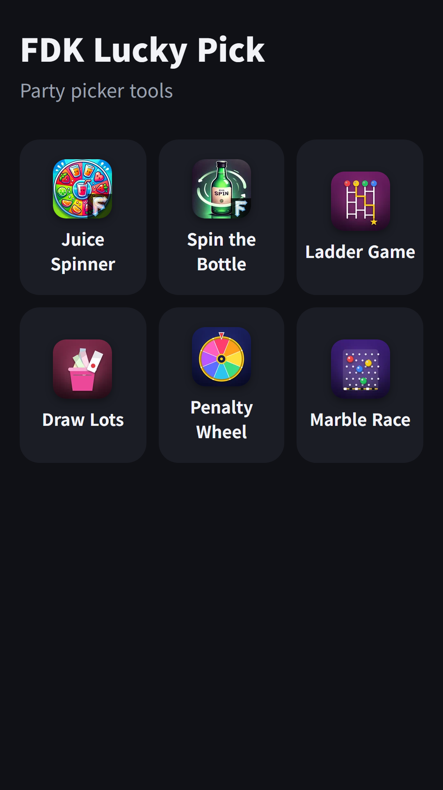
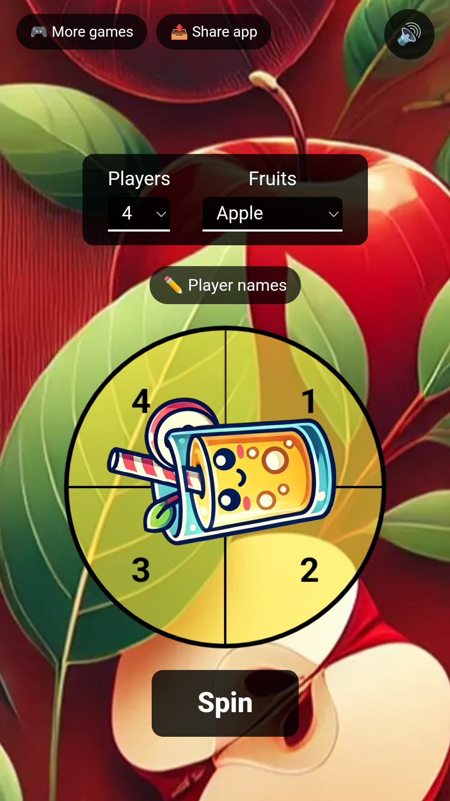
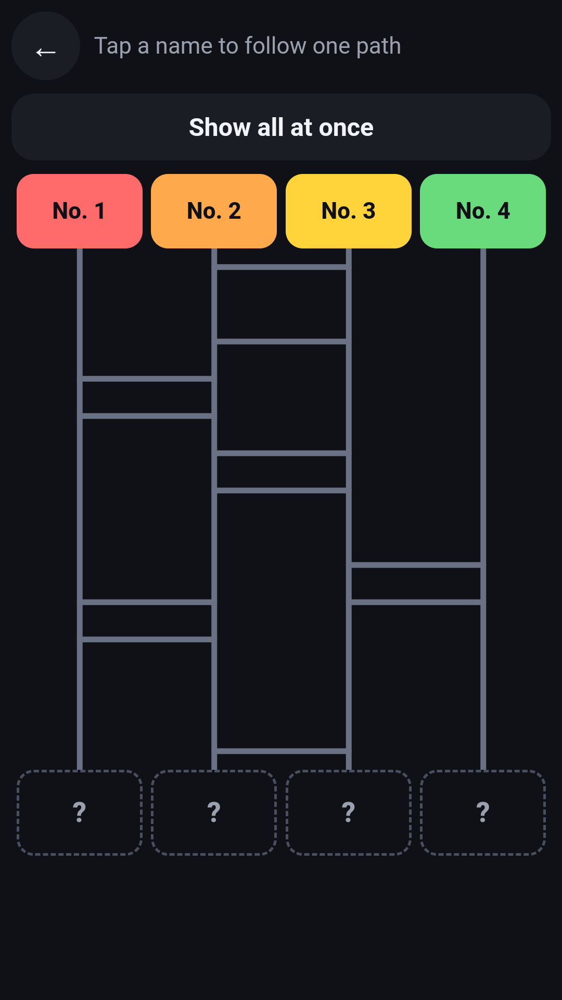

## Info
> **FDK Lucky Pick: Party Games** — Six party tools to settle who pays, who gets the dare and who goes first. Free to use on Google Play, with ads.
{: .prompt-info }

## About the App
FDK Lucky Pick is a party tool app with six ways to settle who pays, who gets the dare and who goes first.

It is a tool for fun and games.

## How to Use
- Tap the tool you want on the home screen
- Enter the player names once and every tool uses them
- Choose from Juice Spinner roulette, Spin the Bottle, Ladder, Draw Lots, Penalty Wheel, Marble Race, whichever suits your group

## Features
- Juice Spinner roulette and Spin the Bottle
- Ladder: type names and draw the ladder
- Draw Lots: pick a slip and reveal the result
- Penalty Wheel: spin for the dare
- Marble Race: a random race that picks one person

## The 6 Tools Inside
Each tool has its own write-up.

- [Juice Spinner](/posts/juice-spinner/) · [Spin the Bottle](/posts/spin-the-bottle/) · [Ladder Game](/posts/ladder/) · [Draw Lots](/posts/draw-lots/)
- [Penalty Wheel](/posts/penalty-roulette/) · [Marble Race](/posts/marble-race/)

It is free to play and contains ads.

{: w="360" }
{: w="360" }
{: w="360" }

## Gameplay Video


## Download
- Google Play: <https://play.google.com/store/apps/details?id=com.fadongkwon.hub_party>
- Apps in Toss: <https://fadongkwon.com/toss/hub-party/> — open it on your phone and it connects straight into the Toss app.

{: w="200" .normal }

## Launched Alongside
These apps came out on Google Play on the same day.

- [Ladder Game](/posts/ladder/) — Type names and prizes, then draw the ladder
- [Draw Lots](/posts/draw-lots/) — Pass the phone and pick a slip
- [Penalty Wheel](/posts/penalty-roulette/) — Spin the wheel to pick a dare
- [Chosung Quiz](/posts/chosung-quiz/) — Guess Korean words from their initials
- [FDK Card Games](/posts/hub-card/) — Solitaire, FreeCell, Spider and three more card games

I post updates here and on [Instagram (@fadongkwon.soft)](https://www.instagram.com/fadongkwon.soft/).
