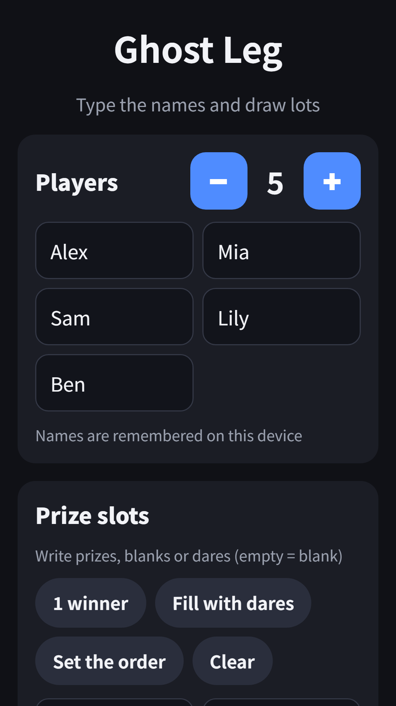
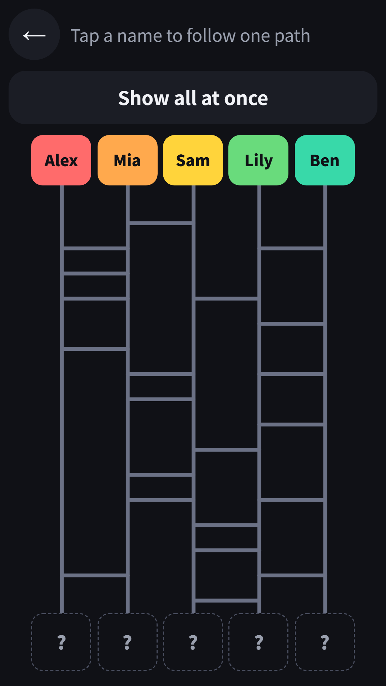
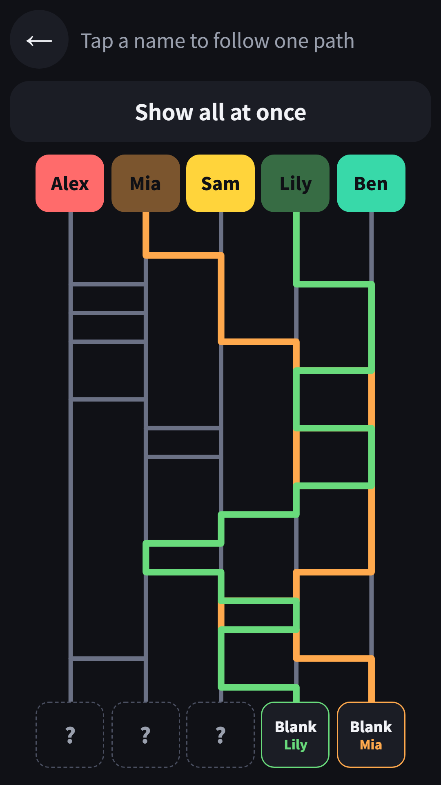

## Info
> **Ladder Game: Random Picker** — Type names and prizes, draw the ladder and see who gets what. Free to play on Google Play, with ads. 9 languages.
{: .prompt-info }

## About the Game
The classic ladder game (ghost leg) for deciding who gets what, such as who wins, who pays or who goes first. Type the names, fill in the prizes and trace each path down the ladder.

## How to Play
- Set 2 to 10 players with the - and + buttons and type the names. Names are remembered on the device
- Fill the prize slots yourself: a winner, blanks, dares or turn order
- Quick presets: 1 winner (random spot), fill with dares, set the order and clear
- Tap a name to follow just that path down the ladder, or tap Show all at once
- A result table appears at the end, and Play again draws a brand new ladder

## Features
- Every ladder is random: no two rungs touch, and every rail gets a rung
- Dares are light and fun, with no drinking
- Plays in 9 languages

It is free to play and contains ads.

{: w="360" }
{: w="360" }
{: w="360" }

## Gameplay Video


## Download
- Google Play: <https://play.google.com/store/apps/details?id=com.fadongkwon.ladder>

{: w="200" .normal }

## Launched Alongside
These apps came out on Google Play on the same day.

- [Draw Lots](/posts/draw-lots/) — Pass the phone and pick a slip
- [Penalty Wheel](/posts/penalty-roulette/) — Spin the wheel to pick a dare
- [FDK Lucky Pick](/posts/hub-party/) — Roulette, ladder, draw lots and four more party tools
- [Chosung Quiz](/posts/chosung-quiz/) — Guess Korean words from their initials

I post updates here and on [Instagram (@fadongkwon.soft)](https://www.instagram.com/fadongkwon.soft/).
