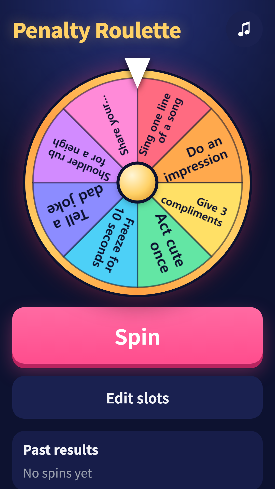
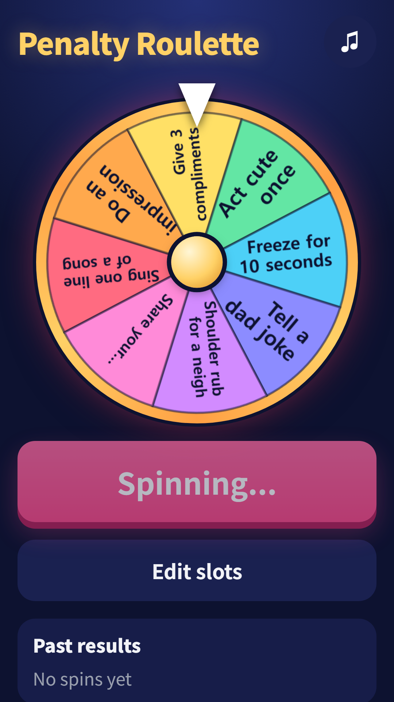
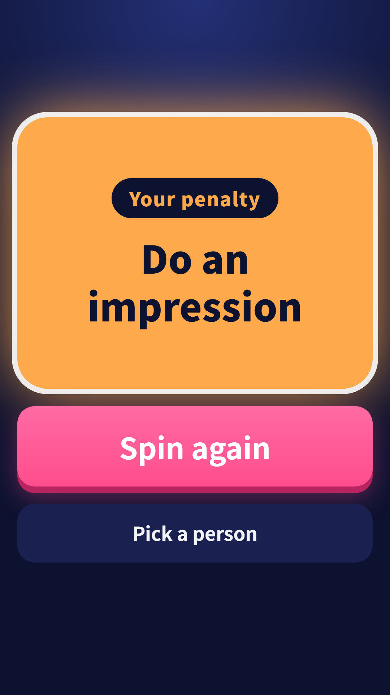
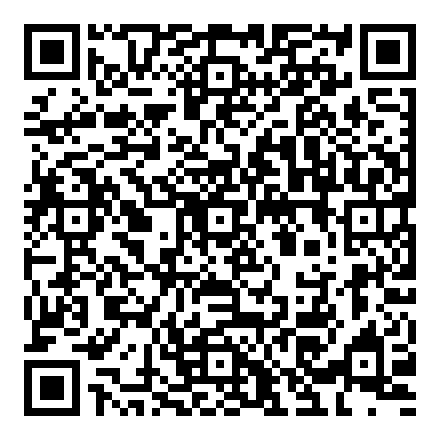

## Info
> **Penalty Wheel: Party Spinner** — Spin the wheel to pick a dare. Edit the slots for your own party games. Free to play on Google Play, with ads. Korean, English, Japanese and Chinese.
{: .prompt-info }

## About the Game
Spin the wheel and let it pick the dare. Use the ready-made sets or write your own for parties, trips and game nights.

## How to Play
- Tap Spin or tap the wheel to start. The wheel has 2 to 12 slots
- The result shows on a big card, and Spin again keeps it going
- Pick who takes the dare: add names and the app draws one fairly from the list
- Edit the slots to change any slot's text (up to 24 characters). Your changes save automatically
- A recent results list shows your past spins

## Features
- Fair spin: the winning slot is picked at random first, then the wheel slows to stop on it. The pointer ticks past each slot with sound and vibration
- 4 ready-made sets: light dares, active dares, talking dares and errand dares, all family friendly and no drinking
- Plays in Korean, English, Japanese and Chinese

It is free to play and contains ads.

{: w="360" }
{: w="360" }
{: w="360" }

## Gameplay Video


## Download
- Google Play: <https://play.google.com/store/apps/details?id=com.fadongkwon.penalty_roulette>

{: w="200" .normal }

## Launched Alongside
These apps came out on Google Play on the same day.

- [Ladder Game](/posts/ladder/) — Type names and prizes, then draw the ladder
- [Draw Lots](/posts/draw-lots/) — Pass the phone and pick a slip
- [FDK Lucky Pick](/posts/hub-party/) — Roulette, ladder, draw lots and four more party tools
- [Chosung Quiz](/posts/chosung-quiz/) — Guess Korean words from their initials

I post updates here and on [Instagram (@fadongkwon.soft)](https://www.instagram.com/fadongkwon.soft/).
