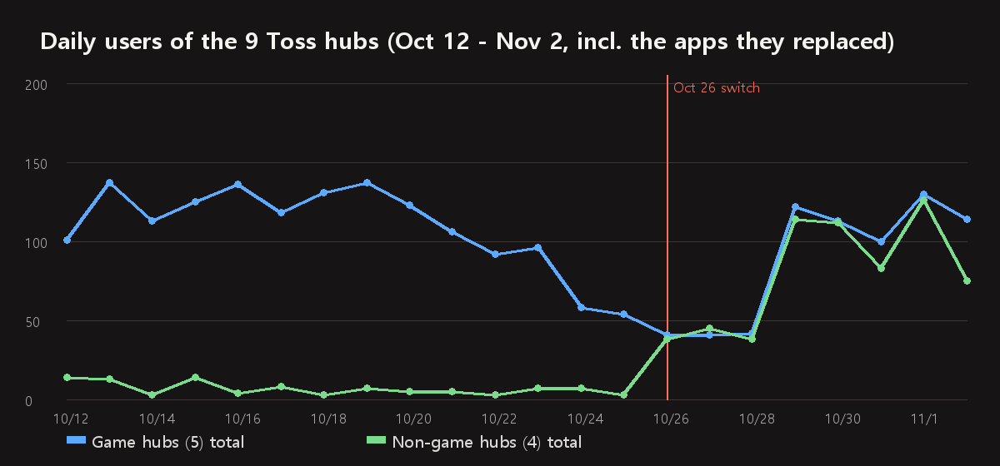

In [the hub conversion post](/posts/toss-hub-conversion/) I wrote that once two to three weeks of numbers were in, I would follow up on how return visits moved. It has been one week and a day. The first week already shows the direction, though, so here is week one. I will fill the same table again for week three in mid-November.

As before, no amounts. Only user counts, ratios and ad impression counts.

## How the comparison works

On Apps in Toss, a hub is not a new app. It is **an existing app whose app info and bundle were replaced.** The app identifier stays the same, so in the console dashboard the record of the app that gave up its slot and the record of the hub run as one line. That makes the comparison simple: the same identifier, before and after.

- **Two weeks before**: October 12 to 18
- **One week before**: October 19 to 25
- **After the switch**: October 27 to November 2
- October 26, the day of the switch, is excluded. The four non-game hubs changed in the early hours and the five game hubs that evening, so the day belongs to neither side.

Figures come from the active users and retention dashboards of the Apps in Toss console, read on the night of November 3. Ad impressions come from the [ledger](/posts/revenue-ledger-dashboard/) where I record the console's in-app ad report daily.

## At a glance

_Game hubs (5) in blue, non-game hubs (4) in green. The vertical line is the switch._

| Hub | App it replaced | Daily users (2 wks before → 1 wk before → after) | Benefits-tab share (before → after) | Next-day return (before → after) |
|---|---|---|---|---|
| [FDK Puzzle Cafe](/posts/hub-puzzle/) | Merge Pop | 24 → 20 → 16 | 93% → 87% | 1/137 → 1/77 |
| [FDK Brain Check](/posts/hub-brain/) | Memory Cards | 32 → 27 → 19 | 87% → 80% | 6/165 → 1/94 |
| [FDK Arcade](/posts/hub-arcade/) | Rock Paper Scissors | 2 → 2 → 21 | 0% → 75% | 1/7 → 1/116 |
| [FDK Board Duel](/posts/hub-board/) | Sea Battle | 27 → 21 → 14 | 96% → 74% | 1/138 → 2/75 |
| [FDK Olympics](/posts/hub-sports/) | Pixel Pong | 37 → 26 → 25 | 74% → 57% | 4/150 → 6/102 |
| [FDK Lucky Lab](/posts/hub-fortune/) | Save Instead of Lotto | 1 → 1 → 15 | 0% → 92% | 0/7 → 1/91 |
| [FDK Daily Quiz](/posts/hub-edu/) | Daily Economics | 2 → 1 → 27 | 0% → 96% | 0/5 → 3/160 |
| [FDK Lucky Pick](/posts/hub-party/) | Juice Spinner | 1 → 1 → 23 | 0% → 89% | 0/5 → 4/137 |
| FDK Exam Bank | Nursing Assistant Mock Exam | 4 → 3 → 19 | 0% → 92% | 0/16 → 0/110 |
| **Game hubs (5) total** | | **123 → 95 → 95** | 85% → 73% | 13/597 (2.2%) → 11/464 (2.4%) |
| **Non-game hubs (4) total** | | **8 → 5 → 85** | 0% → 92% | 0/33 (0.0%) → 8/498 (1.6%) |

For next-day return, the denominator is the users who arrived for the first time during that week (the cohort) and the numerator is those who came back the next day. The "after" cohort covers arrivals from October 27 to November 1. Arrivals on November 2 are left out because their next day is still being counted.

Across all nine, daily users went from **100 to 179**. But reading that as "the hub effect" would be wrong. The breakdown is below.

## Game hubs: flat in total, shifted in place

The five game hubs together had **95 daily users the week before and 95 the week after.** Exactly the same. Only the distribution changed.

- Down: **Puzzle Cafe, Brain Check and Board Duel.** The apps they replaced, Merge Pop, Memory Cards and Sea Battle, already had [1-won promotions](/posts/toss-one-won-promotion-week1/), so nine tenths of their traffic came from the benefits tab. When they became hubs the old promotions ended and new hub promotions were created, and traffic dropped in between.
- Up: **Arcade.** Rock Paper Scissors, the app it replaced, had no promotion and two users a day. As a hub it got its first benefits-tab mission and went to 21 a day.
- **Olympics** went from 26 to 25. Unchanged.

So what moved among the five game hubs is "which app carries a benefits-tab mission." There is no trace in week one of the hub itself bringing in more people. The benefits-tab share falling from 85% to 73% is some consolation, but most of that difference comes from Olympics alone: its users arriving from the All tab (the full mini-app list) went from 27 to 52 week over week. Whether that is the rename from Pixel Pong to Olympics or the effect of [moving the hubs up](/posts/hub-promo-position/) in other apps' "You might also like" lists, one week cannot tell.

One more thing worth noting. The apps in the game-hub slots had already lost half their benefits-tab traffic in the two days before the switch (October 24 and 25). That is the drop from 123 two weeks before to 95 one week before, and it coincides with the decline described in [the post on revenue after the exposure overhaul](/posts/toss-exposure-policy-revenue-drop/). So the "one week before" baseline was itself already depressed.

## Non-game hubs: from 5 to 85 a day

The four non-game hubs went from 5 daily users to 85. Seventeen times. This cannot be credited to the hubs either.

The apps they replaced, Save Instead of Lotto, Daily Economics, Juice Spinner and the Nursing Assistant Mock Exam, were **all apps without a promotion.** Their benefits-tab traffic was zero. As hubs, all four got a benefits-tab mission, and 92% of post-switch traffic comes from the benefits tab. Those 85 people are not "people who came because it is a hub" but "people who saw a brand-new 1-won mission." The same apps with only a promotion added and no hub conversion would most likely have produced similar numbers.

To isolate the hub's share you have to look at traffic that is not from the benefits tab, and for the four non-game hubs that is about 7 a day after the switch. Not much different from the 5 a day before.

## The three-day gap after the switch

The chart bottoms out on October 26 to 28. The game hubs totaled 41 to 42 users a day and the non-game hubs 38 to 45, and then **on October 29 they jump to 122 and 114 at once.**

The hub 1-won promotions started in the early hours of October 26 for the non-game hubs and that evening for the game hubs. Benefits-tab traffic, however, came back three days later on the 29th. During those three days benefits-tab arrivals on the game hubs were in the single digits per day. The old promotions had already ended and the new ones were not yet rotating as benefits-tab cards. Because nine apps changed on the same day, that gap shows up as a clean three-day trough. Next time, the right order would be to create the new promotion first and end the old one afterwards. The catch is that the old code does not pay out inside a hub bundle, so during the overlap a benefits-tab card could be live while mission completions go unrecorded. It is a choice between a three-day gap and unpaid-mission complaints.

## Return visits have not moved

This is the number I most wanted to see. The short version: **no difference yet.**

| | Cohort one week before (Oct 19 to 25) | Cohort after the switch (Oct 27 to Nov 1) |
|---|---|---|
| Game hubs (5), next-day return | 13/597 (2.2%) | 11/464 (2.4%) |
| Non-game hubs (4), next-day return | 0/33 (0.0%) | 8/498 (1.6%) |
| All nine | 13/630 (2.1%) | 19/962 (2.0%) |

The hope was that with several games inside one hub, people would have a reason to come back the next day. In week one they did not. Users arriving from the benefits tab come back the next day at around 2% whether it is a hub or a single app. That is as low as the 0.8% next-day return of benefits-tab arrivals seen in [the Gomoku growth program post](/posts/toss-growth-program-gomoku/). If the acquisition channel is the same, changing the container does not change the return rate.

One number from a different angle looks a little different. Users on a given day who were not first-time arrivals, in other words returning users, went from **69 to 103 per week** on the five game hubs, from 10% to 16% of daily users. On the four non-game hubs, from 4 to 26. But this count also grows naturally because users who arrived before the switch continue under the same identifier in the hub, so I am not reading it as "more people came back because it is a hub" yet. Week three has to fill the same cell again.

## Ad impressions per user doubled on the game hubs

Users stayed flat; ad impressions did not.

| | Impressions, week before | Impressions, week after | Per user |
|---|---|---|---|
| Game hubs (5) | 839 | 1,857 | 1.3 → 2.8 |
| Non-game hubs (4) | 60 | 1,040 | 1.6 → 1.8 |

The five game hubs had the same 95 daily users but 2.2 times the ad impressions. Impressions per user went from 1.3 to 2.8. Two reasons: the hub home gained a banner (fixing "the hub home had no banner" among the [launch-day defects](/posts/hub-launch-day-bugs/)), and some people now play more than one game per visit. Olympics grew the most, from 1.1 to 3.5 per user, and Board Duel from 1.1 to 3.0.

The non-game hubs have seventeen times the users, so impressions grew with them, but per user they stayed at 1.6 to 1.8. Checking a fortune or answering a few questions and leaving did not change when the app became a hub. Exam Bank actually fell from 2.4 to 1.1, but its pre-switch base was three users, which is not a number to compare against.

## One in six benefits-tab arrivals finishes the mission

The hub promotion mission is "finish one round of any game in the hub." As of November 3, payouts total 84 on the five game hubs and 86 on the four non-game hubs. Benefits-tab arrivals over the same stretch were 483 on the game hubs and 547 on the non-game hubs, so **only one in six people who tap the benefits-tab card and arrive actually finishes a round.** The other five leave from the first screen or the game list. Payouts are cumulative from October 26 to midday November 3 and arrivals cover October 27 to November 2, so the periods do not line up exactly, but the order of magnitude is the same.

This is partly a hub first-screen problem. As a single app, you landed straight in the game; in a hub, the game list comes first. Sending benefits-tab arrivals straight into one round is the same idea as the improvement described in [the Gomoku growth program post](/posts/toss-growth-program-gomoku/), so I will decide whether to add it to the hubs after seeing the results there.

## Summary

- Daily users across the nine went from **100 to 179**, but the five game hubs stayed at **95** and only shifted in place. What moved was not the hub but where the benefits-tab mission sits.
- The non-game hubs' **5 to 85** belongs to their first-ever 1-won missions. Non-benefits-tab traffic is about 7 a day, close to before.
- **Three days after the switch (Oct 26 to 28) traffic bottomed out.** That is the gap before a new promotion rotates on the benefits tab.
- Next-day return went from **2.1% to 2.0%, no difference.** Returning users rose from 69 to 103 on the game hubs, but the effect of the same identifier carrying over cannot be separated yet.
- Ad impressions on the game hubs went from **1.3 to 2.8 per user**, thanks to the hub home banner and multiple rounds per visit. Non-game hubs stayed at 1.6 to 1.8.
- Only **one in six** benefits-tab arrivals finishes the mission (one round).

Three things next. In mid-November I will fill the same table for week three. [Card Games](/posts/hub-card/) is now live on Play, so the Toss conversion of the Solitaire slot goes ahead. And the entry path that sends benefits-tab arrivals straight into a first round will be decided after the Gomoku results.

The apps are listed under [GAMES](/ko/games/) and [APPS](/ko/apps/), and some can be [played right in the browser](/play/). Updates go out on this blog and on [Instagram (@fadongkwon.soft)](https://www.instagram.com/fadongkwon.soft/).

> The figures in this post were read from the Apps in Toss console dashboards on the night of November 3, 2026. Console figures are revised over several days and may shift slightly, and one week after a switch is a short window for conclusions. The week-three post will fill the same table again.
{: .prompt-info }
