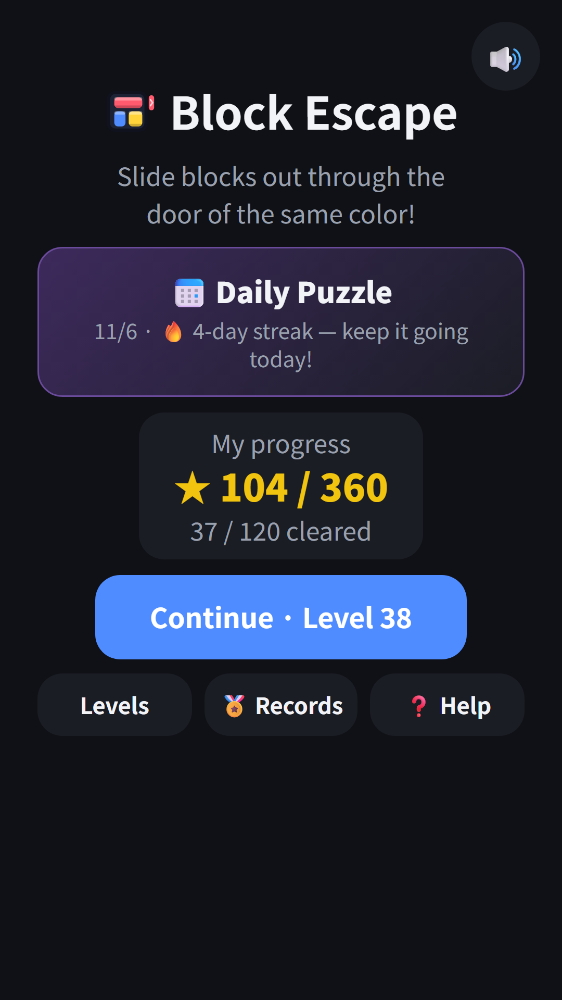
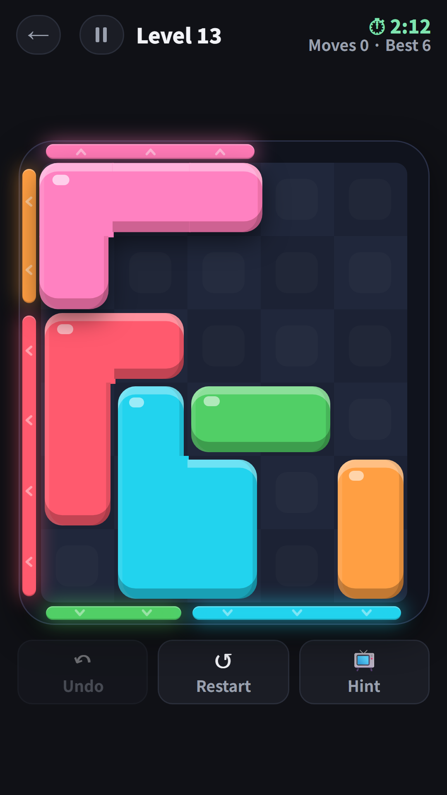
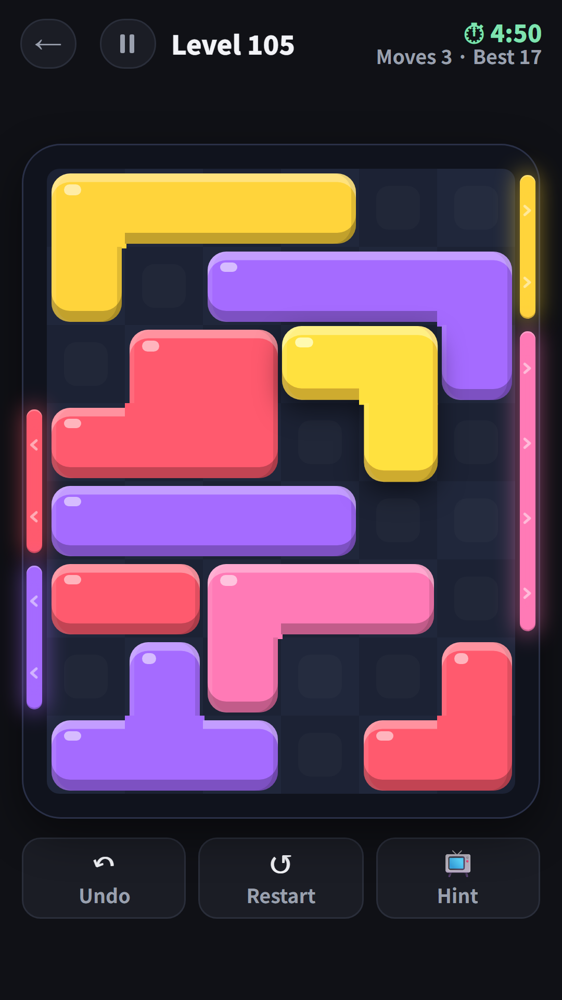
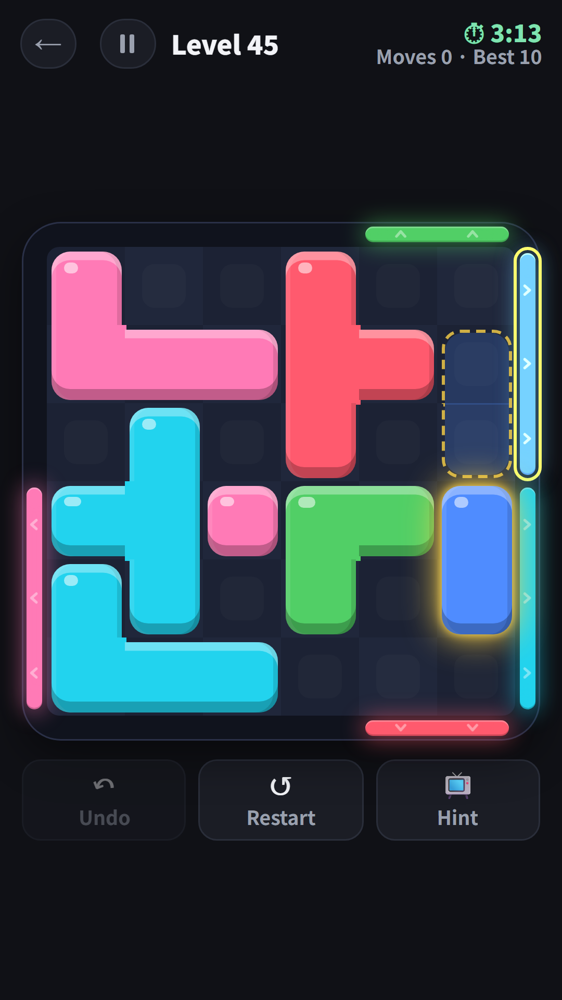
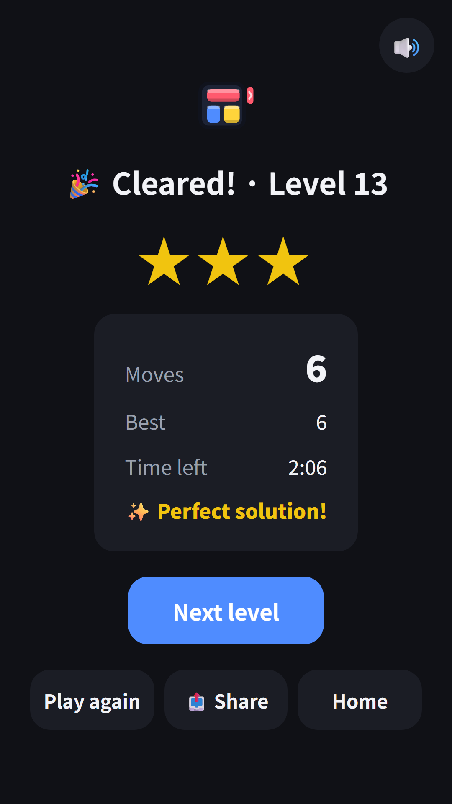

## Info
> **Block Escape: Color Puzzle** — Slide colorful blocks out through doors of the same color. 120 levels, aim for 3 stars. Free to play on Google Play, with ads. 9 languages.
{: .prompt-info }

## About the Game
Drag colorful blocks across the board and slide each one out through the door of the same color on the edge. Blocks move up, down, left and right but never rotate, and a block only fits through a door that is at least as wide as it is. Clear every block to finish the level.

## How to Play
- Grab a block with your finger and drag it where you want. It cannot pass walls or other blocks
- When the way to a door of the same color is clear and the block fits the door, it slides out
- One grab and release is one move, however far the block travels
- Solve in the fewest moves for 3 stars, within 1.5x for 2 stars
- Every level has a time limit of 1 to 5 minutes

## Features
- 120 levels in 6 stages, from two-block warm-ups to packed 7x8 boards, each checked solvable by our own solver
- Undo and restart are free and unlimited, and a board never gets stuck for good
- Stuck? Watch a short ad to get a hint that shows the next block and where it goes
- Daily Puzzle: the same board for everyone each day, so you can keep a streak going
- Records: total stars, cleared levels and the stars you earned by day, week and month
- Progress saves after every move, works offline and plays in 9 languages

It is free to play and contains ads.

{: w="360" }
{: w="360" }
{: w="360" }
{: w="360" }
{: w="360" }

## Gameplay Video


## Download
- Google Play: <https://play.google.com/store/apps/details?id=com.fadongkwon.block_escape>

{: w="200" .normal }

I post updates here and on [Instagram (@fadongkwon.soft)](https://www.instagram.com/fadongkwon.soft/).
