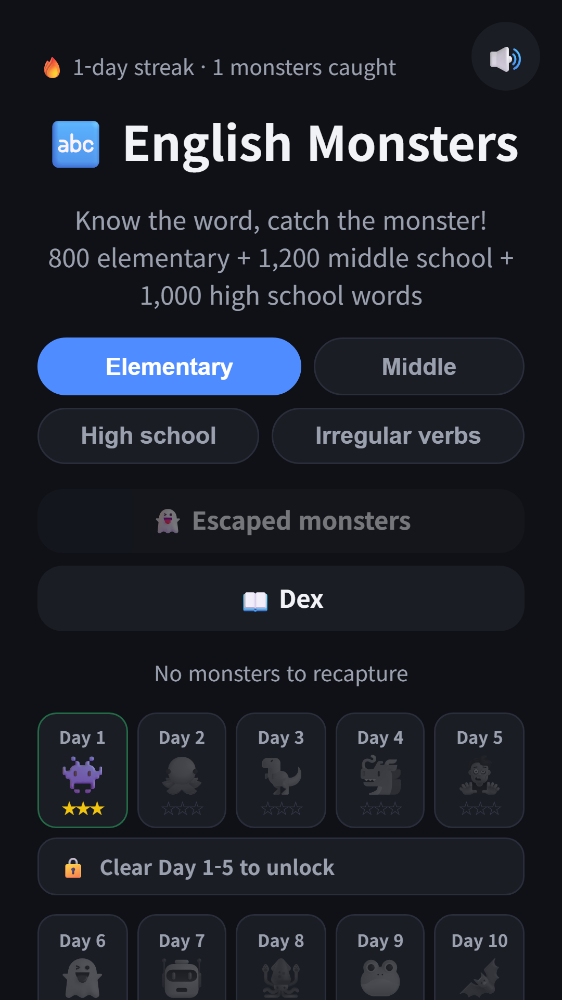
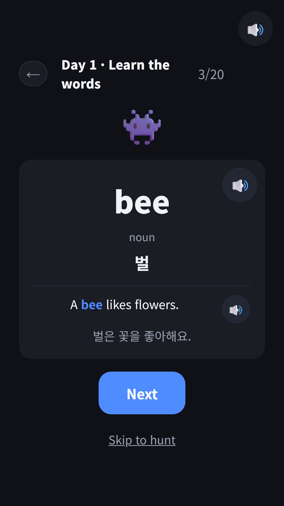
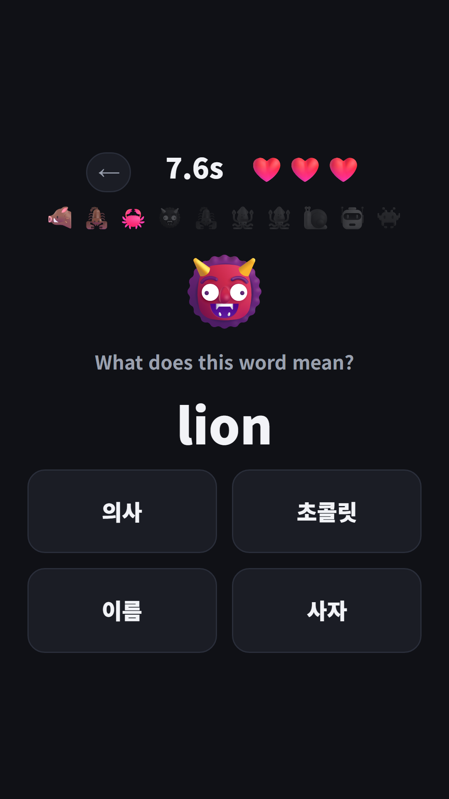
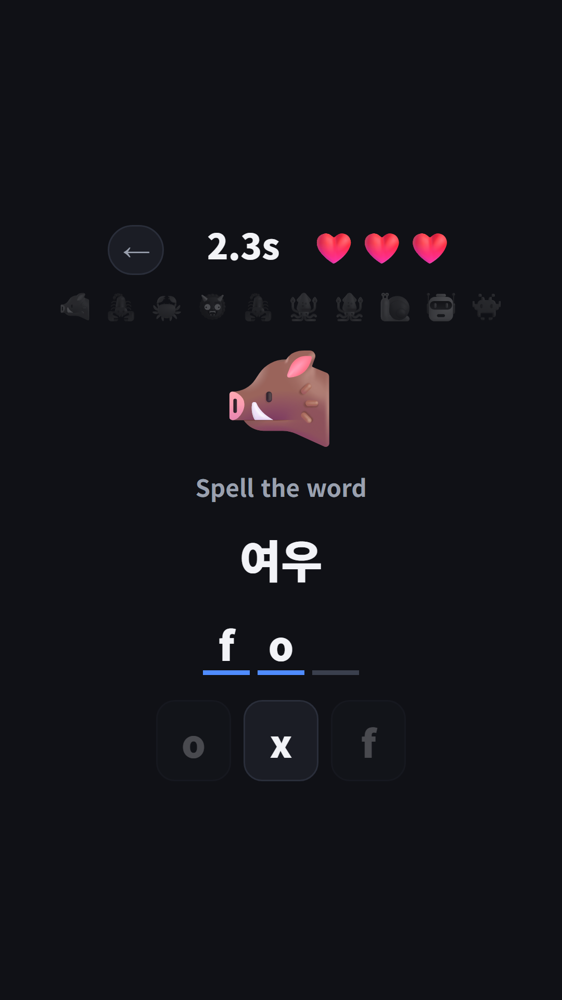
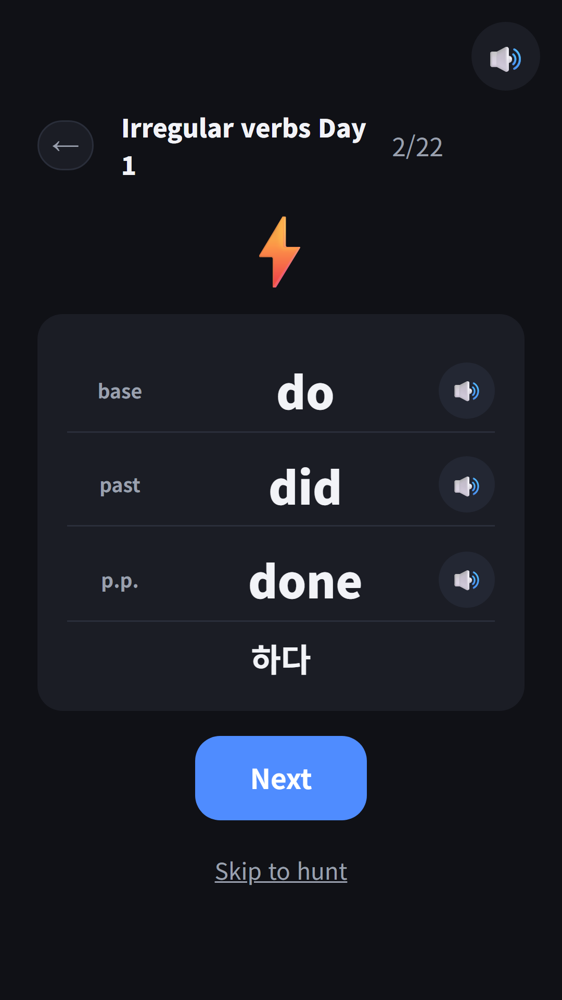
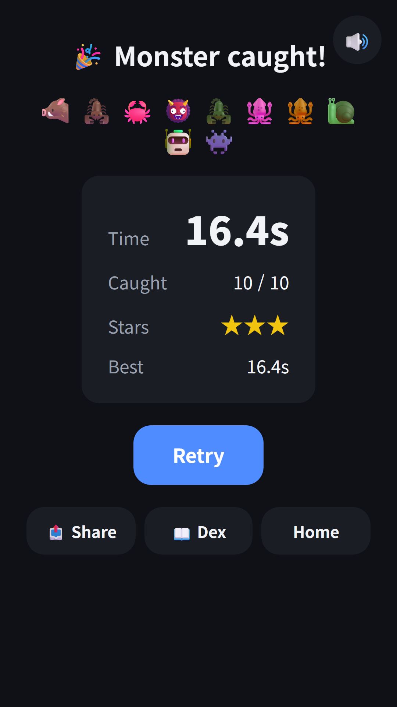

## Info
> **English Monsters: Vocab Hunt** — learn the 3,000 basic words of Korea's national English curriculum and 127 irregular verbs by catching monsters. No ads, no purchases, no sign-up. Korean and English screens.
{: .prompt-info }

> The Google Play release is still in review. Until it clears, you can try the [browser version](/play/english-monsters/) right away.
{: .prompt-tip }

## About the App
This is the third monster app, after Hangul Monsters and Math Monsters. This time it is English words: every word you get right catches one more monster.

The word list is the **3,000 basic vocabulary words** of the 2022 revised English curriculum published by Korea's Ministry of Education, used as is. 800 elementary words (Day 1-40), 1,200 middle school words (Day 41-100) and 1,000 high school words (Day 101-150) are split into 20 words a day, 150 days in all. We wrote the meanings and example sentences ourselves and cross-checked them several times.

## How It Works
- **Learn**: pick a Day and flip through 20 word cards. Each card has the meaning, part of speech and an example sentence. The word is read aloud when the card appears, and the 🔊 button plays the example sentence
- **Hunt**: answer 10 questions to catch 10 monsters. Questions mix picking the meaning, picking the word, listening and choosing, and spelling the word with letter tiles. You have 3 hearts
- **Escaped Monsters**: words you miss come back the next day, after 3 days and after 7 days. Get them right all the way through and they graduate
- **Boss battles**: clear 5 Days to open a 20-question boss battle
- **Stars**: the hearts you have left at the end of a round become your stars

## Features
- All 3,000 basic curriculum words, split into Elementary, Middle and High school tabs
- Irregular verbs course: learn 127 verbs over 6 days in their base, past and past participle forms, then take on the Verb King boss
- A monster collection with 187 slots: 150 Day monsters, 30 bosses and 7 irregular verb monsters
- Every word and example sentence is read aloud in natural-sounding English
- Made for kids: no ads, no purchases and no sign-up
- Word meanings and example translations are in Korean, made for Korean-speaking learners. The app runs in Korean and English

{: w="360" }
{: w="360" }
{: w="360" }
{: w="360" }
{: w="360" }
{: w="360" }

## Gameplay Video


## Download
- Google Play: <https://play.google.com/store/apps/details?id=com.fadongkwon.english_monsters> (in review)
- Play in your browser: [fadongkwon.com/play/english-monsters/](/play/english-monsters/) — no install needed, works on phones, tablets and desktops. Progress is saved in this browser only.

The sibling apps [Hangul Monsters](/posts/hangul-monsters/) and [Math Monsters](/posts/math-monsters/) are here too, and all of our kids' learning apps are collected on the [Learning Apps for Kids](/kids/) page.

I post updates here and on [Instagram (@fadongkwon.soft)](https://www.instagram.com/fadongkwon.soft/).
