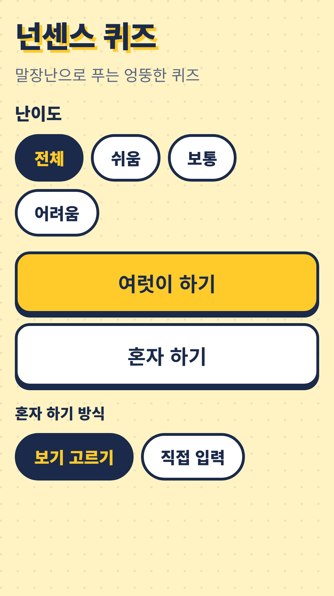
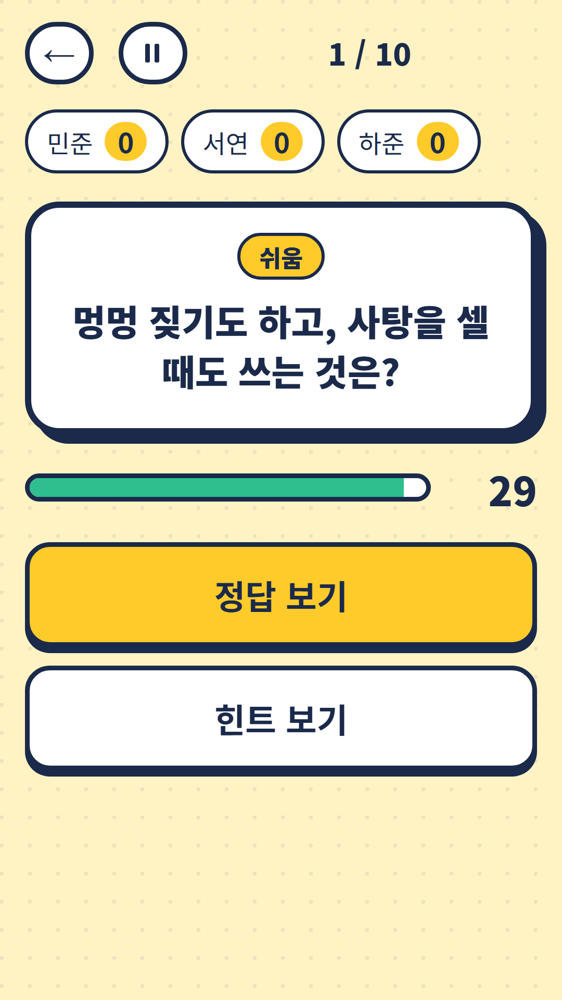
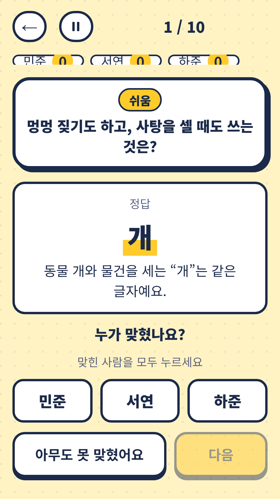
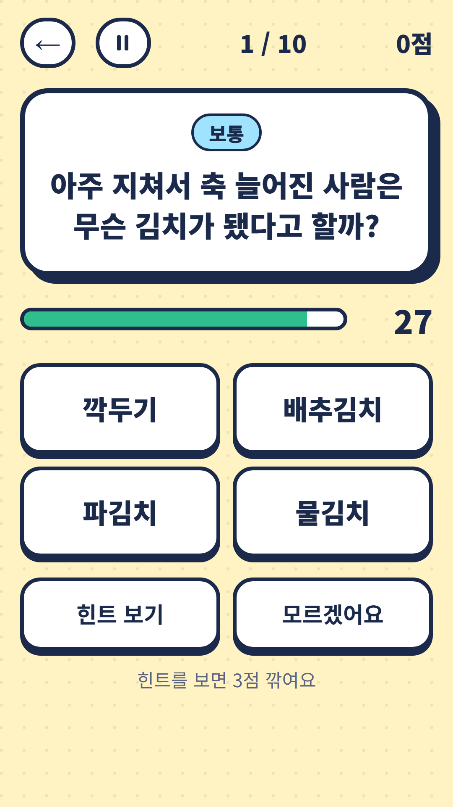

## Info
> **Nonsense Quiz: Korean Puns** — 300 original Korean pun riddles. Laugh together in a group or play solo. The riddles are in Korean. Free to play on Google Play, with ads.
{: .prompt-info }

## About the Game
Nonsense Quiz is a collection of Korean pun riddles that make everyone groan and then laugh. I wrote all 300 riddles myself around wordplay, and every answer comes with an explanation. Play together in a group or alone.

One honest note: the riddles are in Korean and many depend on Korean wordplay, so you need to read Hangul.

## How to Play
- Choose a difficulty: easy, normal or hard (or all of them)
- **Group mode** — choose 5, 10 or 15 riddles and 15, 30 or 60 seconds, and show a hint if needed. Reveal the answer and explanation, then tap everyone who got it. Ranks, ties and shared wins are shown
- **Solo mode** — 10 riddles, 30 seconds each. Pick from four choices or type the answer yourself. Hints cost points
- You can pause anytime

## Features
- 300 original riddles based on wordplay, with an explanation for every answer
- Three difficulty levels: easy, normal and hard
- Group and solo modes, and in solo you can pick from choices or type your answer
- Recently seen riddles are skipped

It is free to play and contains ads.

{: w="360" }
{: w="360" }
{: w="360" }
{: w="360" }

## Gameplay Video


## Download
- Google Play: <https://play.google.com/store/apps/details?id=com.fadongkwon.nonsense_quiz>

{: w="200" .normal }

## Launched Alongside
These apps came out on Google Play around the same time.

<!-- TODO: hub-quiz·quiz-battle·twenty-q·cert-hub 글 게시 뒤 링크 복원 -->

- FDK Quiz Fest — Four party quiz games, including Nonsense Quiz
- Trivia Battle — Four-choice trivia duels in history, economics, science and geography
- [Chosung Quiz](/posts/chosung-quiz/) — Guess Korean words from their initials
- Twenty Questions — Find the secret word in 20 yes-or-no questions
- FDK Certification Exam Prep — Question banks for seven Korean license exams in one app

I post updates here and on [Instagram (@fadongkwon.soft)](https://www.instagram.com/fadongkwon.soft/).
