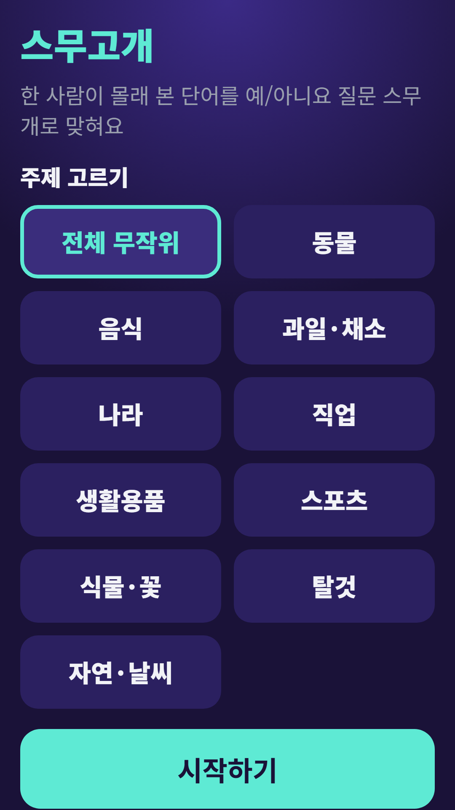
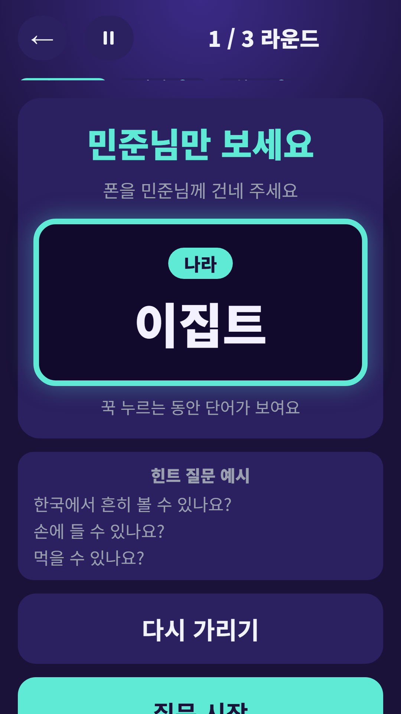
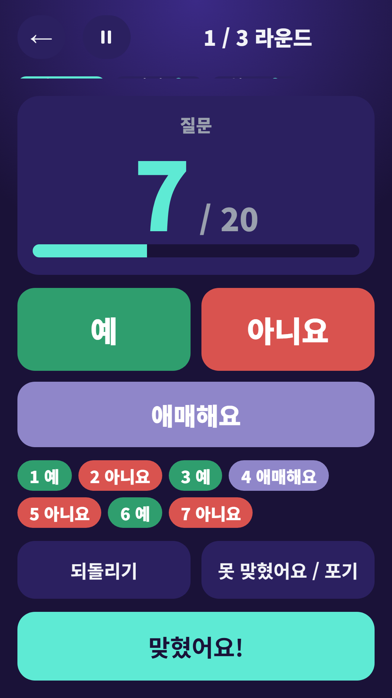
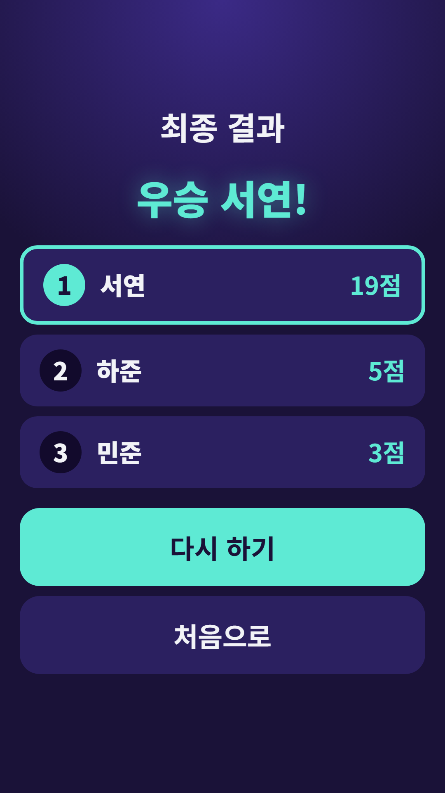

## Info
> **Twenty Questions: Party Game** — One player sees a secret Korean word and everyone else has 20 yes-or-no questions to find it. The words are in Korean. Free to play on Google Play, with ads.
{: .prompt-info }

## About the Game
Twenty Questions is the classic party game on one phone. One player secretly checks a word, and everyone else asks yes-or-no questions out loud, up to twenty, to find it.

One honest note: the words are in Korean, so you need to read Hangul.

## How to Play
- Pick a topic and enter the player names
- One player, the question giver, secretly checks the word, then hides it again
- Everyone else asks yes-or-no questions out loud, and the question giver taps **Yes**, **No** or **Not sure**. Each tap counts a question, and there is an undo button
- When someone guesses it, tap **Got it!** and choose who got it
- The question giver rotates through the player list each round
- Guessing early scores more, and the question giver scores too. The final screen shows ranks, ties and shared wins

## Features
- 10 topics or a random mix: animals, food, fruit and vegetables, countries, jobs, household items, sports, plants and flowers, vehicles, nature and weather
- Optional time limit of 3 or 5 minutes per round, or no limit
- Rules sheet and example questions on screen

It is free to play and contains ads.

{: w="360" }
{: w="360" }
{: w="360" }
{: w="360" }

## Gameplay Video


## Download
- Google Play: <https://play.google.com/store/apps/details?id=com.fadongkwon.twenty_q>

{: w="200" .normal }

## Launched Alongside
These apps came out on Google Play around the same time.

- [FDK Quiz Fest](/posts/hub-quiz/) — Four party quiz games, including Twenty Questions
- [Trivia Battle](/posts/quiz-battle/) — Four-choice trivia duels in history, economics, science and geography
- [Chosung Quiz](/posts/chosung-quiz/) — Guess Korean words from their initials
- [Nonsense Quiz](/posts/nonsense-quiz/) — 300 original Korean pun riddles
- [FDK Certification Exam Prep](/posts/cert-hub/) — Question banks for seven Korean license exams in one app

I post updates here and on [Instagram (@fadongkwon.soft)](https://www.instagram.com/fadongkwon.soft/).
