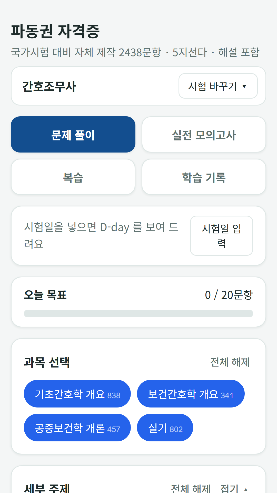
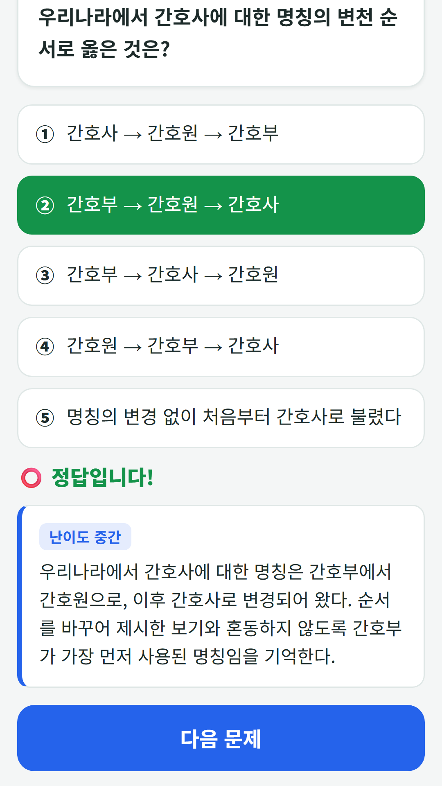
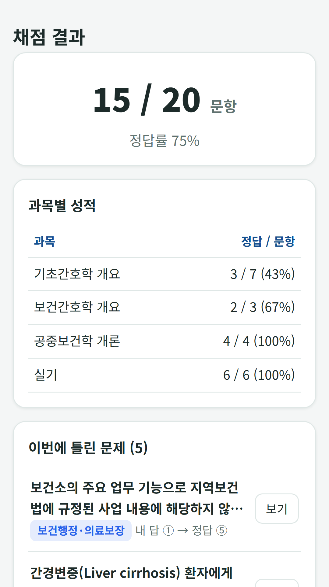
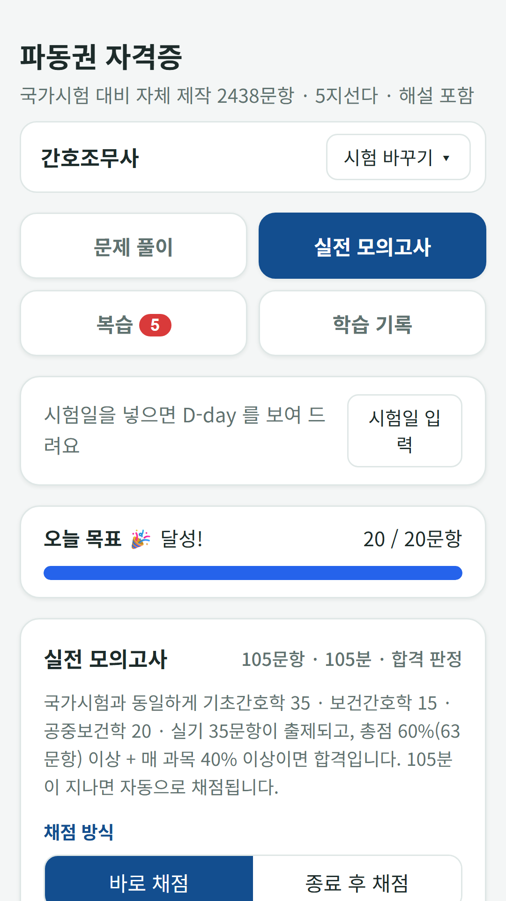
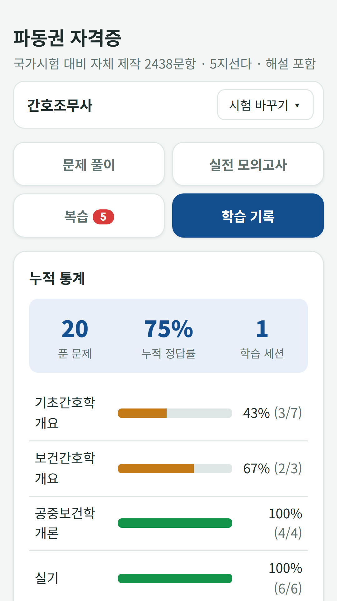

## Info
> **FDK Certification Exam Prep** — Question banks for seven Korean license exams in one app: nursing assistant, care worker, beautician, cook, baking, forklift and excavator, and driver's license. 10,603 questions in total, with a mock exam for each. Free with ads on Google Play. Korean language only.
{: .prompt-info }

## About the App
This app puts the question banks for seven Korean license exams in one place. Pick the exam you are studying for, and its practice questions, mock exams, wrong-answer notebook and study record are kept separately. If you are preparing for more than one exam, one tap on **Switch exam** takes you between them.

One honest note: the whole app, including the questions and explanations, is in Korean only.

- **10,603 questions** — nursing assistant 2,438, care worker 1,500, beautician (general, skin, nail and makeup) 1,800, cook (Korean, Western, Chinese and Japanese) 1,500, baking (confectionery and bread) 1,200, forklift and excavator operator 1,200 and the driving test 965
- **Full mock exams** — each exam uses the real question count, time limit and pass rule

## How to Use
- **Choose your exam** — pick the exam you are preparing for, then set the exam date for a D-day count and a daily question goal
- **Practice** — choose subjects and topics to drill, with the answer and explanation shown right away
- **Full mock exam** — the same number of questions, time limit and pass rule as the real exam, graded as you go or after you finish
- **Review** — the wrong-answer notebook and stars work per exam, or you can review all your exams together
- **Study record** — cumulative accuracy, accuracy by subject and a record of each attempt

## Features
- Seven exams in one app, with a separate record for each
- Exam-date D-day and a daily goal bar
- Adjustable text size (normal, large, extra large)

It is free to use and contains ads (one ad every 25 questions, plus a banner).

The driving test questions are the public question bank of the Korea Road Traffic Authority (effective March 9, 2026), used as published. The questions for the other exams were written from scratch based on the published exam standards, laws and textbooks. They are not real exam questions and may contain errors, so use them as a study aid. The app is not affiliated with any exam administering body.

{: w="360" }
{: w="360" }
{: w="360" }
{: w="360" }
{: w="360" }

## The 7 Exams Inside
Each exam has its own write-up.

- [Nursing Assistant Mock Exam](/posts/nursing-quiz/) · [Care Worker Exam Bank](/posts/care-quiz/) · [Beautician Exam Bank](/posts/beauty-quiz/)
- [Korean Cook Exam Bank](/posts/cook-quiz/) · [Baking Exam Bank](/posts/bake-quiz/) · [Forklift Excavator Exam Bank](/posts/heavy-quiz/)
- [Korean Driving Test Bank](/posts/drive-quiz/)

## Download
- Google Play: <https://play.google.com/store/apps/details?id=com.fadongkwon.hub_cert>

{: w="200" .normal }

## Launched Alongside
These apps came out on Google Play around the same time.

- [FDK Quiz Fest](/posts/hub-quiz/) — Four party quiz games in one app (in Korean)
- [Trivia Battle](/posts/quiz-battle/) — Four-choice trivia duels in history, economics, science and geography
- [Twenty Questions](/posts/twenty-q/) — Find the secret word in 20 yes-or-no questions
- [Nonsense Quiz](/posts/nonsense-quiz/) — 300 original Korean pun riddles

I post updates here and on [Instagram (@fadongkwon.soft)](https://www.instagram.com/fadongkwon.soft/).
