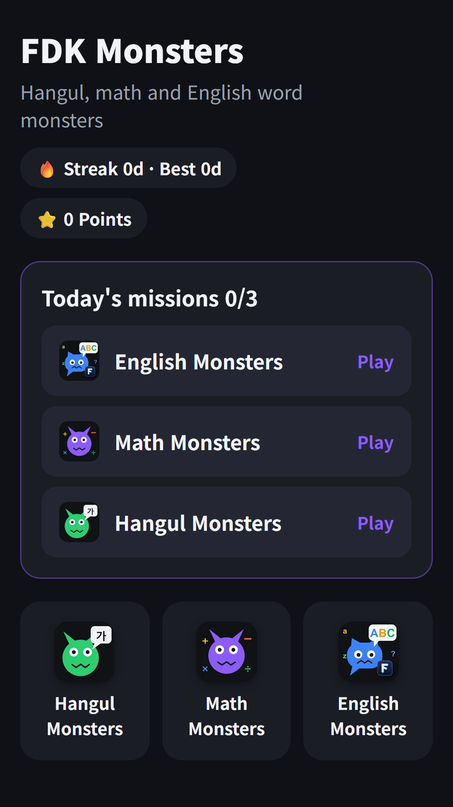
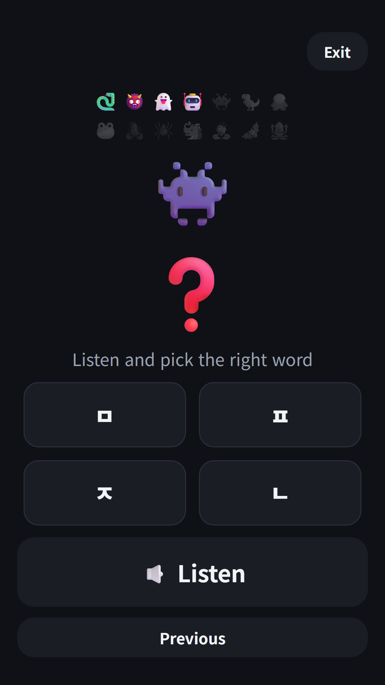
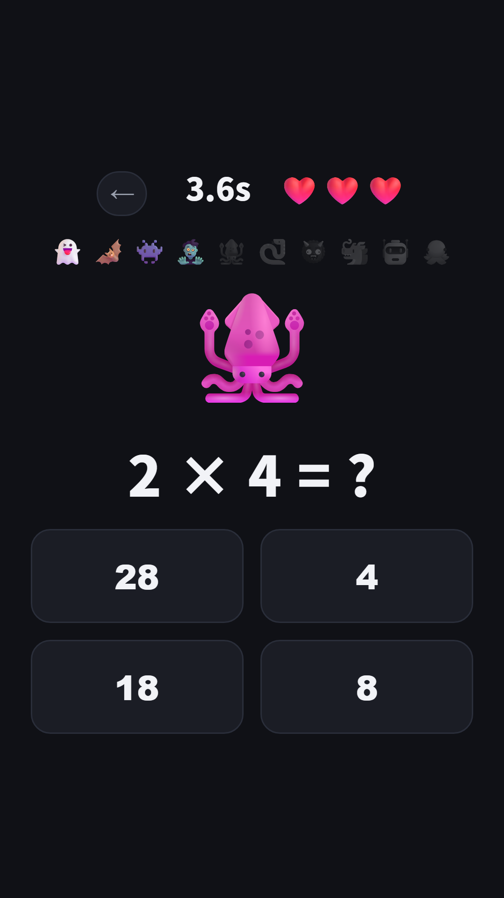
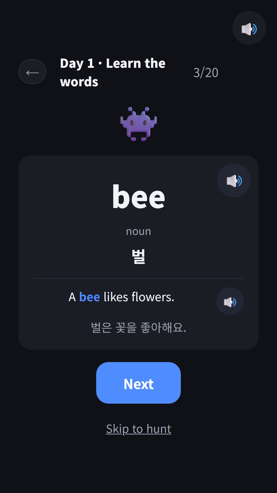

## Info
> **FDK Monsters** — A kids' app that bundles three learning games: Hangul Monsters, Math Monsters and English Monsters. No ads, no purchases, no rating prompts. Korean and English screens.
{: .prompt-info }

> It is available on Toss right now. Google Play is still reviewing it; until then, the three games can be played in the [browser versions](#download) below.
{: .prompt-tip }

## What it is
Until now, each monster game was its own app. [Hangul Monsters](/posts/hangul-monsters/) teaches the Korean alphabet, [Math Monsters](/posts/math-monsters/) covers the four operations, and [English Monsters](/posts/english-monsters/), introduced yesterday, teaches English vocabulary. A child who wanted all three had to find and open three apps.

FDK Monsters is a **hub app** that puts those three games in one place. The home screen shows three daily missions and the three games, and pressing back inside a game returns to the home screen. The games themselves are the same as the standalone apps.

## How it works
- The home screen shows **three missions for today**. Playing one round each of Hangul, Math and English Monsters completes them one by one
- Each mission earns 10 points, and finishing all three on consecutive days builds a **learning streak**
- When a game ends, a "Next mission" button on the result screen takes you straight to the next subject
- Only if you tap "🔔 Daily 6 PM reminder" on the home screen and agree, a daily learning reminder goes out at 6 PM

## The three games
Each game has its own post.

- [Hangul Monsters](/posts/hangul-monsters/) — Learn Hangul by listening to consonants, vowels and words and picking the right one, or by reading aloud. Reading aloud uses the microphone only if you allow it, and nothing is recorded or saved
- [Math Monsters](/posts/math-monsters/) — Solve addition, subtraction, multiplication and division problems to catch monsters. Three difficulty levels
- [English Monsters](/posts/english-monsters/) — Learn the 3,000 basic words of Korea's national curriculum, 20 a day, on word cards, then catch monsters in a quiz. Missed words come back as review monsters

{: w="360" }
{: w="360" }
{: w="360" }
{: w="360" }

## What changed for a kids' hub
All eleven hubs I had built so far were for adults, so they carried a banner ad at the bottom of the home screen, a notice for Toss's 1-won promotion, and a list of my other apps. None of that could go into a kids' app as is, so I added a **kids mode** to the hub configuration.

- Turning on a single `kids` flag in the config empties the ad placements, and empties them again at runtime even if the wrapper config has ad values by mistake
- The 1-won promotion notice and payout path are blocked
- The "You might also like" list at the bottom shows only kids' apps and hubs
- No rating prompt is ever shown
- The pre-release audit script checks, for kids' hubs only, that ad code, external links and rating-prompt calls are all zero

Existing hubs without the flag behave exactly as before. I rebuilt a test hub and confirmed its hub config file was byte-for-byte identical to the one from before the change.

## Why the name ends in -s
The original Korean name was **파동권 몬스터** (FDK Monster). It started with English Monsters. When I tried to put English Monsters on Toss, its Korean name was blocked with "You cannot use a name identical to a Toss service name." The console has no name-check feature, so to find the cause I sent new-app requests with several candidate names. Every request failed because of the workspace's app limit, but **the names carried by those failed requests then behaved as if reserved.** One of them was 파동권 몬스터, the name I meant for the hub.

Later, when I entered that name while changing an existing app's info, I got the same error. I asked through the console chat for the reservation to be released, but rather than let the launch stall while waiting for an answer, I chose to change the name. It became **파동권 몬스터즈** (FDK Monsters, plural). With three monsters, the plural actually fits better.

With the rename I aligned the hub home title, the registry, the Toss app info and the store copy to the plural name. The English name stays **FDK Monsters** (the Toss English name is Monster Academy). The lesson is simple: never send a request that creates something just to investigate. Even a failed request can leave a trace, and there is no undo.

## On Toss, in Spin the Bottle's slot
A Toss workspace holds [only 50 apps](/posts/toss-workspace-50-limit/), and mine was full. So, [like the other hubs](/posts/toss-hub-conversion/), I did not register a new app; instead I replaced the app info and bundle of **Spin the Bottle**, the existing app with the fewest users, with FDK Monsters. The bottle-spinning tool itself still lives inside [FDK Lucky Pick](/posts/hub-party/).

Bundle size was also something to watch. With 6,146 audio clips for English words and examples and 1,076 Hangul audio clips, the bundle is about 38 MB, more than twice the size of Lucky Lab, the largest hub so far. Both the upload and the review went through without trouble.

On Toss it passed both the app-info and bundle reviews and was released on the night of November 7. On Google Play, FDK Monsters and English Monsters went into review the same day. The in-app name and the Korean store title on Play will be updated to the plural name in the next update after approval.

## Gameplay video
Gameplay videos of the three games in the hub.







## Download
- Apps in Toss (Toss mini app): <https://fadongkwon.com/toss/hub-monsters/> — open it on your phone and it goes straight to the Toss app.
- Google Play: in review. I will add the link to this post once it is approved.
- Play in the browser: [Hangul Monsters](/play/hangul-monsters/) · [Math Monsters](/play/math-monsters/) · [English Monsters](/play/english-monsters/)

My other kids' apps are collected on the [kids page](/kids/). Updates go out on this blog and on [Instagram (@fadongkwon.soft)](https://www.instagram.com/fadongkwon.soft/).
