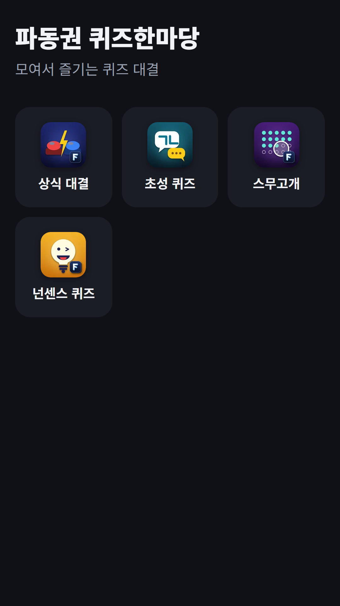
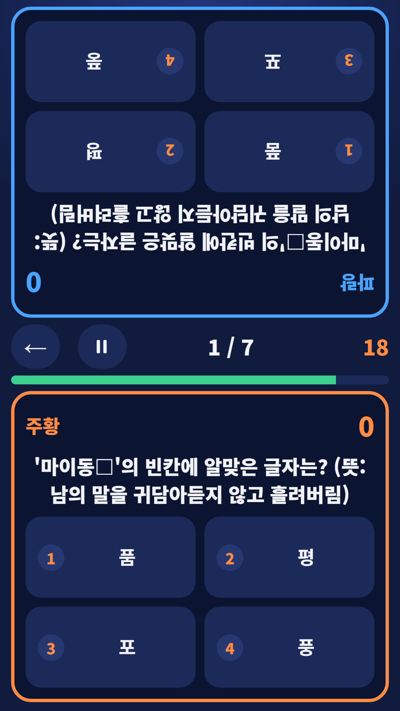
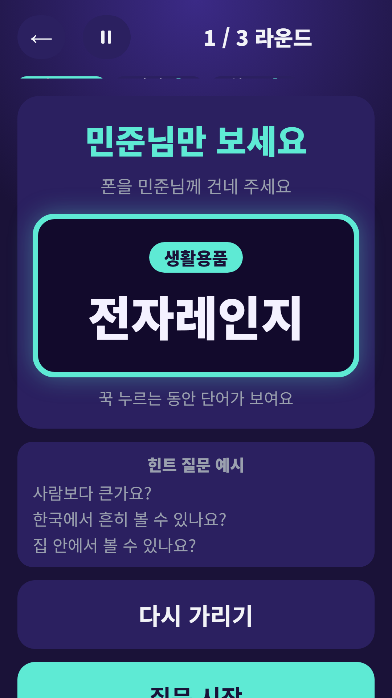
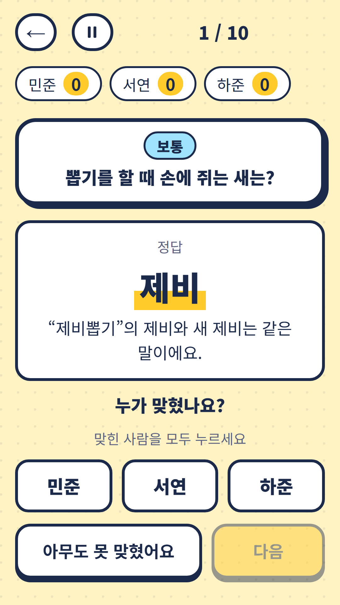

## Info
> **FDK Quiz Fest: Party Quizzes** — Four party quiz games in one app: trivia, initials quiz, Twenty Questions and pun riddles. The questions are in Korean. Free to play on Toss, with ads. Google Play is coming soon.
{: .prompt-info }

## About the Game
FDK Quiz Fest brings four party quiz games together: Trivia Battle, Chosung Quiz, Twenty Questions and Nonsense Quiz. Pick whichever suits the mood of your group.

One honest note: the questions and words are in Korean, so you need to read Hangul.

## How to Play
- Tap the quiz you want on the home screen
- Enter the player names once and every quiz uses them
- Scores and ranks are tallied for you
- Quizzes that have a solo mode can also be played alone

## Features
- Trivia Battle: four-choice questions in history, economics, science and geography, including a face-to-face duel mode
- Chosung Quiz: guess the word from its initial consonants
- Twenty Questions: find the secret word in 20 yes-or-no questions
- Nonsense Quiz: 320 classic pun riddles
- One player list shared by all the quizzes

It is free to play and contains ads.

{: w="360" }
{: w="360" }
{: w="360" }
{: w="360" }

## Gameplay Video


## Download
- Apps in Toss (Toss mini app): <https://fadongkwon.com/toss/hub-quiz/> — open it on your phone and it jumps straight into the Toss app.
- Google Play: <https://play.google.com/store/apps/details?id=com.fadongkwon.hub_quiz>

{: w="200" .normal }

## See Also
The quizzes inside Quiz Fest also came out as separate apps.

- [Chosung Quiz](/posts/chosung-quiz/) — Guess Korean words from their initials
- [Twenty Questions](/posts/twenty-q/) — Find the secret word in 20 yes-or-no questions
- [Nonsense Quiz](/posts/nonsense-quiz/) — 320 Korean pun riddles

I post updates here and on [Instagram (@fadongkwon.soft)](https://www.instagram.com/fadongkwon.soft/).
