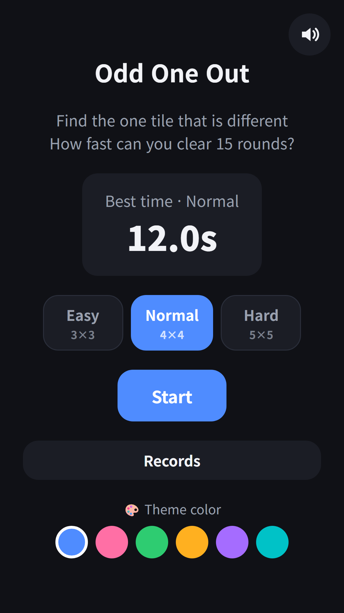
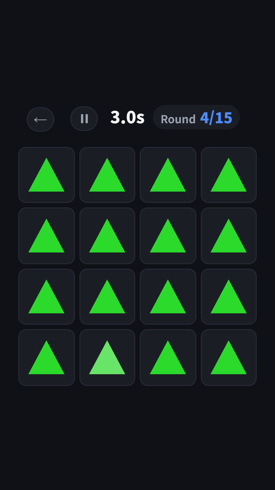
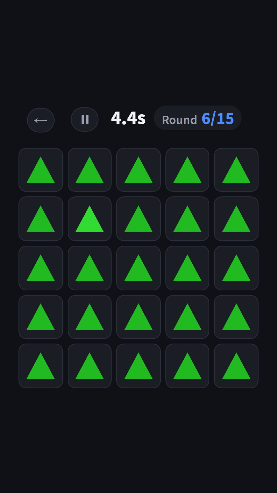
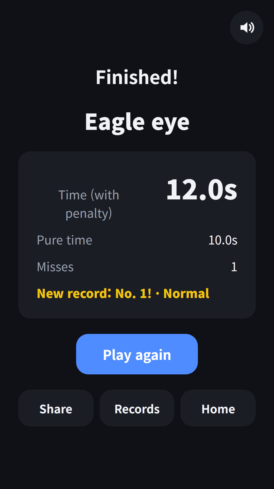

## Info
> **Odd One Out: Spot the Tile** — Find the one tile that looks different in 15 rounds and beat your best time. Free to play on Google Play, with ads.
{: .prompt-info }

## About the Game
A grid is full of the same shape, and exactly one tile is different. Find it and tap it as fast as you can. Clear 15 rounds and your total time is your record, so lower is better. It is the focus game from the brain games in FDK Brain Check, now also available as its own app on Google Play.

## How to Play
- Pick a level on the home screen and tap **Start**. Easy is a 3×3 grid, Normal is 4×4 and Hard is 5×5
- Touch the ready screen to start the clock. The grid stays hidden until you do
- The odd tile can differ in shade, shape or size, so you never know which one is coming
- A wrong tap adds 2 seconds. After round 15 you get your time and a grade
- Pause any time. The grid is hidden while paused

## Features
- Every round the difference gets a little smaller
- Colors differ only in brightness, so colorblind players get the same challenge
- Top 10 for each level, plus best times for today, this week, this month and all time
- 3 free hearts every day. Each game uses one, and you can watch a short ad to get more
- Works offline and plays in 9 languages

Free to play, with ads.

{: w="360" }
{: w="360" }
{: w="360" }

## Gameplay Video


## Download
- Google Play: <https://play.google.com/store/apps/details?id=com.fadongkwon.odd_one_out>

{: w="200" .normal }

## You May Also Like
- [FDK Brain Check](/posts/hub-brain/) — A hub of brain games in one app

I post updates here and on [Instagram (@fadongkwon.soft)](https://www.instagram.com/fadongkwon.soft/).
