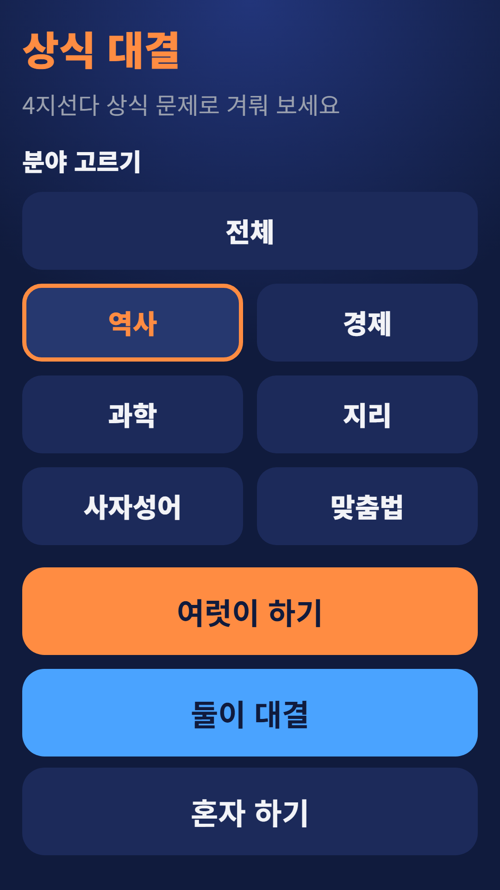
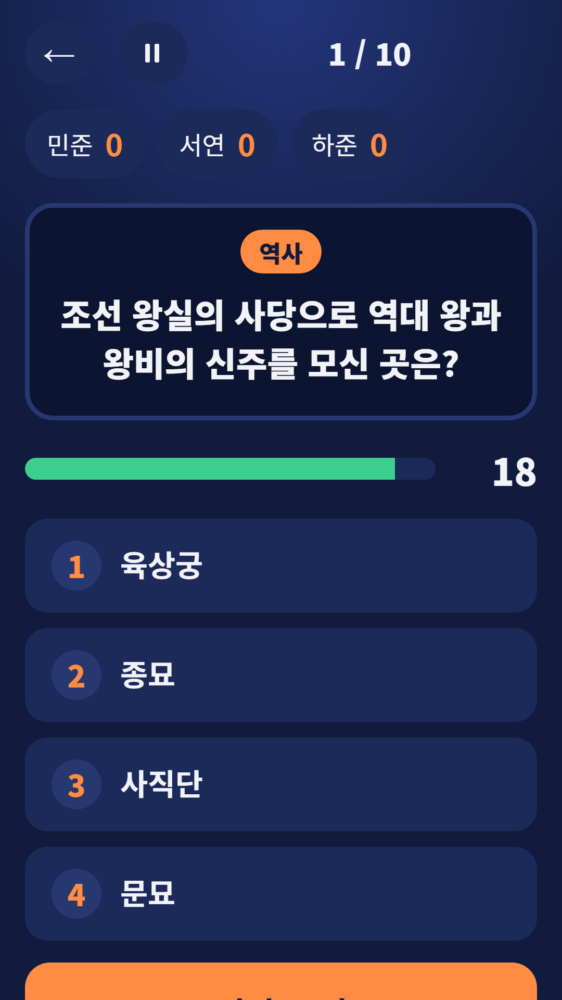
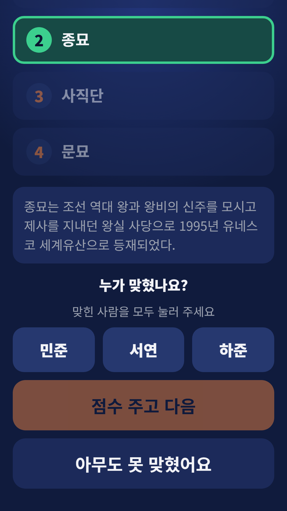
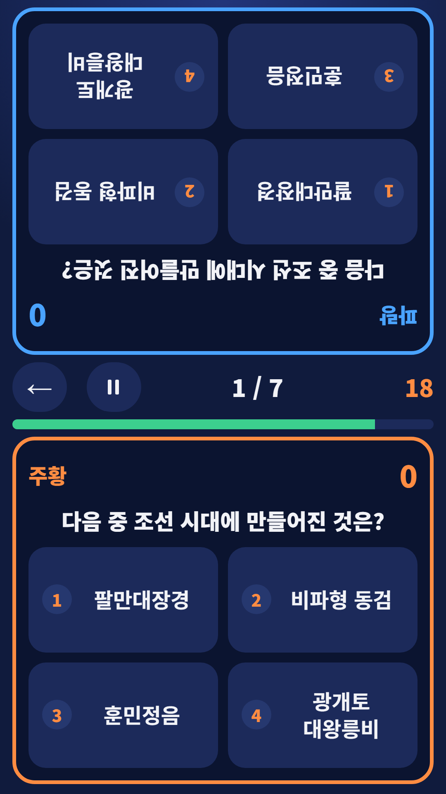

## Info
> **Trivia Battle: Party Quiz** — Four-choice Korean trivia for groups, head-to-head duels on one phone and solo play. The questions are in Korean. Free to play on Google Play, with ads.
{: .prompt-info }

## About the Game
Trivia Battle lets you challenge your friends with four-choice trivia on one phone. It has more than 2,600 questions in six subjects: Korean history, economics, science, world geography, Korean idioms and spelling. You can play in a group, in a two-player duel, or alone.

One honest note: the questions are in Korean, so you need to read Hangul.

## How to Play
- **Group mode** — choose 5, 10 or 15 questions and 10, 20 or 30 seconds, then add the player names. Reveal the answer with a short explanation and tap everyone who got it right. Ranks, ties and shared wins are shown
- **Duel mode** — two players sit face to face with one phone between them. The first right answer scores a point, a wrong answer locks you out of that question, and a tie goes to sudden death
- **Solo mode** — 10 questions, 15 seconds each, with a speed bonus. Your best score per subject is saved
- You can pause anytime

## Features
- Six subjects: Korean history, economics, science, world geography, Korean idioms and spelling, with more than 2,600 questions
- Three ways to play: group, duel and solo
- Recently seen questions are skipped

It is free to play and contains ads.

{: w="360" }
{: w="360" }
{: w="360" }
{: w="360" }

## Gameplay Video


## Download
- Google Play: <https://play.google.com/store/apps/details?id=com.fadongkwon.quiz_battle>

{: w="200" .normal }

## Launched Alongside
These apps came out on Google Play around the same time.

- [FDK Quiz Fest](/posts/hub-quiz/) — Four party quiz games, including Trivia Battle
- [Chosung Quiz](/posts/chosung-quiz/) — Guess Korean words from their initials
- [Twenty Questions](/posts/twenty-q/) — Find the secret word in 20 yes-or-no questions
- [Nonsense Quiz](/posts/nonsense-quiz/) — 300 original Korean pun riddles
- [FDK Certification Exam Prep](/posts/cert-hub/) — Question banks for seven Korean license exams in one app

I post updates here and on [Instagram (@fadongkwon.soft)](https://www.instagram.com/fadongkwon.soft/).
