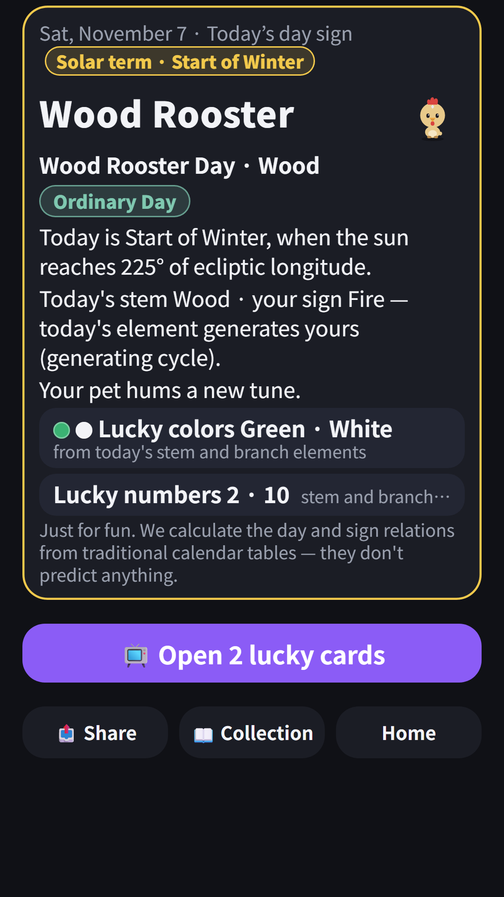
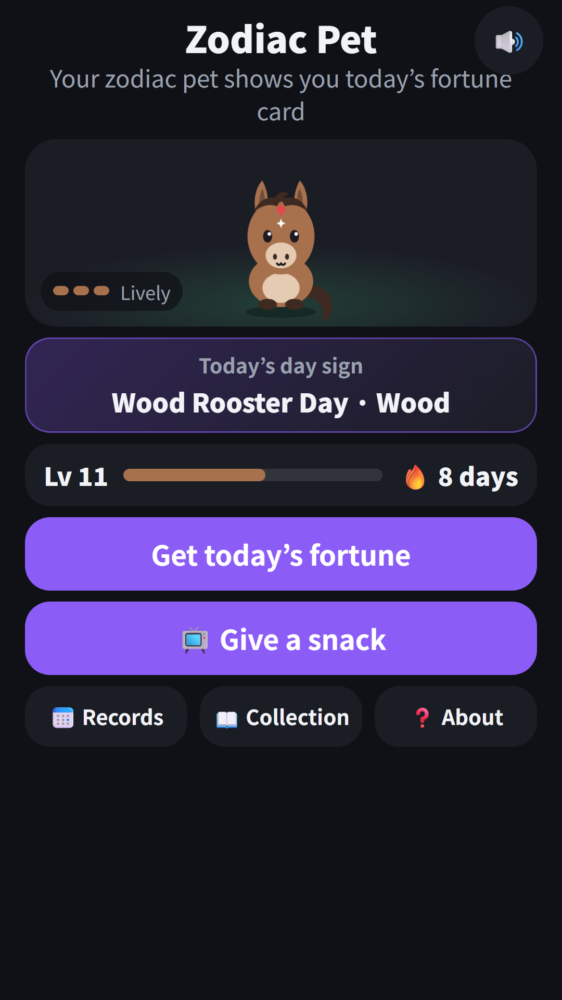
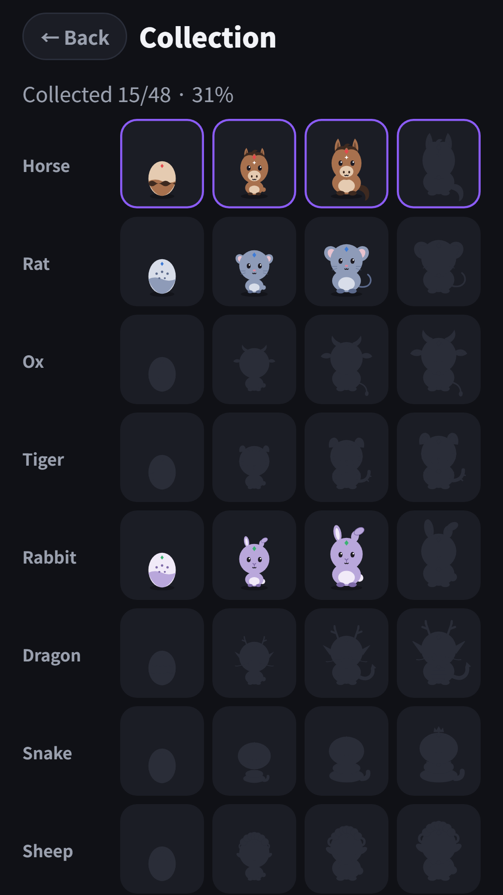
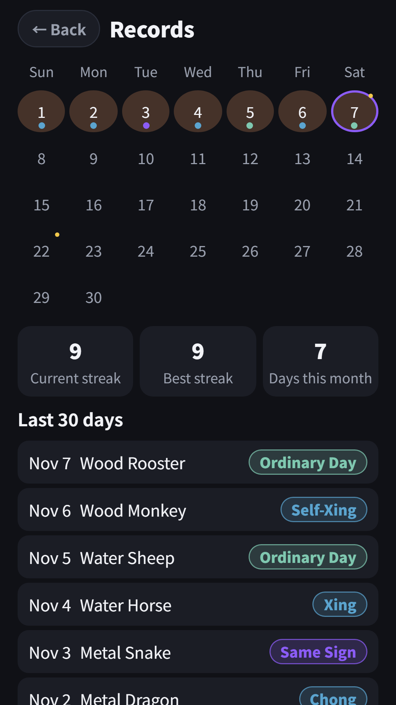
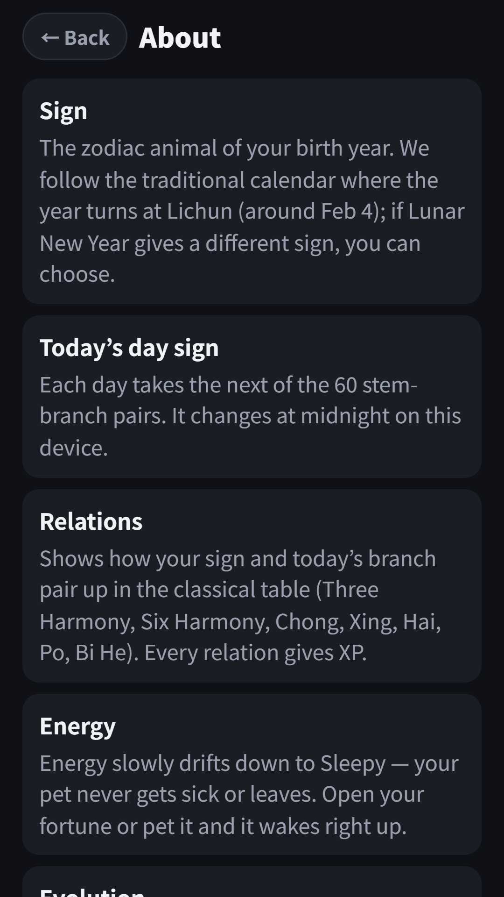

## Info
> **Zodiac Pet: Daily Fortune Card** — Your birth year's zodiac animal becomes your pet, and it shows a daily fortune card with the data behind it. For fun only. Free to use on Google Play, with ads.
{: .prompt-info }

## About the App
Your birth year gives you a zodiac animal, and that animal is your pet. Raise one of the 12 zodiac pets, open a daily fortune card and see how today's day sign relates to yours in the classical tables. Every card shows the data behind it instead of a prediction.

It is for fun and reference only. This is not fortune-telling advice, and not medical, financial or legal advice.

## How to Use
- Pick your birth year (solar or lunar calendar, month and day optional) to set your sign, and your pet's egg appears
- Tap **Get today's fortune** on the home screen and the card flips over to show today's fortune card
- The card shows today's stem-branch (ganzhi) day, your sign's classic relation to it (Three Harmony, Six Harmony, Chong, Xing, Hai, Po, same sign), the five-element cycle, and a lucky color and number
- If you like, **Open 2 lucky cards** adds a lucky direction and time of day (an ad plays once before they open)
- Pet your pet, then browse the collection book and the records calendar

## Features
- Daily fortune card: today's stem-branch day, your sign's classic relation to it and the five-element cycle, shown as data
- Lucky color, number, direction and time of day worked out from fixed rules, not guesses
- Raise your pet: egg, baby, youth, then divine beast as your days together add up
- Gentle streaks: a missed day never hurts your pet. It just gets sleepy and wakes when you come back
- Invite the other 11 zodiac friends to fill your collection book, and browse the last 30 days in the records calendar
- Works offline, no sign-in, and your birth date stays on your device
- Available in Korean, English, Japanese, Chinese, Spanish, Portuguese, German, French and Italian

It is free to use and contains ads: two optional rewarded ads (open 2 extra lucky cards, give your pet a snack) and a banner.

{: w="360" }
{: w="360" }
{: w="360" }
{: w="360" }
{: w="360" }

## Gameplay Video


## Download
- Google Play: <https://play.google.com/store/apps/details?id=com.fadongkwon.zodiac_pet>
- Apps in Toss: included in [FDK Lucky Lab](/posts/hub-fortune/) — <https://fadongkwon.com/toss/hub-fortune/> open it on your phone and it connects straight into the Toss app.

{: w="200" .normal }

## You Might Also Like
- [FDK Lucky Lab](/posts/hub-fortune/) — Saju, tarot and lotto picks in one app
- [Saju Lotto](/posts/saju-lotto/) — This week's numbers from your birth chart
- [Tarot Ping](/posts/tarot-ping/) — A cute pastel mascot deck tarot reading app
- [Tarot Fortune](/posts/tarot-fortune/) — A one-card tarot reading app for 12 themes

I post updates here and on [Instagram (@fadongkwon.soft)](https://www.instagram.com/fadongkwon.soft/).
