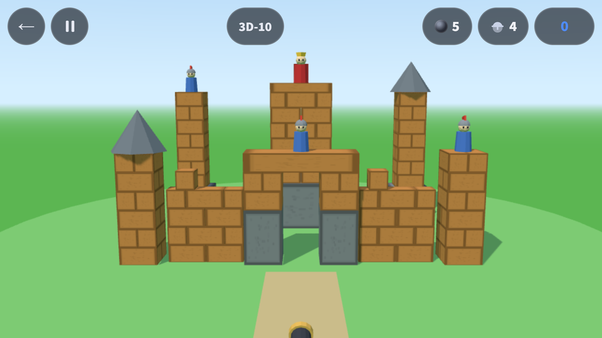
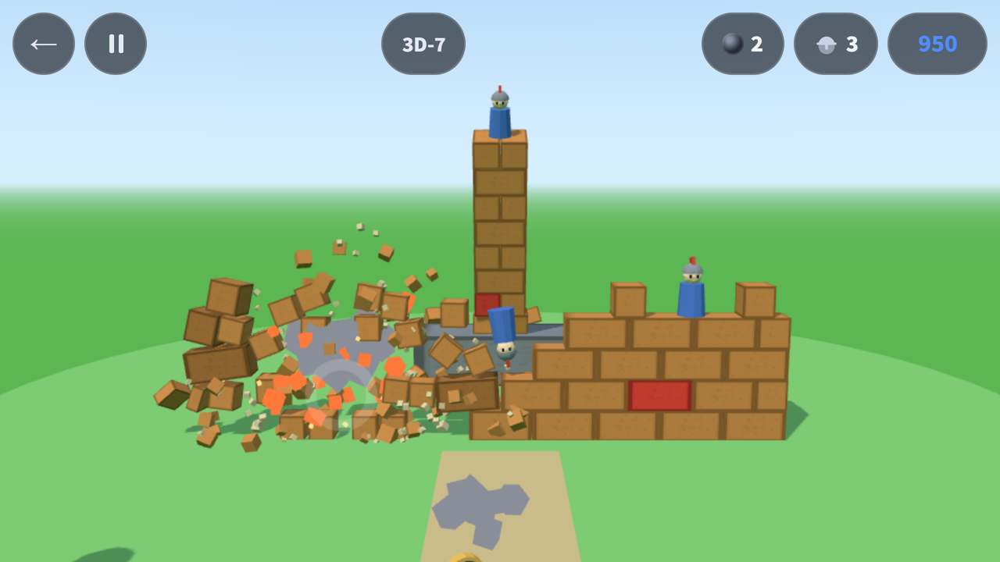
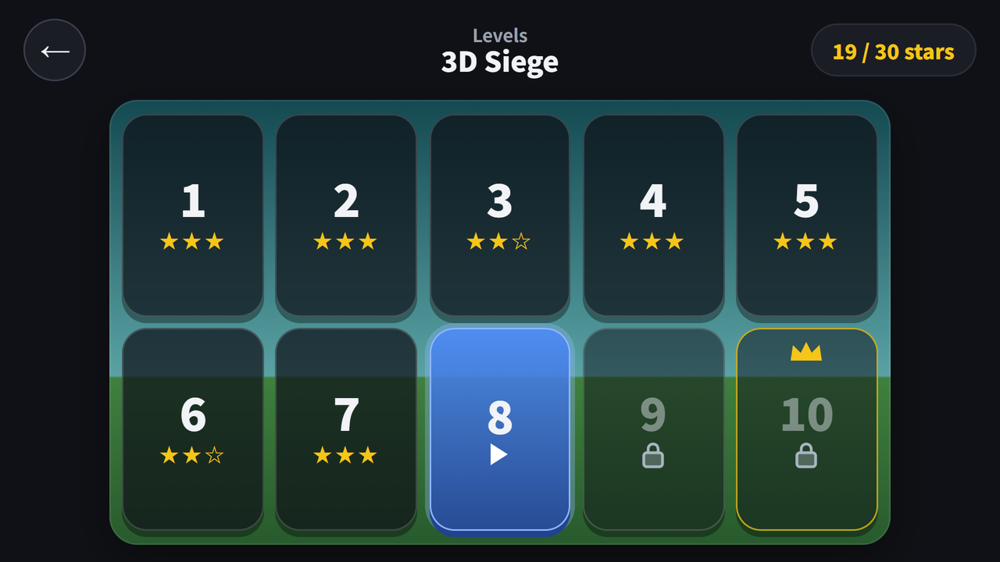

## Info
> **Castle Topple 1.2.0** — The cannon physics puzzle gets a new mode, **3D Siege**. Free to play on Google Play and Apps in Toss (Toss mini app), with ads.
{: .prompt-info }

## About the Mode
[Castle Topple](/posts/castle-topple/) is a 2D physics puzzle where you pull back a cannon and bring castles down. Version 1.2.0 adds a third mode card to the home screen: **3D Siege**.

A 3D castle, seen from the front and slightly above, fills the screen. **Tap the castle and the cannon fires at that spot.** Unlike 2D, where you pull back to set power and angle, here you only choose where to hit. The castle is a voxel build stacked brick by brick, so bricks split and fly where the ball lands and everything above comes down with them.

{: w="640" }

## How to Play
- **Tap to fire.** A short press on any point of the castle sends the cannon's shot there
- **Drag to turn the view.** Drag sideways and the cannon and camera swing around the castle together, up to ±45°, so you can aim at sides you cannot see from the front
- You can fire again while the last ball is still in the air, once 0.75 seconds have passed and that ball has hit the castle
- Hold while a ball flies or the castle shakes to fast-forward (⏩)
- In the current version the clear condition is the same as 2D: knock down every knight and the king to clear, and finish within the set number of shots (par) for 3 stars
- Out of cannonballs? Watch an ad for +2 and keep going right where you left off

Each material breaks its own way. Wood splits into 2 to 4 pieces that fly off, ice shatters, and TNT blasts everything within 2.4 m. Stone does not break from cannonballs.

{: w="640" }

## Ten 3D Levels
The 3D Siege card on the home screen opens its own level select. 3D-10 is the boss castle. You get one cannonball more than par.

| Level | Castle | Knights (incl. king) | Par (3 stars) | Cannonballs |
|---|---|---|---|---|
| 3D-1 | One wooden wall on a stone base, a knight behind it | 1 | 1 | 2 |
| 3D-2 | Two corner towers (knights on top) with a wall between | 2 | 2 | 3 |
| 3D-3 | A knight over the gate (stone posts + wooden lintel), side walls and a corner tower | 2 | 2 | 3 |
| 3D-4 | Low front wall + wooden keep on a base | 2 | 2 | 3 |
| 3D-5 | Ice wall + two ice corner towers | 3 | 3 | 4 |
| 3D-6 | Square castle with two stone bottom rows + four corner towers | 2 | 2 | 3 |
| 3D-7 | Wall with TNT bricks inside + a corner tower | 3 | 3 | 4 |
| 3D-8 | Unbreakable stone outer wall + wooden keep inside + two corner towers | 2 | 2 | 3 |
| 3D-9 | Front wall + four corner towers + golden keep | 3 | 3 | 4 |
| 3D-10 | Boss: gate + front wall + four corner towers + king on the keep | 4 | 4 | 5 |

Par comes from a solver that fires by tapping the actual game screen, and the only level you can clear in one shot is the 3D-1 tutorial.

{: w="640" }

## It Was Supposed to Be a Separate App
This mode was not planned as a mode.

When I built the 2D game in October, the picture I wanted was **a tall castle filling the screen and crashing down**, but what came out was a lob at a distant castle. So, as I wrote at the end of the [planck post](/posts/castle-topple-planck/), I kept polishing the 2D app and decided to make the tall-castle version as **a separate app**. Its name on the task list was `tower-royal`.

When I started that work on November 5, I changed course and put it **inside Castle Topple as a new mode** instead. [Hoop Shot](/posts/hoop-shot/) had set the precedent with its 3D Shootout mode in the same app, and I judged that a mode was better on the app-count limit, store exposure and maintenance.

Along the way I carried the 2D rule over as is: **knock down every knight to clear.** Once it was built, that turned out to be the problem. The feedback on November 8 had three points.

1. 3D had been decided as a separate app
2. It became a game about knocking knight figures off, not about destroying the castle
3. So it was too easy

The reason was simple. The knights stand on top, so hitting the top one or two rows drops them, and the level clears even with the body of the castle still standing. I had overwritten a recorded decision (a separate app, with destroying the castle itself as the goal) with my own judgment.

Here is how I sorted it out.

- **The 3D Siege mode already built stays inside Castle Topple.** Version 1.2.0, live in the stores now, is this one, and its clear condition is the knight rule above.
- **I am working on changing the goal toward destroying the castle.** The plan is to stand each castle on a raised table and make it **clear when every block on the table has been knocked off**. Knights go away, the screen shows the blocks left and a table-clearing progress bar, and stars depend on how many cannonballs you have left. The levels will all be rebuilt for the new rule. Because the rule changes, 3D star records are planned to start fresh (2D records stay). It ships in the next update once testing is done.
- **The separate app, `tower-royal`, built around toppling a tall castle, will be planned from scratch.**

## How It Is Built: three.js + cannon-es
The 2D game runs on the planck physics engine (a Box2D port). The 3D mode uses **three.js 0.187.0** for rendering and **cannon-es 0.20.0** for physics, both pinned to exact versions. The first condition I set was that not a single line of the 2D game (campaign, Daily Siege, Endless Siege) would change. 3D records are also saved separately so they never mix with existing 2D records.

As with planck, I measured in Node before adopting it. Splitting each 1/60-second step into **two 1/120-second substeps** let a 20-story tower of 0.5 m cubes stand and fall asleep within 2 cm after 10 seconds. With a single step, towers fell from 14 stories up. So two substeps is a fixed value.

### Firing at the tapped spot
The cannonball speed is fixed at 26 m/s, and the cannon fires at the angle of the **low arc** that reaches the tapped point. If no arc reaches it, it fires at 45°. If your finger does not move and lifts within 400 ms, it is a tap (fire); anything else is a drag (turn the view).

The code that decides "where did you tap" lives in one place, shared by the screen and the solver. At first the solver set par by aiming straight at 3D coordinates without going through the screen, and when I fired by actually tapping the screen, only 7 of 10 levels cleared. Taps on empty sky landed on a plane through the middle of the castle, and in one level the wall knocked down by the first shot covered the spot for the second tap. So I set rules: a tap on empty sky goes to the plane of the nearest knight, and a tap on a roof goes to the top of the block holding that roof. I also reran the solver so it taps at the real game screen size (622×350). After that, real taps alone cleared all 10 levels in par shots with 3 stars.

### Rapid fire
The first build made you wait until the castle stopped completely before the next shot, and that wait was 3 to 10 seconds. There was no feel of rapid hits. So I separated "settled" from "ready to fire." Once 45 steps (0.75 seconds) have passed since the last shot and that ball has hit the castle once, you can fire even while the castle is still shaking. After the change, the measured gap between shots was 0.72 to 0.89 seconds depending on the level.

### View rotation: ±35° → ±45°
The first design turned only the camera by ±35° on drag, and turning it pushed the cannon off the screen. So I **tied the cannon and the camera together** so they orbit the castle center as one, and widened the range to ±45°. At any angle the cannon stays at the bottom center of the screen, and the ball leaves from the turned cannon.

## Keeping the 3D Code Separate
What I cared about most was **keeping the 2D first load fast**. Toss rejects apps whose first load is slow. Putting three.js and cannon-es in the main bundle would make even people who never play 3D carry that weight.

So the 3D code is not loaded on the first screen; it is split into **a separate chunk loaded when needed**. Sizes in the 1.2.0 build:

| File | Size | gzip |
|---|---|---|
| Main (the whole 2D game, loaded on the first screen) | 507.7KB | 160.8KB |
| 3D chunk (three.js + cannon-es + 3D game code) | 670.5KB | 179.0KB |

The 3D chunk is fetched in the background after the first screen has loaded and settled (about 5 seconds later). On my test phone (Galaxy S23 Ultra, 120 Hz), the app's cold start was 933 ms, fetching the 3D chunk took 26 ms (a file inside the app), and going from tapping a 3D level tile to the 3D screen took 348 ms. While playing 3D, the average frame interval was 8.94 ms, nearly keeping up with 120 Hz.

Before 1.2.0 shipped there were 288 automated tests, and all ten 3D levels were confirmed to clear within par both by the solver and by real screen taps.

## Gameplay Video


## Download
- Google Play: <https://play.google.com/store/apps/details?id=com.fadongkwon.castle_topple>
- Apps in Toss: <https://fadongkwon.com/toss/castle-topple/> — open it on your phone and it connects straight into the Toss app.

{: w="200" .normal }
{: w="200" .normal }

I post updates here and on [Instagram (@fadongkwon.soft)](https://www.instagram.com/fadongkwon.soft/).
