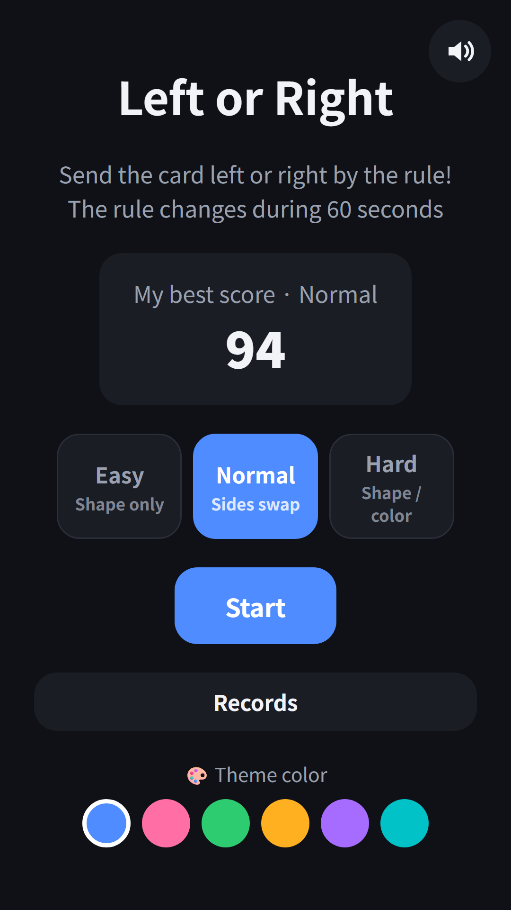
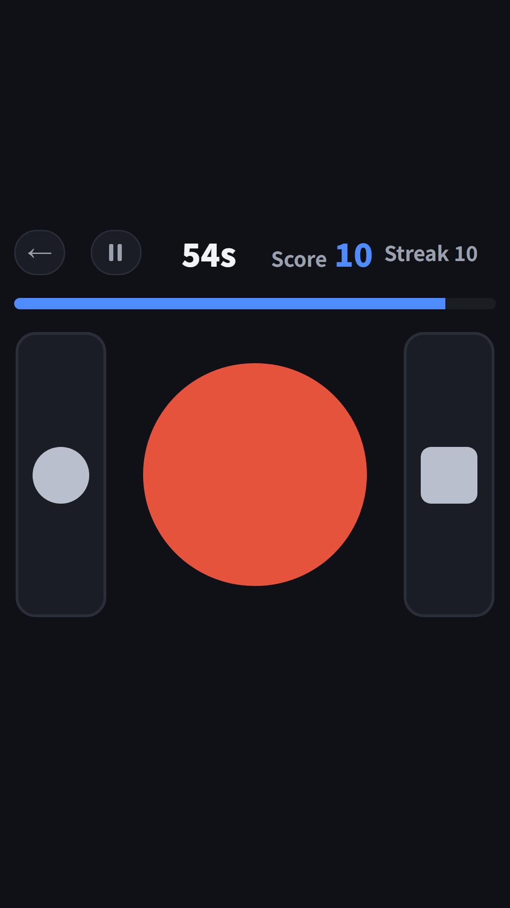
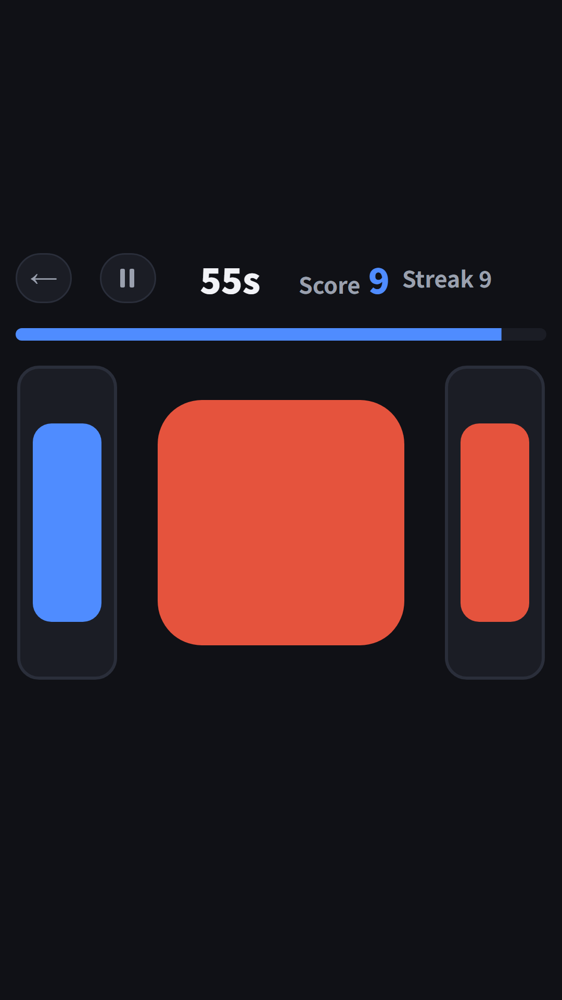
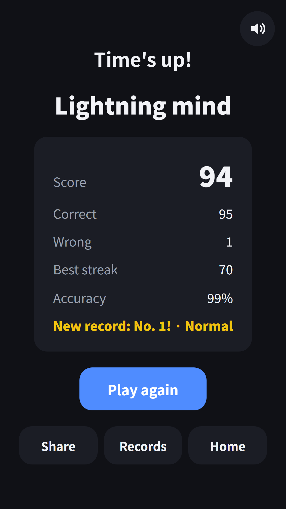

## Info
> **Left or Right: Quick Sort** — Send each card left or right by the rule. The rule changes while you play. Free to play on Google Play, with ads.
{: .prompt-info }

## About the Game
A card appears in the middle. Send it left or right by the current rule, shown on both sides of the screen. You have 60 seconds, and the rule changes while you play. Your score is correct answers minus wrong ones. It is one of the brain games in FDK Brain Check, now also available as its own app on Google Play.

## How to Play
- Pick a level on the home screen and tap **Start**
- The pictures on the two sides are the current rule. Send the card to the side that matches it
- Tap the left half or the right half of the screen
- When the "rule changed" alert appears, check both sides again
- A wrong answer locks you for half a second and the card stays

## Features
- 3 levels: Easy sorts by shape only. Normal swaps the sides every few cards. Hard switches between shape and color
- The rule is drawn with pictures, so you can play without reading
- Results show correct, wrong, best streak, accuracy and your grade
- Top 10 for each level, plus bests for today, this week, this month and all time
- 3 free hearts every day. Each game uses one, and you can watch a short ad to get more
- Works offline and plays in 9 languages

Free to play, with ads.

{: w="360" }
{: w="360" }
{: w="360" }

## Gameplay Video


## Download
- Google Play: <https://play.google.com/store/apps/details?id=com.fadongkwon.left_right>

{: w="200" .normal }

## You May Also Like
- [FDK Brain Check](/posts/hub-brain/) — A hub of brain games in one app
- [Odd One Out](/posts/odd-one-out/) — Find the one tile that looks different, fast
- [Shell Game](/posts/shell-game/) — Follow the cup that hides the ball

I post updates here and on [Instagram (@fadongkwon.soft)](https://www.instagram.com/fadongkwon.soft/).
