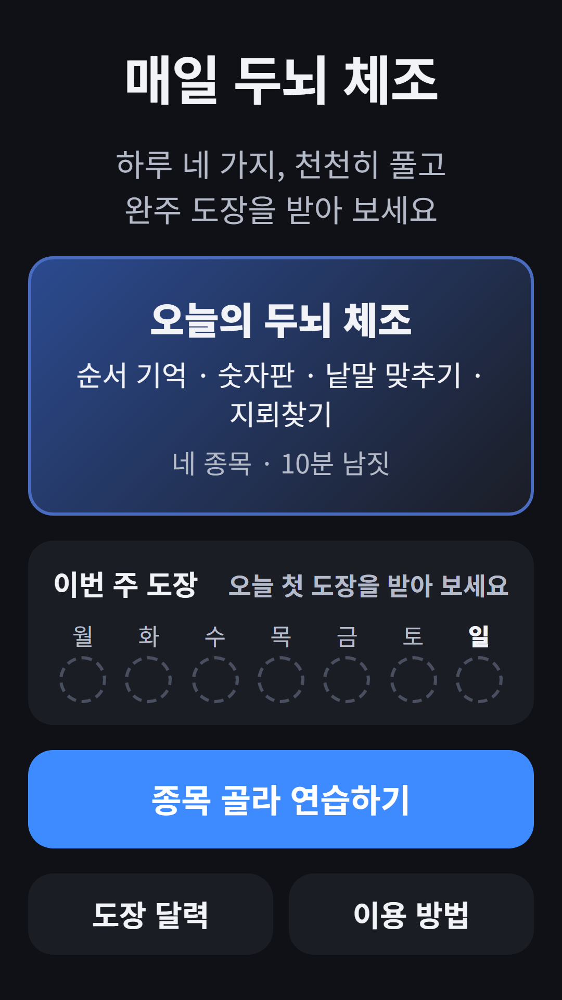
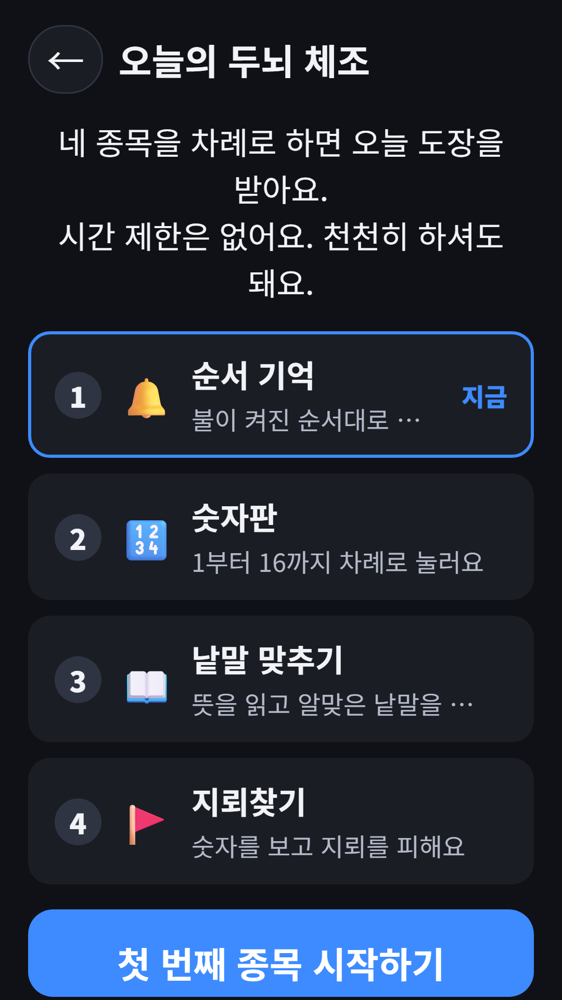
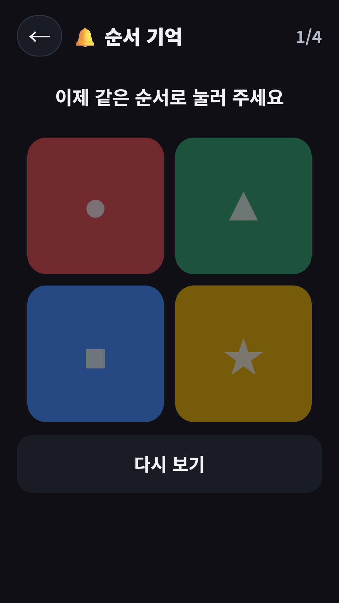
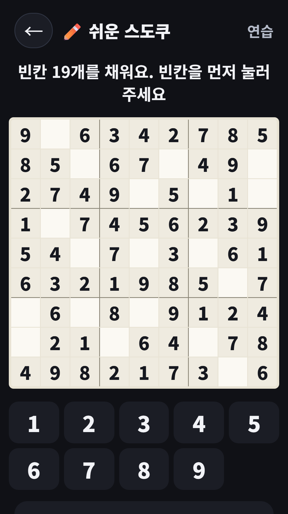
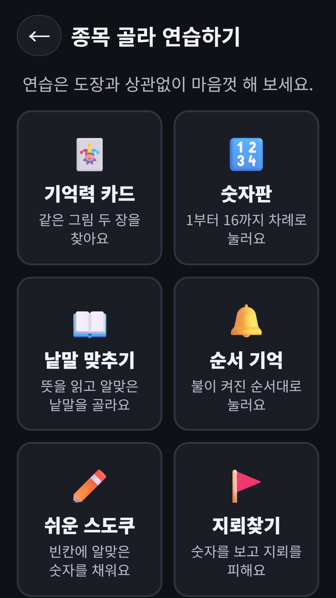
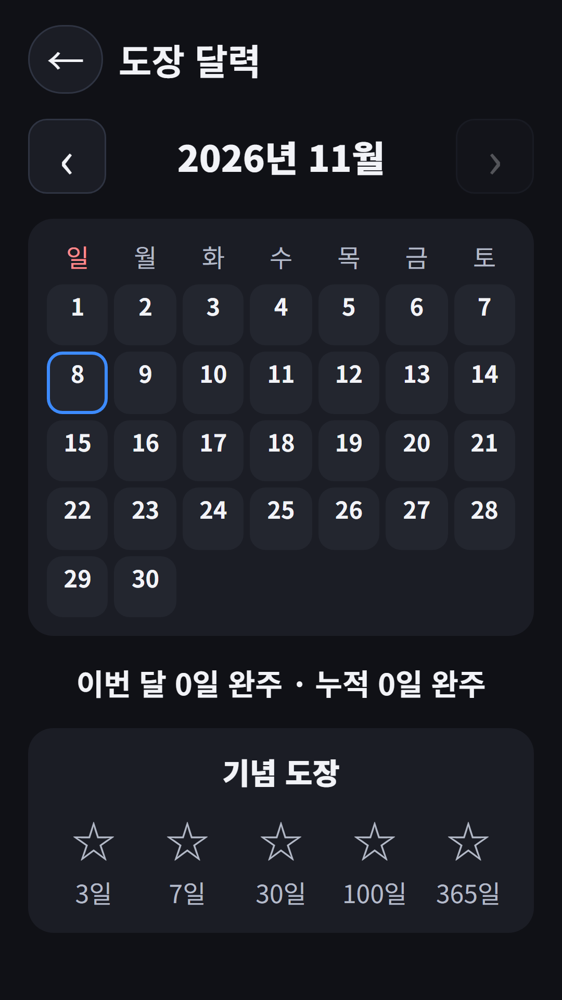

## Info
> **Daily Brain Workout** — Four easy puzzles a day, taken at your own pace, and a stamp when you finish. No scores, rankings or time limits. Free on Google Play, with ads. The app is in Korean only.
{: .prompt-info }

## About the App
Four easy puzzles a day, taken at your own pace, and a "Well done" stamp when you finish them. Each day has a set course: three of memory cards, number grid, word guess and sequence memory, plus a closing puzzle (sudoku or minesweeper). Everyone gets the same course and boards on the same day. It is the senior daily course from FDK Brain Check, now also available as its own app on Google Play.

## How to Use
- Tap **today's workout** on the home screen and the four puzzles come up one after another
- After each puzzle you return to the course screen and start the next one
- Finish all four and the "Well done" stamp fills this week's box
- Finished puzzles are saved if you leave midway
- Practice any puzzle on its own, separate from the stamp course

## Features
- No scores, rankings or time limits
- 6 puzzle types with board sizes, speeds and forgiveness set to be comfortable
- Stamp calendar, streak counter and milestone stamps at 3, 7, 30, 100 and 365 days
- The word puzzle uses Korean words, so the app is available in Korean only
- No sign-up needed

The app contains ads (banner, interstitial and rewarded). Sudoku hints are free a few times, then available by watching an ad.

The screenshots below show the Korean screens, since the app is in Korean only.

{: w="360" }
{: w="360" }
{: w="360" }
{: w="360" }
{: w="360" }

## Gameplay Video


## Download
- Google Play: <https://play.google.com/store/apps/details?id=com.fadongkwon.senior_brain>

{: w="200" .normal }

## You May Also Like
- [FDK Brain Check](/posts/hub-brain/) — A hub of brain games in one app
- [Odd One Out](/posts/odd-one-out/) — Find the one tile that looks different, fast
- [Shell Game](/posts/shell-game/) — Follow the cup that hides the ball

I post updates here and on [Instagram (@fadongkwon.soft)](https://www.instagram.com/fadongkwon.soft/).
