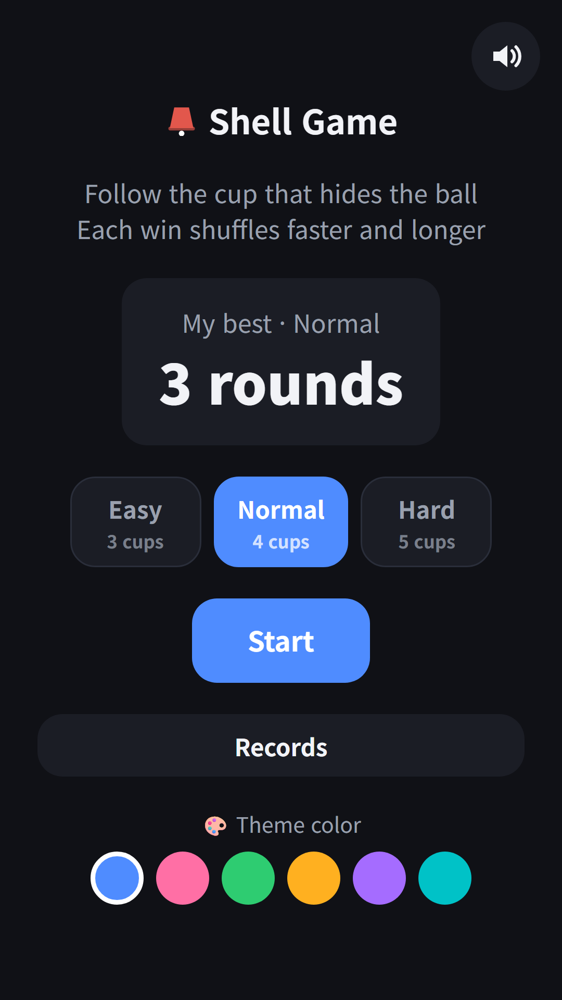
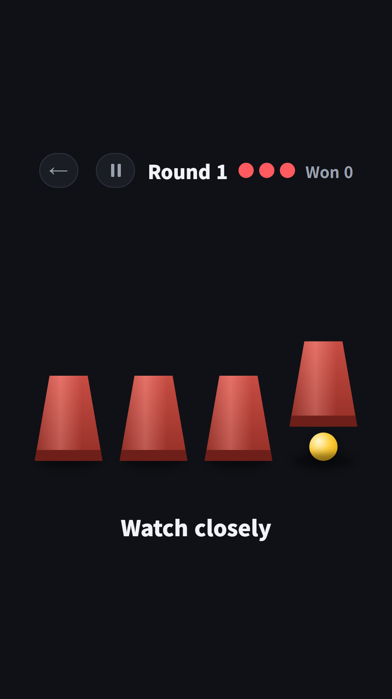
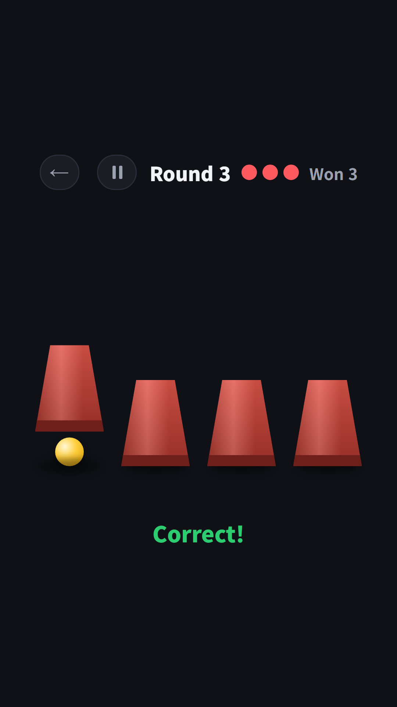
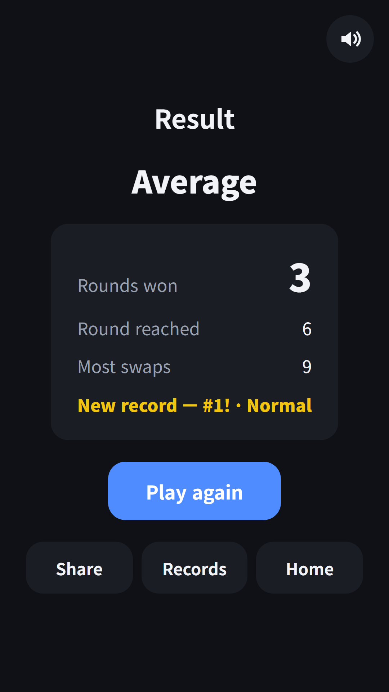

## Info
> **Shell Game: Follow the Cup** — Watch the ball, follow the cup as it shuffles, then pick it. Free to play on Google Play, with ads.
{: .prompt-info }

## About the Game
The ball goes under a cup, then the cups shuffle. Keep your eyes on the right cup and tap it when the shuffling stops. Every correct pick sends you to the next round, where the cups move faster and swap more times. Miss three times and the game is over. Your record is the number of rounds you won. It is one of the brain games in FDK Brain Check, now also available as its own app on Google Play.

## How to Play
- Pick a level on the home screen and tap **Start**. Easy has 3 cups, Normal 4 and Hard 5
- At the start of each round the cup with the ball lifts for a moment. Watch closely
- While the cups shuffle, follow only the cup with the ball
- When the shuffling stops, tap the cup you think hides the ball
- A miss costs one life, and you see where the ball really was

## Features
- Each round adds one more swap and a little more speed
- A short tick on every swap, so you can count the moves by ear
- Results show rounds won, round reached, most swaps and your grade
- Top 10 for each level, plus bests for today, this week, this month and all time
- 3 free hearts every day. Each game uses one, and you can watch a short ad to get more
- Works offline and plays in 9 languages

Free to play, with ads.

{: w="360" }
{: w="360" }
{: w="360" }

## Gameplay Video


## Download
- Google Play: <https://play.google.com/store/apps/details?id=com.fadongkwon.shell_game>

{: w="200" .normal }

## You May Also Like
- [FDK Brain Check](/posts/hub-brain/) — A hub of brain games in one app
- [Odd One Out](/posts/odd-one-out/) — Find the one tile that looks different, fast
- [Left or Right](/posts/left-right/) — Sort cards left or right by the rule in 60 seconds

I post updates here and on [Instagram (@fadongkwon.soft)](https://www.instagram.com/fadongkwon.soft/).
