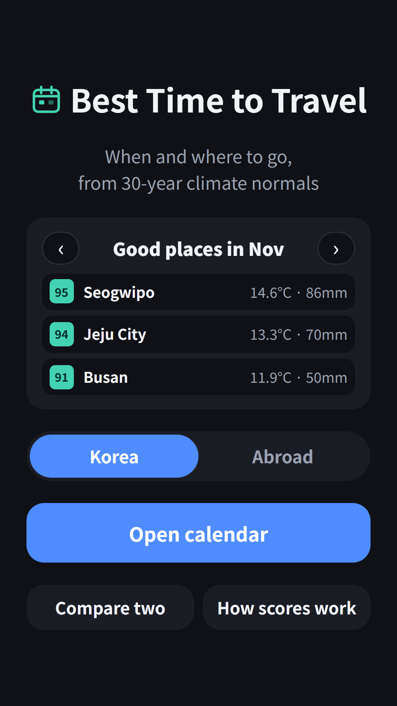
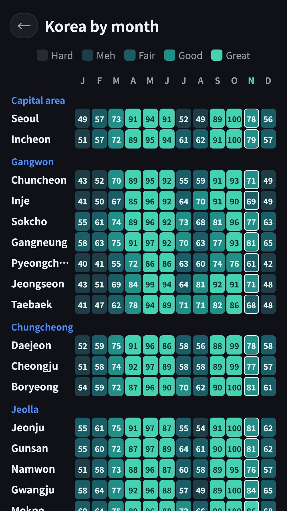
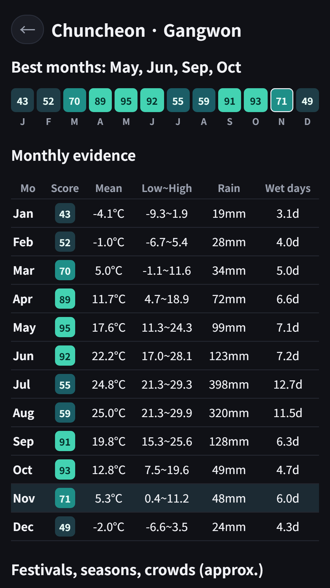
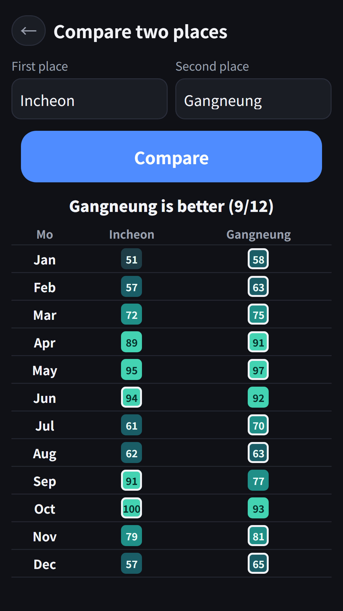
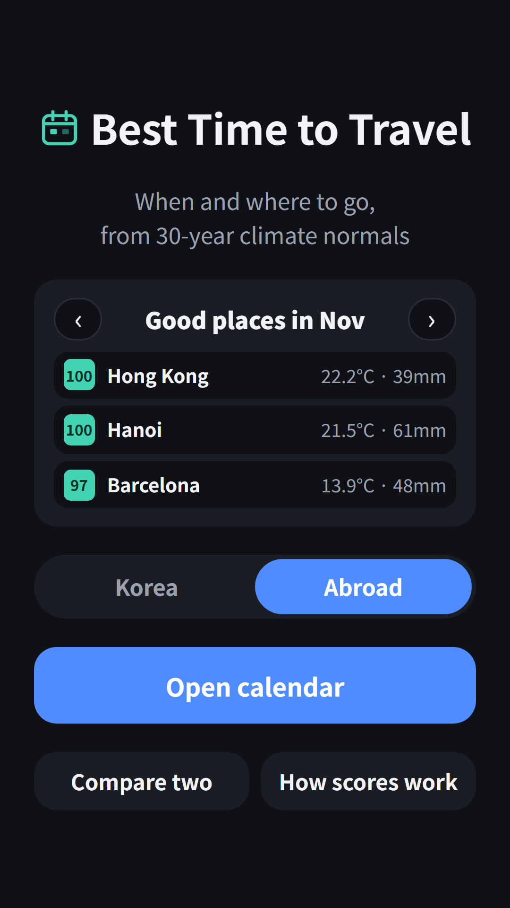

## Info
> **Best Time to Travel** — See the best month to visit 60 places, scored from climate normals. Free on Google Play, with ads.
{: .prompt-info }

## About the App
Pick the month before you pick the flight. Best Time to Travel paints a calendar of how pleasant each month is at 60 places (32 in Korea and 28 abroad), using official 1991-2020 climate normals. The darker the color, the better that month is for a trip.

## How to Use
- See **this month's top 3 places** on the home screen and flip months with the arrows
- Switch between **Korea** and **Abroad**, then **Open calendar** for a region-by-month score table
- Tap a place to see monthly mean, low and high temperature, precipitation, rainy days and the source of every number
- **Compare two** places side by side, month by month
- **How scores work** shows the exact formula

## How the Score Works
The score uses **only two** climate normals, so anyone can recompute it from the same numbers.

- **Temperature score**: 1 point when the monthly mean is 15-24°C. Colder, it drops 1/20 per °C; hotter, it drops 1/10 per °C
- **Rain score**: 1 point at 60 mm or less per month, 0 at 360 mm or more, linear in between
- **Travel score = 100 × (temperature × 0.6 + rain × 0.4)**, 85 or more is "Great"

Humidity, typhoons, air quality, prices and crowds are not scored, because there are no public normals on the same basis for every station. Instead, each place lists festivals, seasonal highlights and local holidays (crowds) by approximate month, with source links. Trips that need cold weather, like skiing, will score low.

Tropical places average above 24°C all year, so their temperature score stays lower; wet and dry seasons show up in the rain score.

## Data Sources
- **32 places in Korea**: 1991-2020 climate normals submitted to the WMO by the Korea Meteorological Administration (NOAA NCEI public tables)
- **22 places abroad**: tables from national weather services (JMA, HKO, TMD, PAGASA and others) on the same WMO normals
- **Kyoto, Taipei and four places in Vietnam (Da Nang, Hanoi, Ho Chi Minh City, Phu Quoc)**: not in the WMO public tables, so the app uses Wikipedia climate tables that carry each agency's values, and says so on the place screen
- Festival timing is the approximate month checked against public sources in November 2026. Dates change every year, so check the official notice before you go

Normals are 30-year averages, not a forecast. Use them as a first step in choosing dates.

No sign-up needed. The app contains ads: the compare screen plays a rewarded ad before the result (once per launch), and a banner is shown at the bottom. Each place's detail screen is available without ads. The app screens are in English and Korean.

{: w="360" }
{: w="360" }
{: w="360" }
{: w="360" }

## App Video


## Download
- Google Play: <https://play.google.com/store/apps/details?id=com.fadongkwon.travel_season>

{: w="200" .normal }

I post updates here and on [Instagram (@fadongkwon.soft)](https://www.instagram.com/fadongkwon.soft/).
