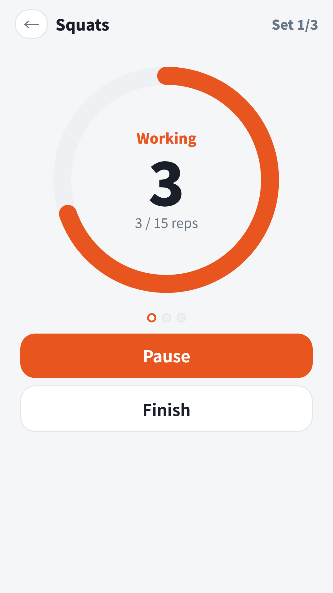
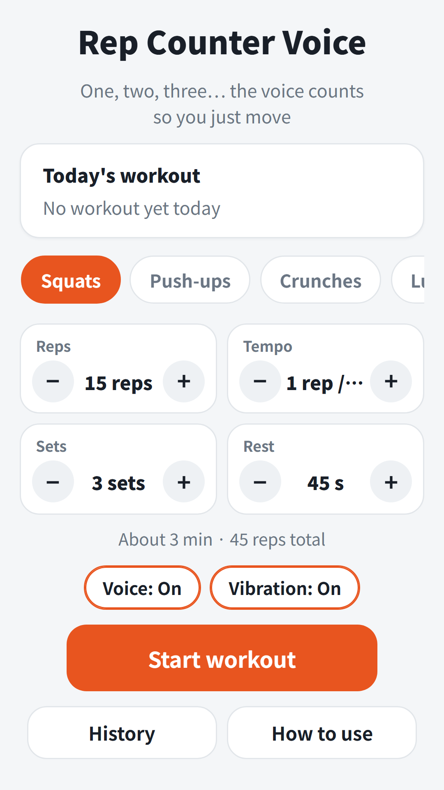
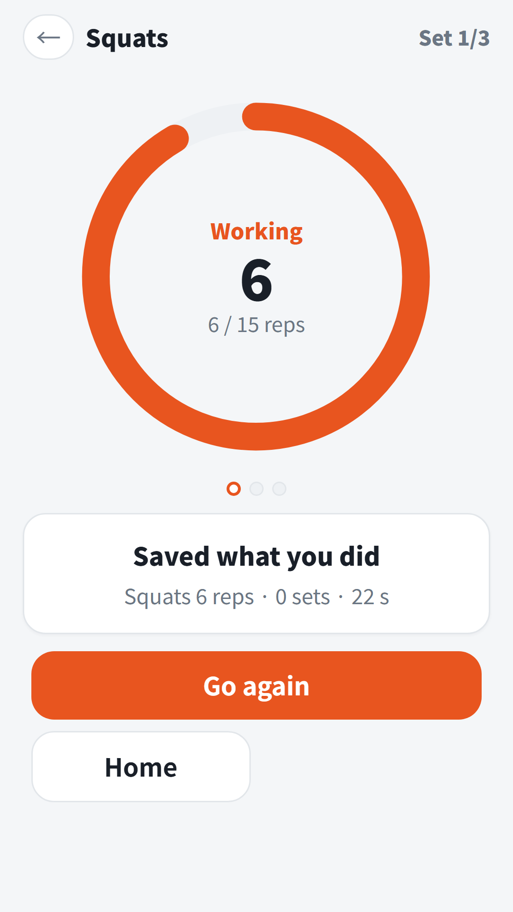
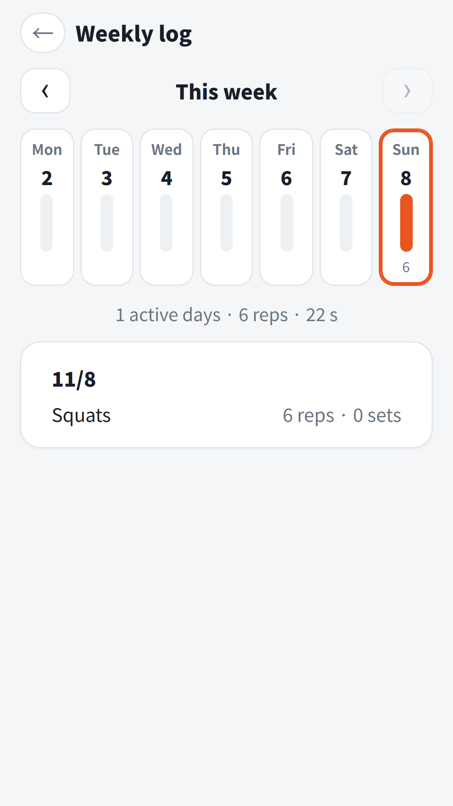

## Info
> **Rep Counter Voice** — A voice counts your reps, sets and rests, so you can skip the screen. Free on Google Play, with ads. On Toss there is no separate app; use it inside Weekend Life.
{: .prompt-info }

## About the App
Halfway through a set of squats it is easy to lose count, and glancing at your phone breaks your form. Rep Counter Voice is a counter that **says your reps, sets and rest time out loud**. Pick an exercise, set reps, tempo, sets and rest, then tap Start workout. After "Get ready, 3-2-1, go!" the voice counts one, two, three... on your beat. You just move.

It does not use the camera or sensors to detect your movement. It counts at the tempo you set.

## How to Use
- Pick one of 9 exercises: Squats, Push-ups, Crunches, Lunges, Jumping jacks, Burpees, Plank, Wall sit and Free count
- Set **Reps**, **Tempo**, **Sets** and **Rest**. Tempo is how long one rep takes. The estimated time and total reps appear below (for example, About 3 min · 45 reps total)
- After each set the rest timer runs, and a 3, 2, 1 countdown starts the next set
- For Plank and Wall sit, set a hold time. You will hear halfway, ten seconds left and 3, 2, 1
- During a workout you can **Pause**, **Skip rest** or **Finish**. Switching apps pauses it; tap Resume to carry on
- If you stop early, what you counted still goes into today's log

## Features
- Voices in 9 languages: Korean, English, Japanese, Chinese, Spanish, Portuguese, German, French and Italian
- Turn Voice and Vibration on or off separately
- The screen stays on while you work out
- Settings are saved per exercise, and the home screen shows Today's workout and your streak
- **Weekly log**: bars for each day and what you did on each date. Logs stay on this device
- No sign-up needed

Contains ads: a banner at the bottom of the screen.

{: w="360" }
{: w="360" }
{: w="360" }
{: w="360" }

## App Video


## Download
- Google Play: <https://play.google.com/store/apps/details?id=com.fadongkwon.exercise_count>
- Toss: no separate app; use Rep Counter Voice inside Weekend Life — <https://fadongkwon.com/toss/hub-weekend/> (open it on your phone and it connects straight into the Toss app)

{: w="200" .normal }

## You May Also Like
- [Best Time to Travel](/posts/travel-season/) — a monthly travel calendar for 60 places, scored from 30-year climate normals. It is also inside Weekend Life
- [Daily Brain Workout](/posts/senior-brain/) — four easy puzzles a day with no scores, rankings or time limits

I post updates here and on [Instagram (@fadongkwon.soft)](https://www.instagram.com/fadongkwon.soft/).
