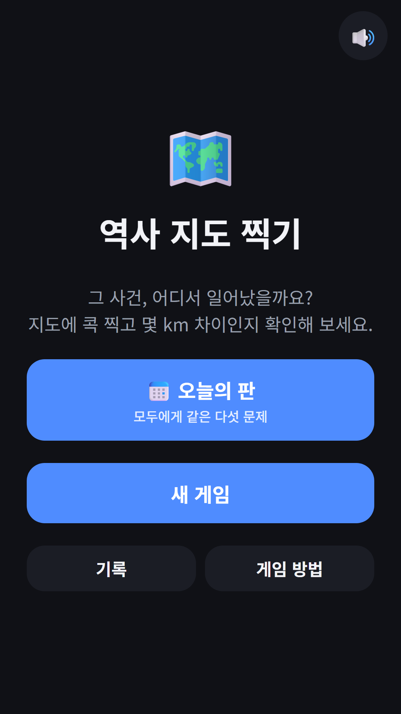
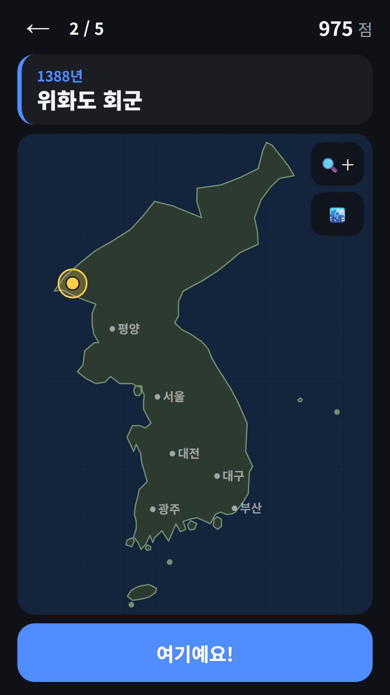
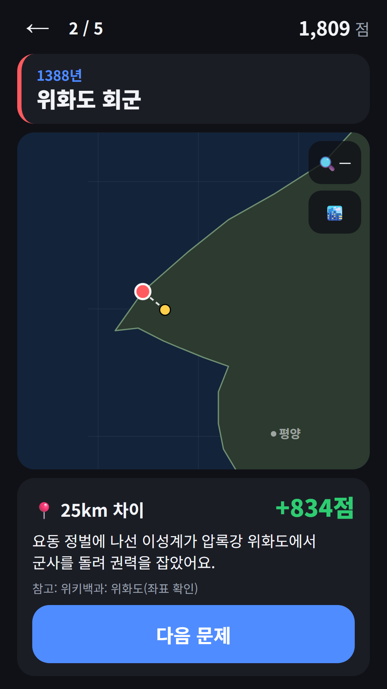
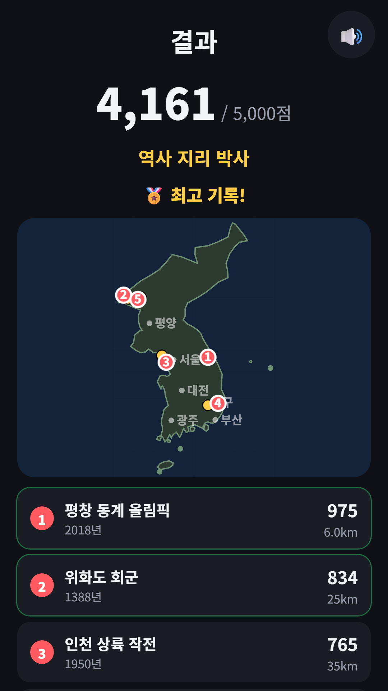

## Info
> **History Map Pin: Korea Quiz** — Pin where events in Korean history happened on a map of the Korean Peninsula and score by distance. Free on Google Play, with ads. The app is in Korean only. On Toss, play it inside [FDK Daily Quiz](/posts/hub-edu/).
{: .prompt-info }

## About the Game
A card shows a year and an event, such as "1388, Retreat from Wihwa Island". Tap the map of the Korean Peninsula where it happened to drop a pin, then confirm. The real spot appears, and your score depends on the distance between the two points in kilometres. Instead of memorising dates, it asks where things happened.

## How to Play
- A round is 5 questions with up to 5,000 points. A pin within 3 km scores the full 1,000, and the score drops the farther away you are
- Move your pin as many times as you like before you confirm
- Zoom in with the magnifier button and drag the map while zoomed. Guide cities such as Pyongyang, Seoul and Daejeon can be turned on or off, and they do not affect your score
- Each answer shows the real spot, the distance, a one-line fact and the source document
- After five questions, the result map shows all five pins and answers together, and your score earns a rank title

## Features
- 96 questions: 78 about Korean history and 18 about Korean geography. Places whose location is disputed and sites outside Korea are left out
- Daily round: everyone gets the same 5 questions on the same day. Your streak grows, and the first try of the day is the score that counts
- A TOP 10 list and resume where you left off
- Optional rewarded ad: once per round, see a circle with a radius of about 60 km that contains the answer. A question where you used the hint scores 700 at most
- Questions, event names and facts are in Korean, so the app is Korean only
- No sign-up needed

Contains ads (banner and rewarded).

The screenshots below show the Korean screens, since the app is in Korean only.

{: w="360" }
{: w="360" }
{: w="360" }
{: w="360" }

## Gameplay Video


## Download
- Google Play: <https://play.google.com/store/apps/details?id=com.fadongkwon.geo_history>
- Toss: History Map Pin inside [FDK Daily Quiz](/posts/hub-edu/)

{: w="200" .normal }

## You May Also Like
- [FDK Daily Quiz](/posts/hub-edu/) — daily questions in Korean history, economics, spelling, idioms, science and world geography, plus History Map Pin and Hangul Alchemy, in one hub
- [Daily Korean History](/posts/daily-history/) — one Korean history question a day
- [Daily World Geography Quiz](/posts/daily-geo/) — one geography question a day

Follow updates on this blog and on [Instagram (@fadongkwon.soft)](https://www.instagram.com/fadongkwon.soft/).
