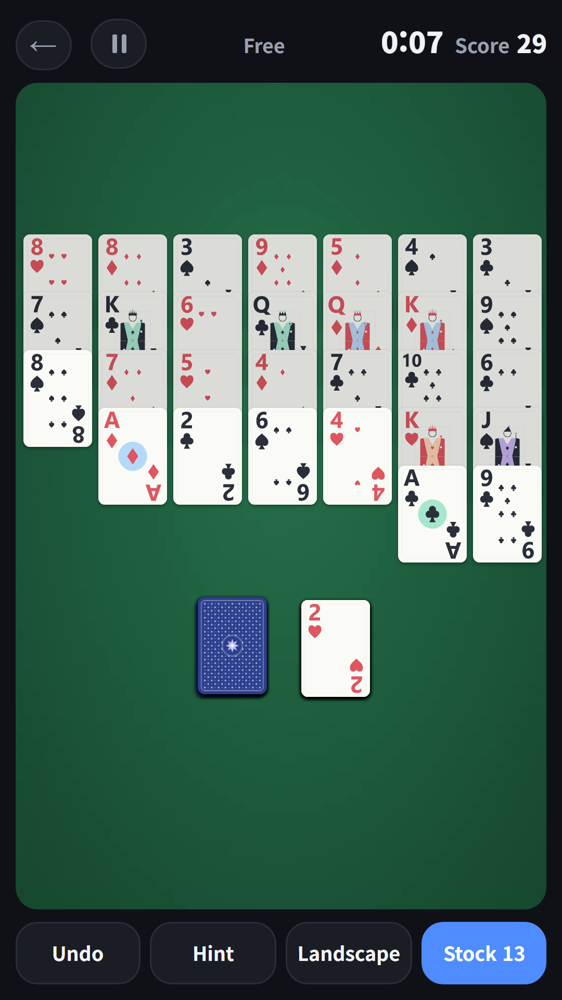
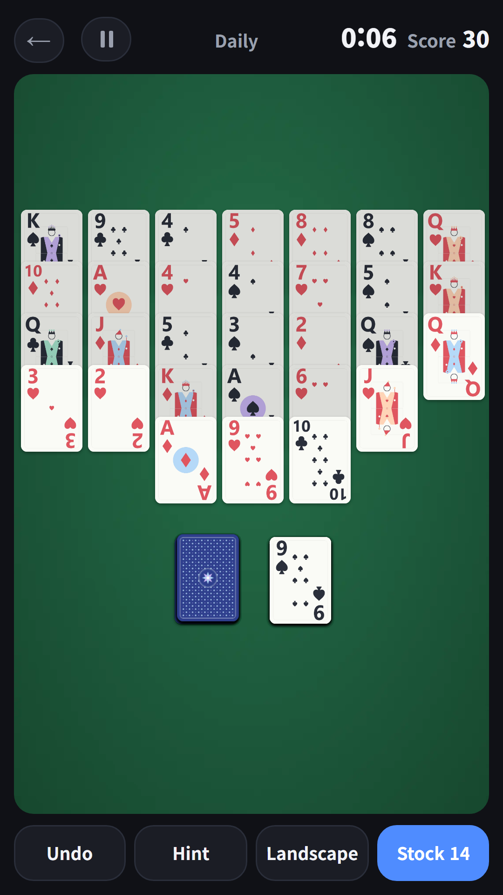
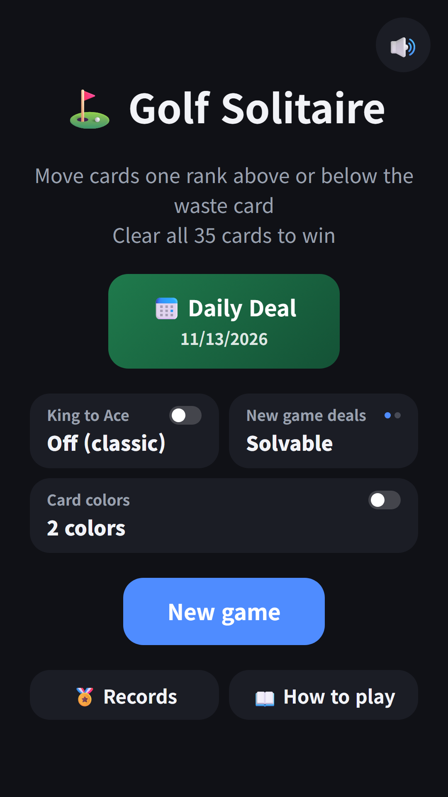
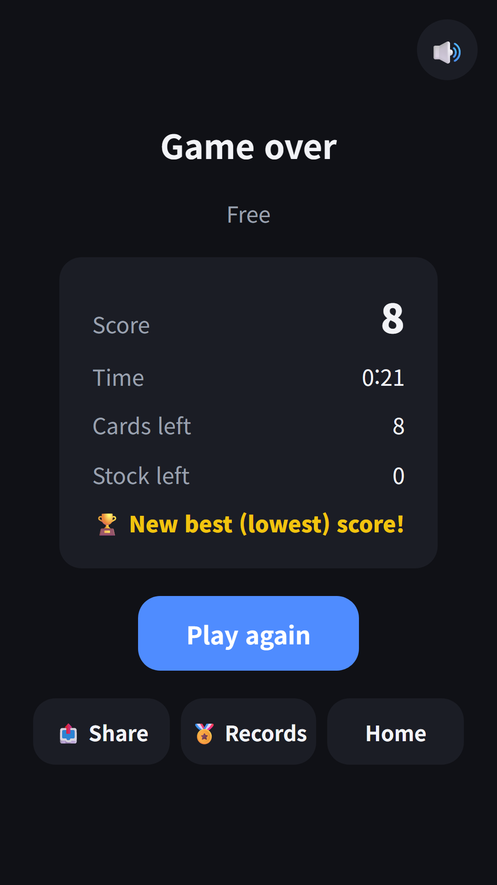
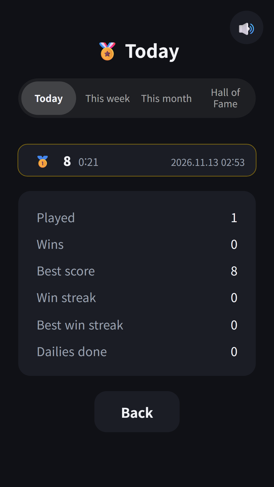

## Info
> **Golf Solitaire** — A classic card game where you clear all 35 cards by playing one rank above or below the waste card. Free on Google Play, with ads. On Toss, play it inside [FDK Card Games](/posts/hub-card/).
{: .prompt-info }

## About the Game
Seven columns of five cards, all 35 face up. Tap a card one rank higher or lower than the top waste card and it moves onto the waste pile. Suits do not matter, so on a 7 you can play a 6 or an 8. The longer you keep a run going up and down, like 7-6-5-6-7, the faster the table clears. Scoring works like golf: lower is better.

## How to Play
- Only the front (bottom) card of each column can move. One tap sends it to the waste pile
- When nothing can move, tap the stock to turn one card. The stock is not recycled
- Nothing can be played on a King. Turn on "King to Ace" on the home screen to play A or Q on a K and K or 2 on an A (the Daily Deal always uses the classic rules)
- Your score is the number of cards left on the table. Clear all 35 and you score 0 minus the cards left in the stock (3 stock cards left = −3)
- When no moves are left, choose Undo, See score or New deal

## Features
- Solvable deals: the Daily Deal and new games are checked by a solver to be winnable. Switch to random deals if you like
- Daily Deal: everyone plays the same deal on the same day, and your streak keeps growing
- Hint makes the movable cards blink, and Undo is there too
- Records: Today, This week, This month and Hall of Fame score lists, plus played, wins, best score and win streak stats
- Clear card art, an optional four-colour deck, portrait or landscape play, and continue where you left off
- No sign-up needed

Contains ads (banner).

{: w="360" }
{: w="360" }
{: w="360" }
{: w="360" }
{: w="360" }

## Gameplay Video


## Download
- Google Play: <https://play.google.com/store/apps/details?id=com.fadongkwon.golf_solitaire>
- Toss: Golf Solitaire inside [FDK Card Games](/posts/hub-card/)

{: w="200" .normal }

## You May Also Like
- [FDK Card Games](/posts/hub-card/) — Solitaire, FreeCell, Spider, Pyramid, Golf Solitaire and TriPeaks in one card game hub
- [Pyramid Solitaire](/posts/pyramid/) — pair cards that add up to 13
- [Solitaire](/posts/solitaire/) — the Klondike you already know

Follow updates on this blog and on [Instagram (@fadongkwon.soft)](https://www.instagram.com/fadongkwon.soft/).
