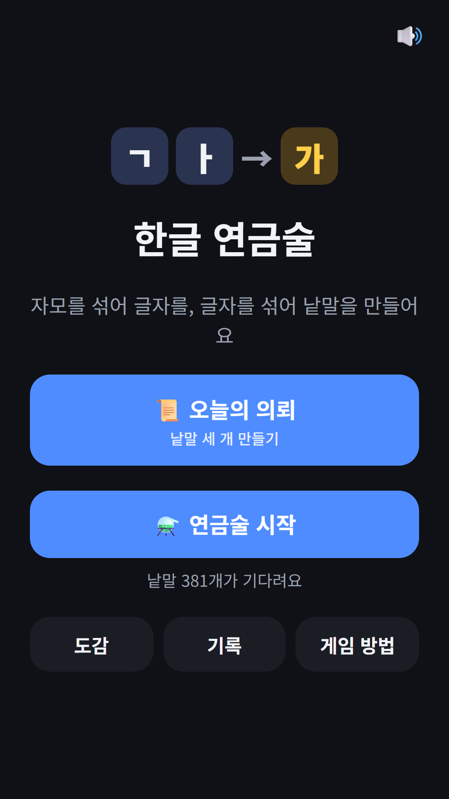
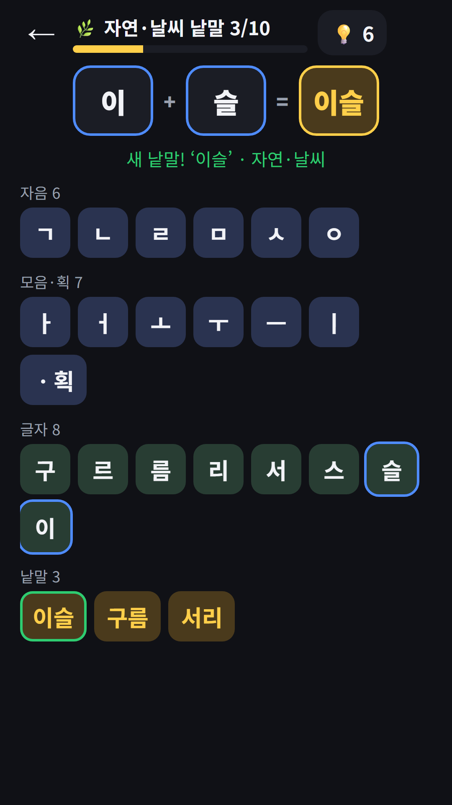
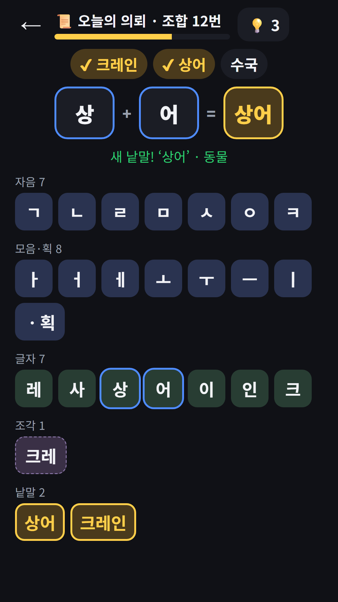
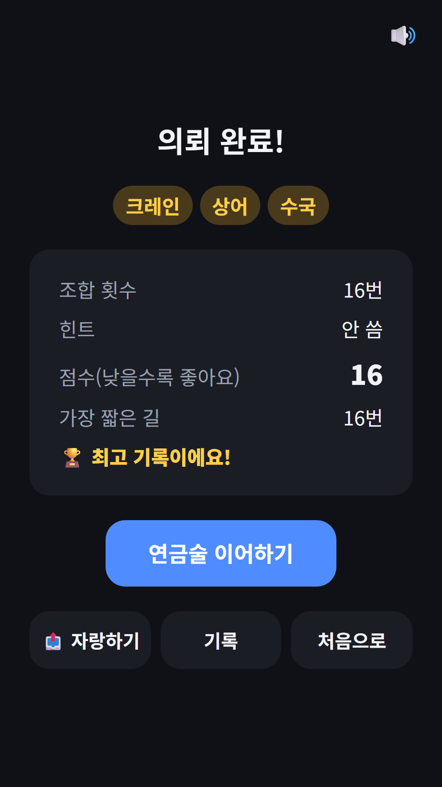

## Info
> **Hangul Alchemy: Word Puzzle** — Mix Hangul letters into syllables, then syllables into real Korean words, and fill your collection book. Free on Google Play, with ads. The app is in Korean only. On Toss, play it inside [FDK Daily Quiz](/posts/hub-edu/).
{: .prompt-info }

## About the Game
It takes the classic alchemy game, where you mix elements to discover new ones, and plays it with the Korean alphabet. You begin with six consonants (ㄱ ㄴ ㄹ ㅁ ㅅ ㅇ), six vowels (ㅏ ㅓ ㅗ ㅜ ㅡ ㅣ) and a single stroke. Add a stroke to ㄱ and you get ㅋ, mix ㄱ with ㅏ and you get 가, and mix 이 with 슬 to find the word 이슬 (dew). Every word in the book is a real everyday Korean word.

## How to Play
- Tap two pieces in turn and they mix on the workbench. You can also drag a piece onto another one
- Letters with letters: add a stroke to make new consonants, such as ㄴ to ㄷ to ㅌ or ㅅ to ㅈ to ㅊ. Two of the same consonant make a double consonant, two vowels make a compound vowel, and two final consonants make a double final
- A consonant plus a vowel makes a syllable without a final consonant, and adding one more consonant gives it a final
- Two syllables make a two-syllable word. For a three-syllable word, mix a third syllable into the first two, which you keep as a fragment
- A mix that makes nothing still counts as one combination. Stuck? A hint shows one piece for the next step, and tapping it again shows the other

## Features
- Alchemy (free mode): seven themes in order, from nature and weather, animals, fruit and vegetables, food, plants and flowers, and household items to vehicles, with a goal of 10 words per theme. It saves automatically, and you start with 3 hints and get one more for every new word
- Daily request: make 3 words from different themes, starting from the basic pieces. Your score is the number of combinations plus 3 for each hint, so lower is better, and the result shows the shortest possible path
- A collection book of 381 everyday nouns in 7 themes, records, and a daily request streak
- Optional rewarded ad: when you run out of hints, watch an ad for one more (once per theme in Alchemy, once a day in the daily request)
- The letters and words are Korean, so the app is Korean only
- No sign-up needed

Contains ads (banner and rewarded).

The screenshots below show the Korean screens, since the app is in Korean only.

{: w="360" }
{: w="360" }
{: w="360" }
{: w="360" }

## Gameplay Video


## Download
- Google Play: <https://play.google.com/store/apps/details?id=com.fadongkwon.hangul_alchemy>
- Toss: Hangul Alchemy inside [FDK Daily Quiz](/posts/hub-edu/)

{: w="200" .normal }

## You May Also Like
- [FDK Daily Quiz](/posts/hub-edu/) — six daily trivia subjects plus History Map Pin and Hangul Alchemy in one hub
- [Hangul Word Guess](/posts/hangul-word/) — guess a Korean word one jamo at a time
- [Chosung Quiz](/posts/chosung-quiz/) — guess Korean words from their initials

Follow updates on this blog and on [Instagram (@fadongkwon.soft)](https://www.instagram.com/fadongkwon.soft/).
