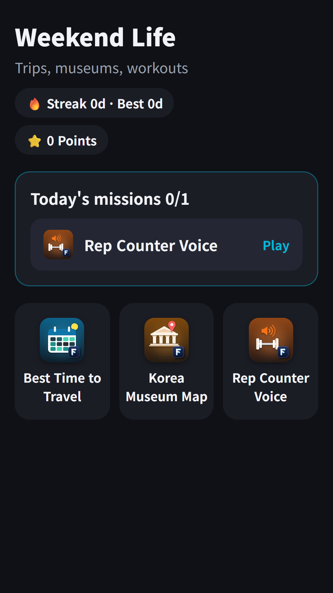
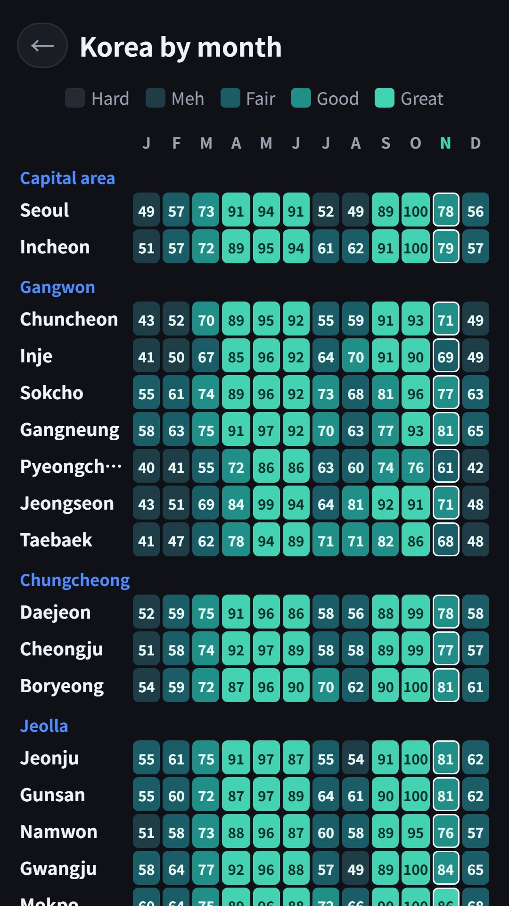
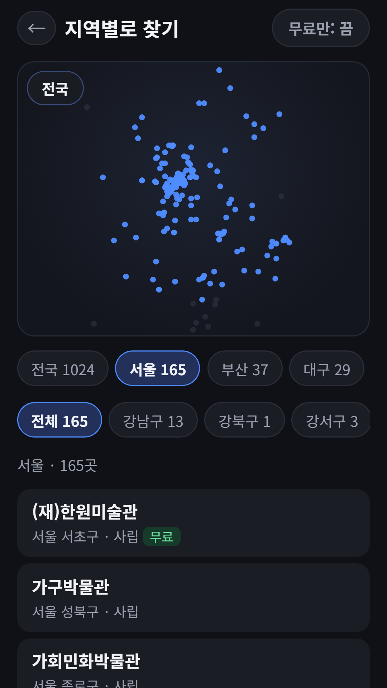
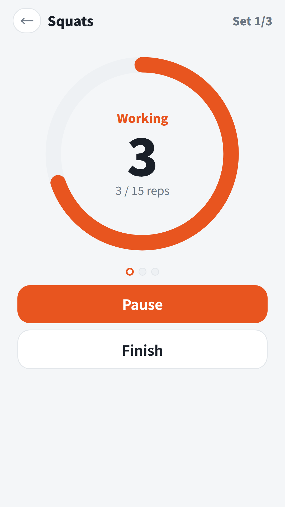

## Info
> **Weekend Life** — Trip timing, museum finding and home workouts in one app. Free on Google Play, with ads. Also available as a Toss mini app.
{: .prompt-info }

## About the App
Weekend Life is a **hub app** that puts three tools for planning your weekend in one place. Check which places are best to visit this month, find museums and galleries near you, and work out at home to a voice that counts for you. Open any of the three from the home screen, and pressing back inside one returns you to the home screen.

## How to Use
- The home screen shows **Today's missions**: one of the three apps, with a Play button that takes you straight in
- Finish one daily task each day to build a **streak**. The home screen shows your streak, best streak and points
- The three tiles at the bottom open Best Time to Travel, Korea Museum Map and Rep Counter Voice at any time

## The Three Apps
- [Best Time to Travel](/posts/travel-season/) — a travel calendar that scores January to December at 32 places in Korea and 28 abroad from 1991-2020 temperature and rainfall normals published by national weather services. Each place shows its data table and sources, and you can compare two places side by side
- Korea Museum Map — 1,024 museums and galleries across Korea, built from the public "National Museum and Art Gallery Standard Data" on Korea's Public Data Portal. Narrow down by province and district, or show free places only. The detail screen lists address, opening hours, closed days, admission and transport, and you can **stamp** the places you have visited into a stamp book. Museum details are in Korean
- Rep Counter Voice — says your reps, sets and rest time out loud for 9 exercises, from squats and push-ups to the plank. It counts at the tempo you set, so you can keep your eyes off the screen

Korea Museum Map's nearby search uses your location only after you tap the button and allow location access. The location is used on the device for distance only and is never saved or sent.

Travel scores are reference values from 30-year climate normals and may differ from this year's weather. Museum details come from public data, so please check opening status before you visit.

## On Toss, in an Existing App's Slot
A Toss workspace holds [only 50 apps](/posts/toss-workspace-50-limit/), so, [like the other hubs](/posts/toss-hub-conversion/), this hub was not registered as a new app. Instead I replaced the app info and bundle of the existing app **Car Number Lotto** with Weekend Life. Car Number Lotto itself still lives inside [FDK Lucky Lab](/posts/hub-fortune/).

No sign-up needed. Contains ads: a banner at the bottom, and an optional rewarded ad you choose to watch.

{: w="360" }
{: w="360" }
{: w="360" }
{: w="360" }

## App Video


## Download
- Google Play: <https://play.google.com/store/apps/details?id=com.fadongkwon.hub_weekend>
- Apps in Toss: <https://fadongkwon.com/toss/hub-weekend/> — open it on your phone and it connects straight into the Toss app. It went live taking over an existing app's slot ([how and why](/posts/toss-hub-conversion/)).

{: w="200" .normal }

## You May Also Like
- [Daily Brain Workout](/posts/senior-brain/) — four easy puzzles a day with no scores, rankings or time limits
- [FDK Brain Check](/posts/hub-brain/) — check your day with five games: words, memory, sequence, reaction and focus

I post updates here and on [Instagram (@fadongkwon.soft)](https://www.instagram.com/fadongkwon.soft/).
