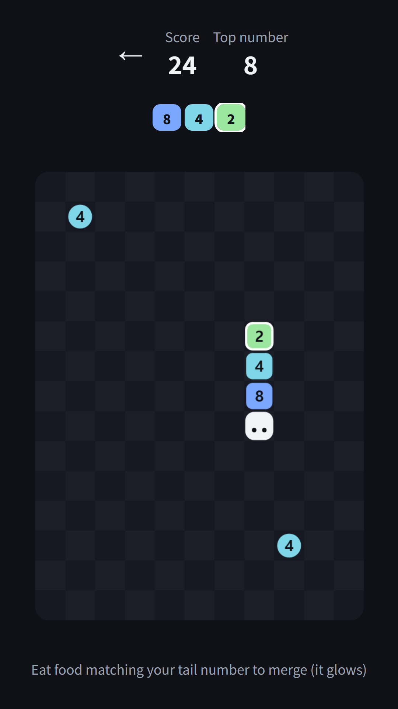
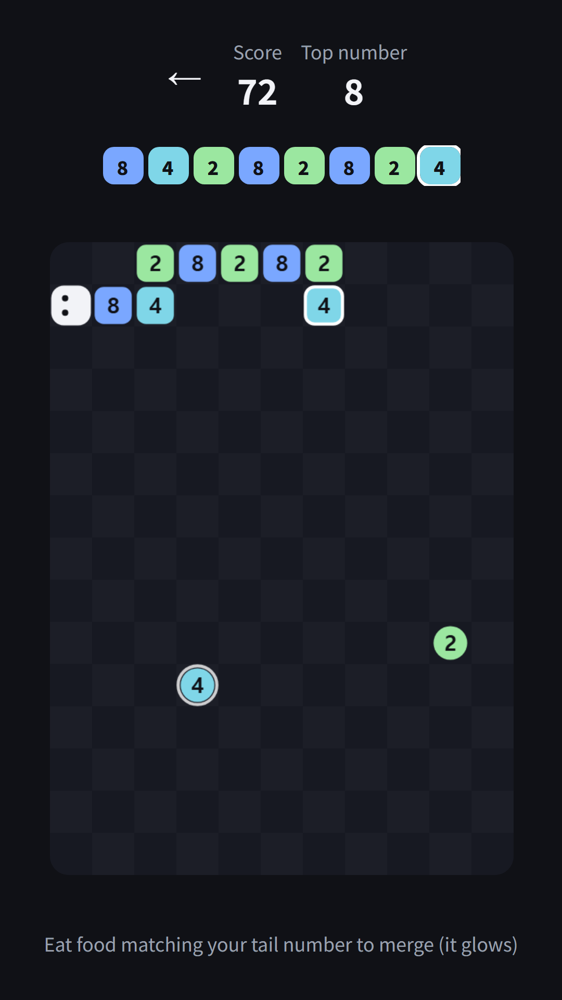
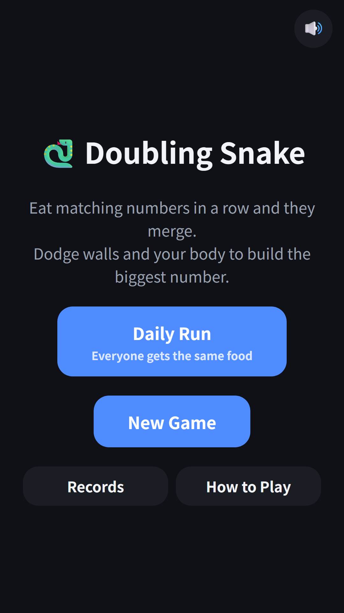
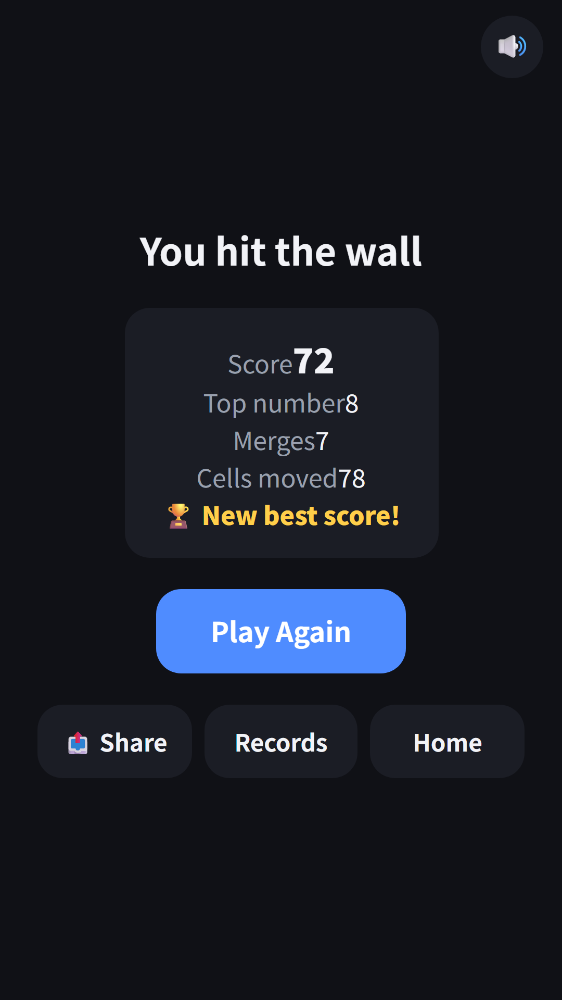
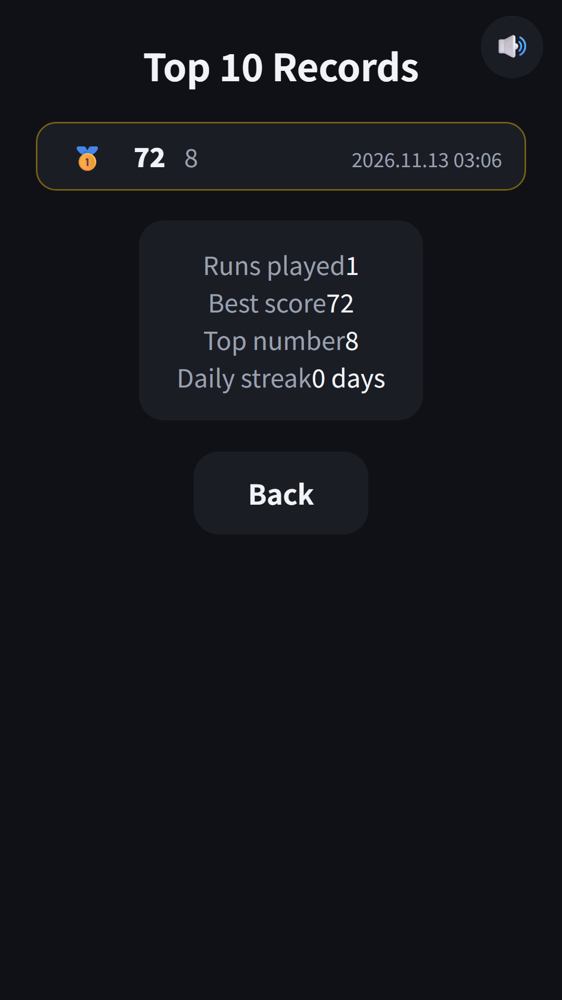

## Info
> **Doubling Snake** — A snake game where you eat numbers and matching ones merge, making the snake shorter. Free on Google Play, with ads. On Toss, play it inside [FDK Arcade](/posts/hub-arcade/).
{: .prompt-info }

## About the Game
Snake meets 2048. The head carries no number, and every segment of the body does. Eat a number on the board and it joins the end of your body, then equal numbers merge from the end and double up, just like 2048. Every merge makes the snake shorter, so unlike classic snake, the fun is in choosing which food to eat first.

## How to Play
- Swipe to steer. Your first swipe starts the run
- Food that matches your tail number glows. Eat it and it merges right away
- Merges chain. With 8, 4, 2 on your body, eating another 2 turns them into a single 16
- Hitting a wall or your own body ends the run
- Once per run, you can watch an optional ad to redraw both foods on the board

## Features
- An 11 by 15 board with two foods at all times. They are 2 or 4, and once your top number reaches 32 an 8 sometimes appears
- Your score is the numbers you eat plus the values you merge. The bigger your top number, the faster the snake gets
- Daily Run: everyone gets the same food on the same day
- Continue where you left off, a Top 10 of your best scores, and runs played, top number and daily streak stats
- Plays in 9 languages, no sign-up needed

Contains ads (banner and rewarded).

{: w="360" }
{: w="360" }
{: w="360" }
{: w="360" }
{: w="360" }

## Gameplay Video


## Download
- Google Play: <https://play.google.com/store/apps/details?id=com.fadongkwon.snake_2048>
- Toss: Doubling Snake inside [FDK Arcade](/posts/hub-arcade/)

{: w="200" .normal }

## You May Also Like
- [FDK Arcade](/posts/hub-arcade/) — Brick Breaker, Snake, Whack-a-Mole, Doubling Snake and more quick arcade games in one hub
- [Snake](/posts/snake/) — eat, grow, try not to bite yourself
- [2048](/posts/game-2048/) — slide and merge your way to the 2048 tile

Follow updates on this blog and on [Instagram (@fadongkwon.soft)](https://www.instagram.com/fadongkwon.soft/).
