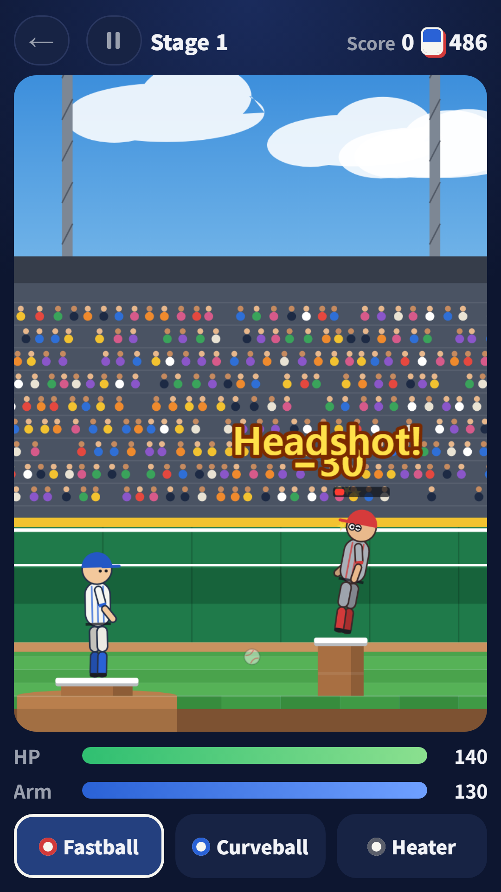
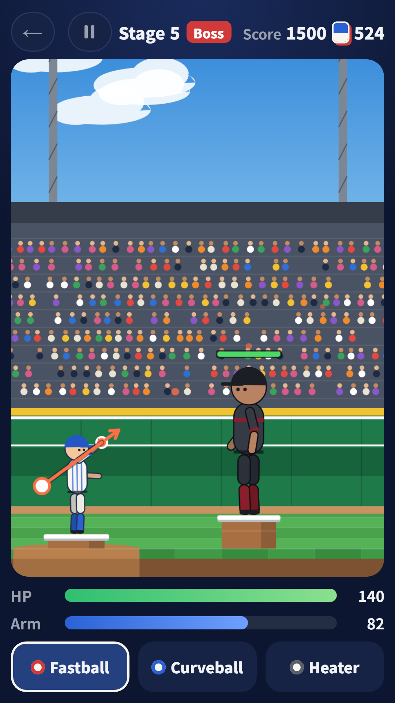
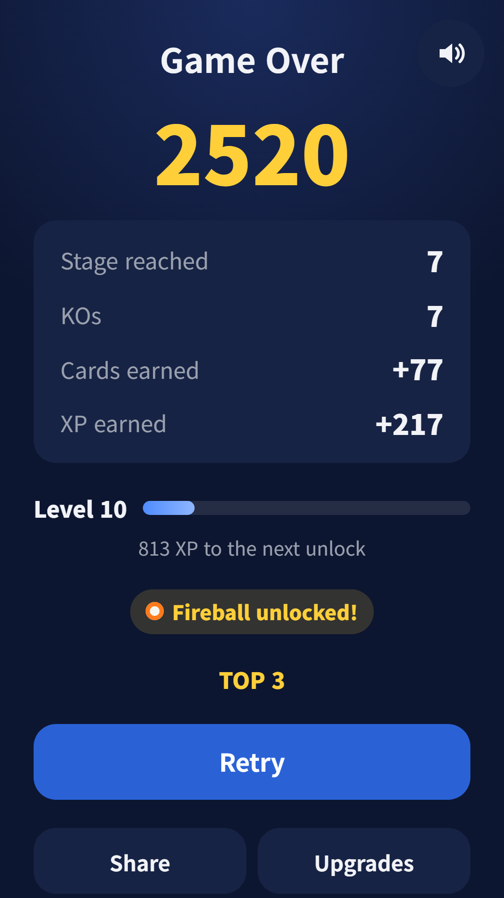
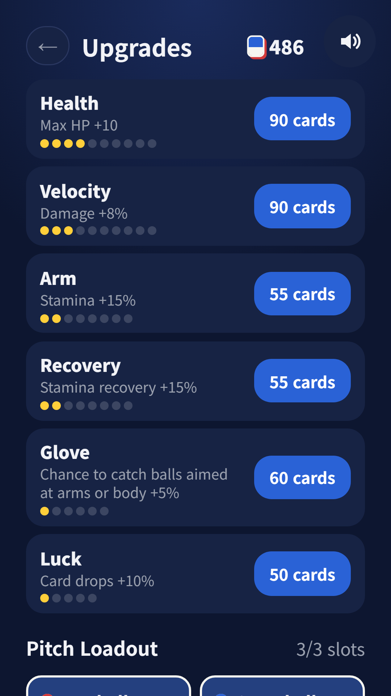
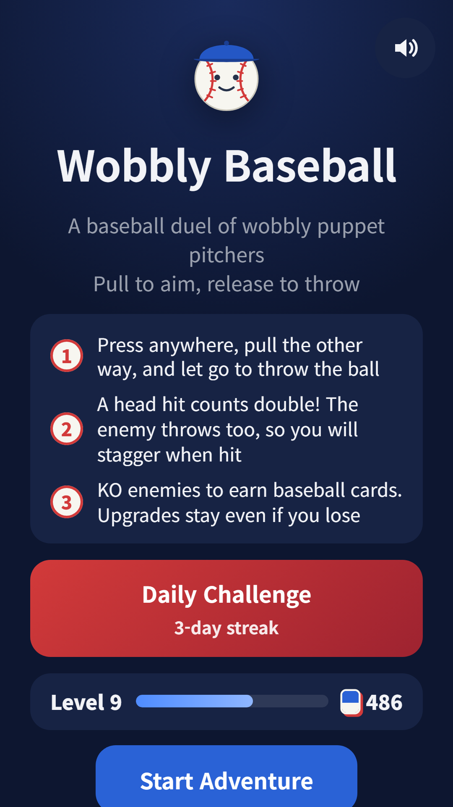

## Info
> **Wobbly Baseball** — Become a floppy ragdoll pitcher and win a 1:1 baseball duel. Free on Google Play, with ads. On Toss, play it inside [FDK Olympics](/posts/hub-sports/).
{: .prompt-info }

## About the Game
Press anywhere, pull the other way to aim, and let go to throw. Your opponent throws back, so a hit makes you stagger and an empty health bar drops you to the ground. It runs on ragdoll physics, and watching a hit doll's arms and legs flop around is half the fun. Headshots do double damage, so you will be aiming high.

## How to Play
- The farther you pull, the faster the ball. A dotted line shows where it will fly
- Holding the pull drains your arm stamina. Below 20% your throws slow down, so timing matters
- Knock out the opponent to reach the next stage. Every fifth stage brings a giant boss
- Every KO earns baseball cards and XP, and you keep them even when you lose
- When you go down, you can watch an ad to get back up once per run

## Features
- 7 pitch types: fastball, curveball, splitter, heater, knuckleball, fireball and twin ball. Earn them by leveling up and equip up to 3
- 6 permanent upgrades: health, velocity, arm, recovery, glove and luck
- New opponents as you go: a catcher whose gear guards head and body, a batter who hits the ball back, and a fast, accurate ace
- Daily challenge: everyone faces the same lineup on the same day
- No sign-up needed

Contains ads (banner, interstitial and rewarded).

{: w="360" }
{: w="360" }
{: w="360" }
{: w="360" }
{: w="360" }

## Gameplay Video


## Download
- Google Play: <https://play.google.com/store/apps/details?id=com.fadongkwon.wobbly_baseball>
- Toss: the Baseball tab inside [FDK Olympics](/posts/hub-sports/)

{: w="200" .normal }

## You May Also Like
- [FDK Olympics](/posts/hub-sports/) — golf, billiards, table tennis, bowling, archery, basketball and baseball in one sports hub
- [Castle Topple](/posts/castle-topple/) — a physics game where one cannon shot brings the castle down
- [Hoop Shot](/posts/hoop-shot/) — a 60-second three-point challenge

Follow updates on this blog and on [Instagram (@fadongkwon.soft)](https://www.instagram.com/fadongkwon.soft/).
