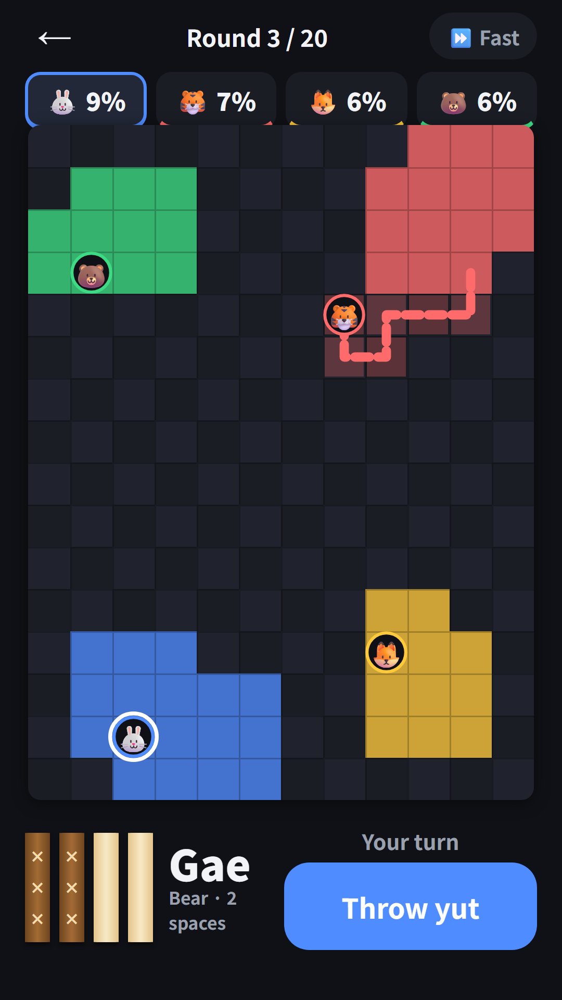
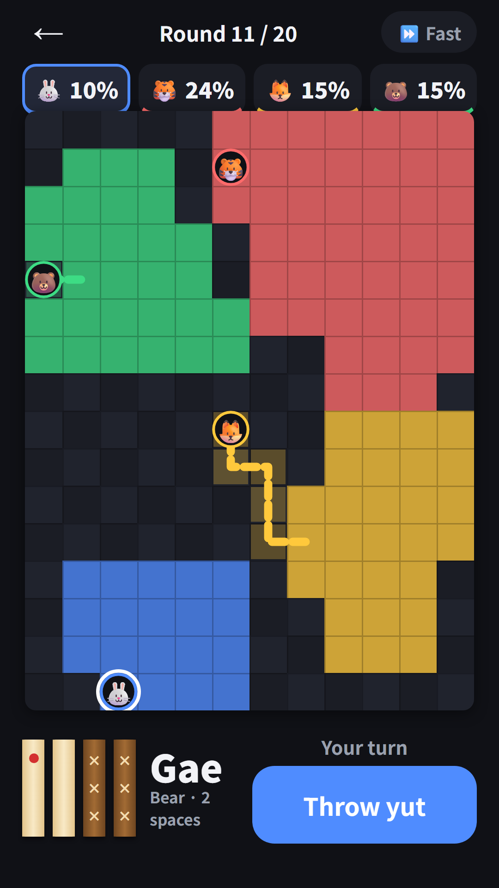
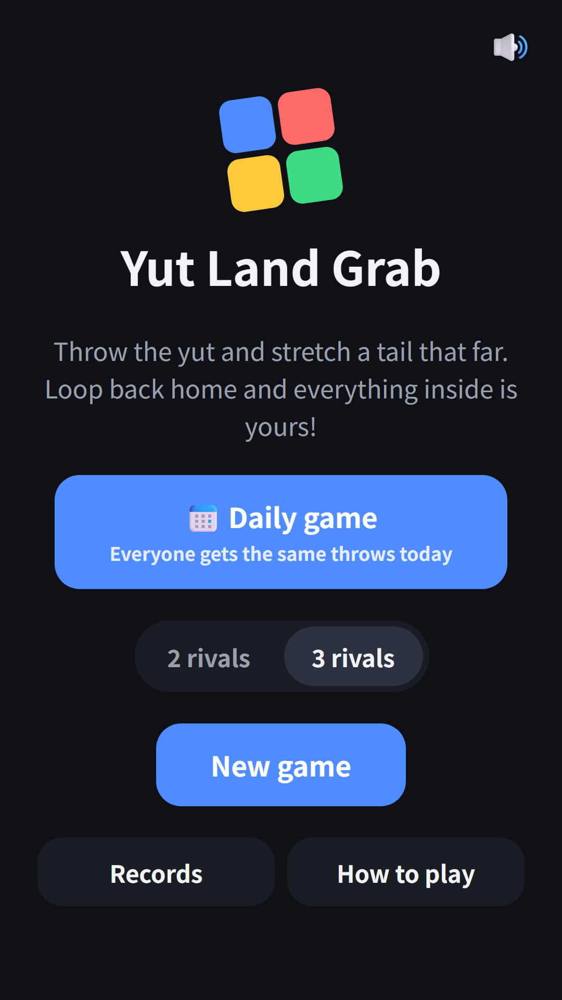
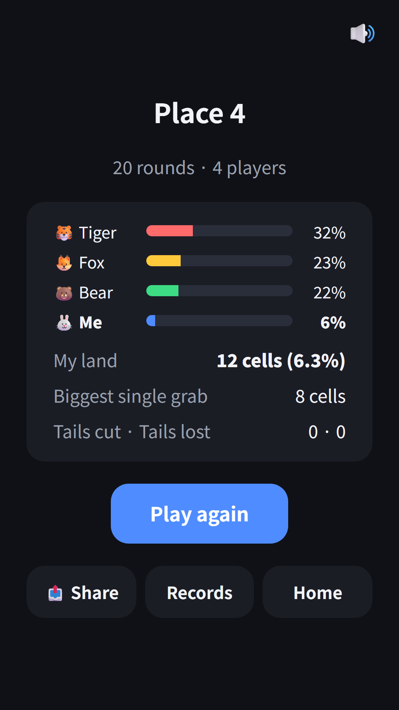
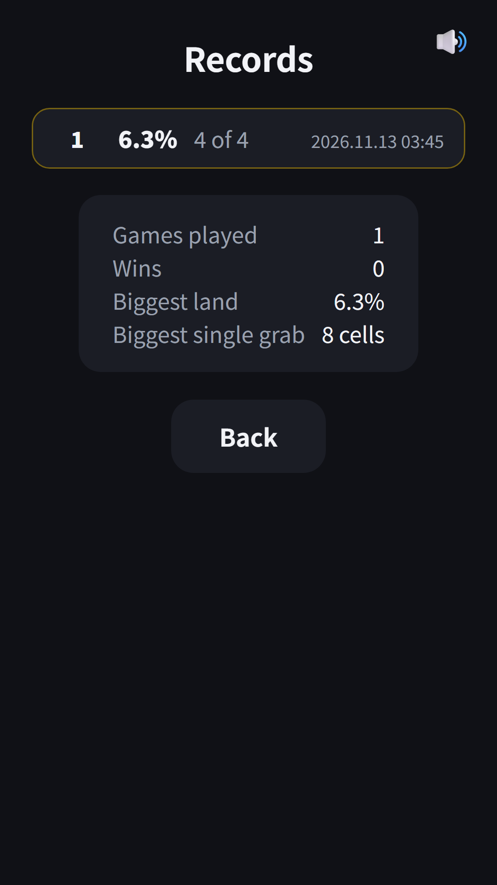
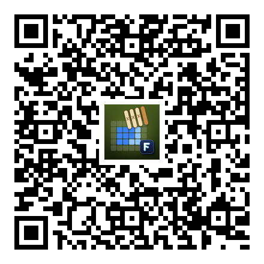

## Info
> **Yut Land Grab** — A turn-based land-grab game: throw the yut sticks, trail a tail out of your land and loop back to claim everything you enclose. Free on Google Play, with ads. On Toss, play it inside [FDK Board Duel](/posts/hub-board/).
{: .prompt-info }

## About the Game
Yut Nori meets a land-grab game. On a 12 by 16 board you (the rabbit) and 2 or 3 AI rivals (Tiger, Fox and Bear) each start on a 3 by 3 home territory. Throw the yut sticks and move that many cells, choosing a direction for every step. Once you leave your land, your path becomes a tail. Get back to your land safely and the tail plus every cell inside it becomes yours in one go. A bigger loop claims more, but your tail stays exposed for longer.

## How to Play
- Tap Throw yut to throw four sticks: Back-do, Do, Gae, Geol, Yut or Mo. Yut and Mo give you another throw
- Move one cell at a time, as many cells as the throw says. Tap a glowing cell on the board or use the direction buttons. You have to use every step
- You cannot step on your own tail. A Back-do pulls your tail back by one cell
- Rivals' land inside your loop becomes yours too. A ✔ marks a cell that closes your loop, and a ✂ marks a rival's tail
- Step on a rival's tail to cut it, and that piece goes back to its nearest land. Your tail can be cut the same way
- If the land under you is taken, you move to your nearest land. A player with no land left is out
- After 20 rounds, the biggest territory wins

## Features
- Choose 2 or 3 rivals, and speed through their turns with Fast
- Daily game: everyone gets the same throws on the same day (4 players)
- Results show your place, your land share, your biggest single grab, and tails cut and lost
- Records: a TOP 10 of your land share, plus games played, wins, biggest land and biggest single grab
- Continue where you left off, 9 languages, no sign-up needed
- Once per game, right after your own throw, you can watch an optional ad to throw again

Contains ads (banner and rewarded).

{: w="360" }
{: w="360" }
{: w="360" }
{: w="360" }
{: w="360" }

## Gameplay Video


## Download
- Google Play: <https://play.google.com/store/apps/details?id=com.fadongkwon.yut_territory>
- Toss: Yut Land Grab inside [FDK Board Duel](/posts/hub-board/)

{: w="200" .normal }

## You May Also Like
- [FDK Board Duel](/posts/hub-board/) — Janggi, Go, Gomoku, Yut Land Grab and more board games against the computer in one hub
- [Yut Nori](/posts/yut-nori/) — throw the sticks, stack pieces and take shortcuts home
- [Gomoku](/posts/gomoku/) — first to five in a row wins

Follow updates on this blog and on [Instagram (@fadongkwon.soft)](https://www.instagram.com/fadongkwon.soft/).
