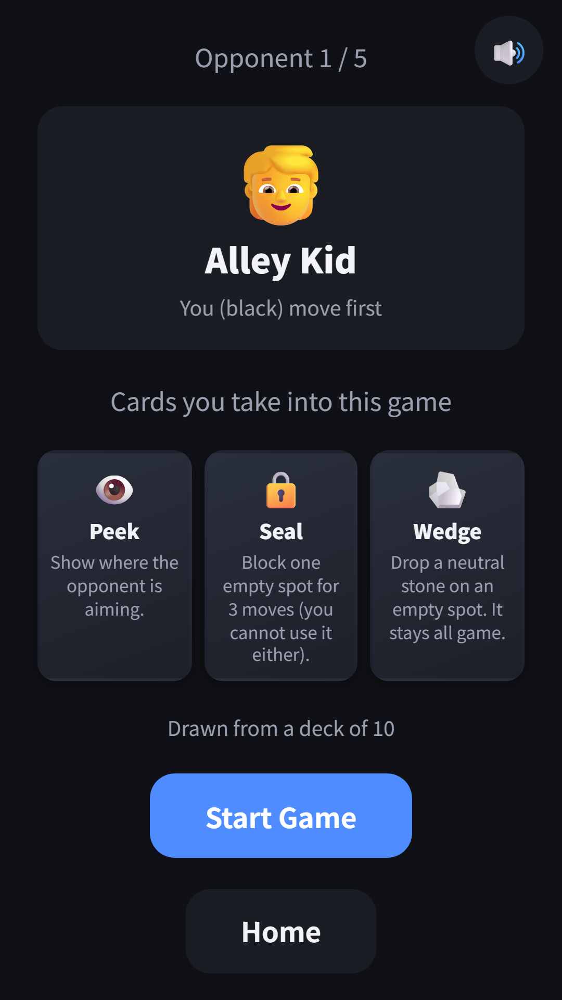
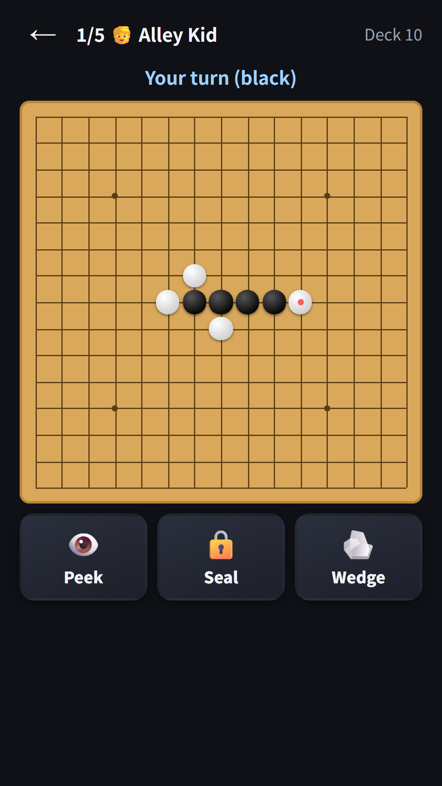
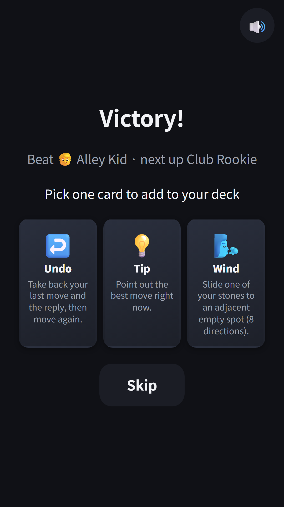
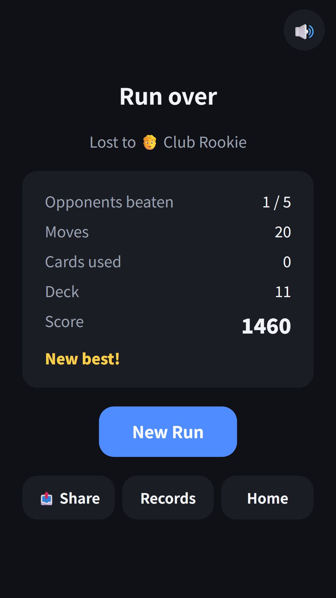
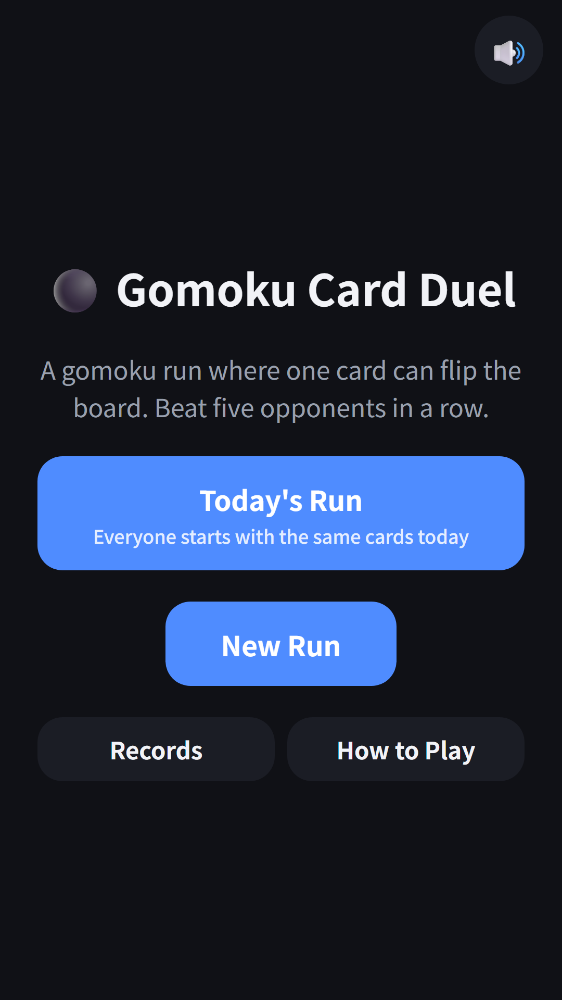

## Info
> **Gomoku Card Duel** — A roguelike Gomoku where one-time power cards help you beat five rivals in a row. Free on Google Play, with ads. On Toss, play it inside [FDK Board Duel](/posts/hub-board/).
{: .prompt-info }

## About the Game
A roguelike twist on Gomoku. You play black on a 15 by 15 board and face five rivals one after another in a single run. Before each match you draw 3 cards from your deck, and you can play one card per turn before placing a stone. Win a match and you add 1 of 3 new cards to your deck. Lose and the run is over.

## How to Play
- Exactly five in a row wins. Six or more does not count, for you and your opponent alike
- Before each match you draw 3 cards from your starting deck of 10. A match intro screen shows the rival and your hand first
- Play one card per turn, before you place a stone. Only legal targets glow
- After a win, pick 1 of 3 new cards for your deck (or skip). A draw replays the same rival
- Optional ads: redraw your hand before a match, or replay a lost match against the same rival, once per run each

## Features
- 10 cards: erase a stone, double move, seal a spot for three turns, undo, wind, preview, recolor, bomb, wedge stone and hint
- 5 rivals: Alley Kid, Club Junior, Neighborhood Master (moves first), Old Ink Master (you start with only 2 cards) and Black Dragon Master (hard stones that erase, recolor and bomb cards cannot touch)
- Your score comes from rivals beaten, a bonus for fewer moves and a bonus for finishing the run
- Daily Run: everyone gets the same run on the same day
- Resume a run, and a Top 10 of your best scores
- Plays in 9 languages, no sign-up needed

Contains ads (banner and rewarded).

{: w="360" }
{: w="360" }
{: w="360" }
{: w="360" }
{: w="360" }

## Gameplay Video


## Download
- Google Play: <https://play.google.com/store/apps/details?id=com.fadongkwon.board_cards>
- Toss: Gomoku Card Duel inside [FDK Board Duel](/posts/hub-board/)

{: w="200" .normal }

## You May Also Like
- [FDK Board Duel](/posts/hub-board/) — Gomoku, Janggi, Chess, Gomoku Card Duel and more board games in one hub
- [Gomoku](/posts/gomoku/) — classic five-in-a-row Gomoku

Follow updates on this blog and on [Instagram (@fadongkwon.soft)](https://www.instagram.com/fadongkwon.soft/).
