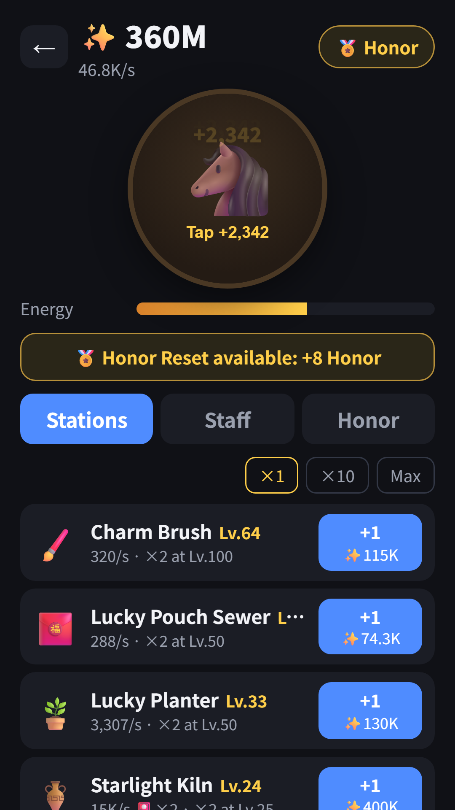
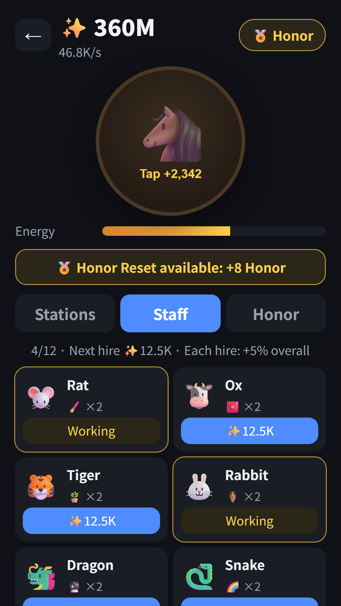
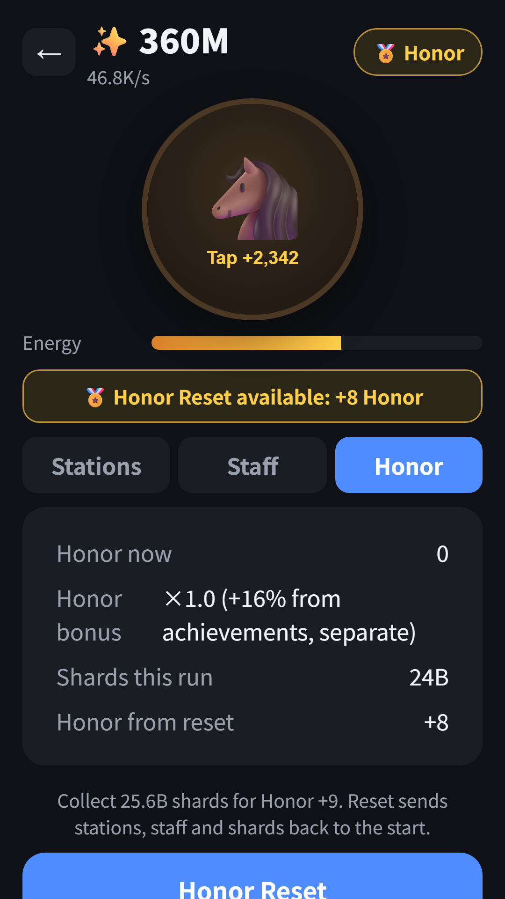
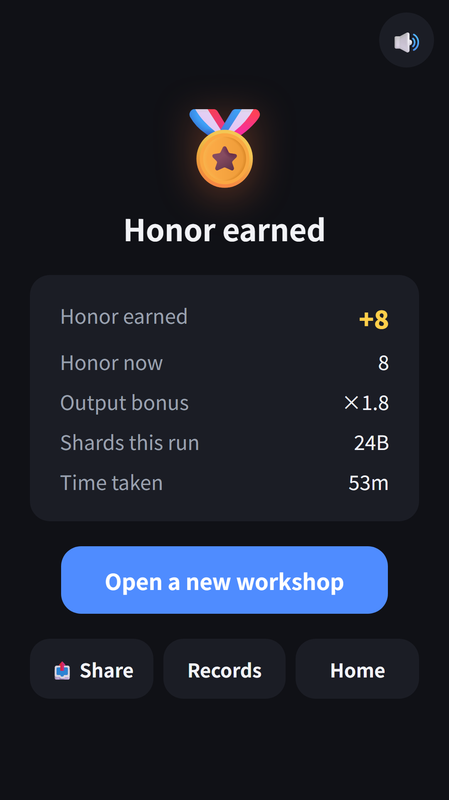
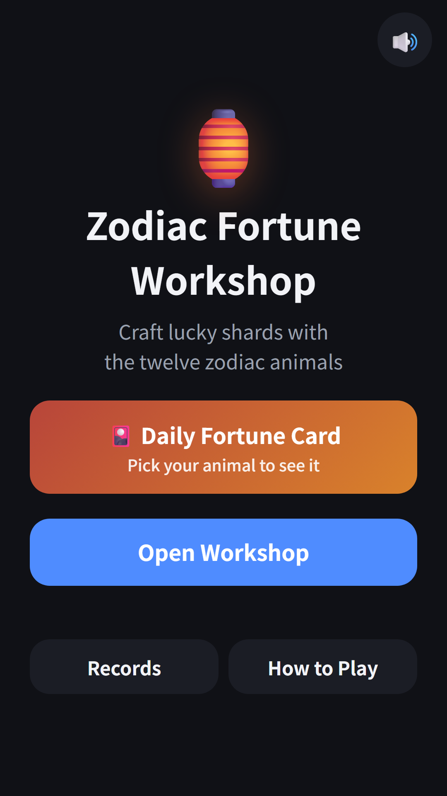

## Info
> **Zodiac Fortune Workshop** — An idle workshop game where the twelve zodiac animals are your staff and you collect lucky shards. Free on Google Play, with ads. On Toss, play it inside [FDK Arcade](/posts/hub-arcade/).
{: .prompt-info }

## About the Game
An idle workshop game staffed by the twelve zodiac animals. Pick your animal and it becomes the workshop head, boosting all production. Level up workbenches, hire animal staff and collect lucky shards. Production keeps running even when the app is closed, and when you come back you collect what piled up.

## How to Play
- Enter your birth year to pick your zodiac animal automatically, or choose from all twelve
- Level up the workbenches. There are six: Charm Brush, Lucky Pouch Sewer, Lucky Planter, Starlight Kiln, Orb Polisher and Rainbow Loom
- Hire any of the twelve animals as staff. Each one has a favorite workbench
- Tap the workshop to boost production, and fill the energy gauge for a short burst of speed
- Once enough shards pile up, reset for Honor: workbenches and staff go back to the start, and you keep a permanent Honor bonus

## Features
- Each workbench doubles its output whenever it reaches level 10, 25, 50, 100, 150 and 200
- Daily Fortune Card: it only changes in-game bonuses, such as a production boost or a cheaper hire, and it is fixed to your animal for the day
- Production keeps running for up to 8 hours while you are away, and a welcome-back summary shows what you collected. You can watch an optional ad to collect double, once per summary
- 17 achievements and a Top 10 of your Honor records
- Plays in 9 languages, no sign-up needed

Contains ads (banner and rewarded).

{: w="360" }
{: w="360" }
{: w="360" }
{: w="360" }
{: w="360" }

## Gameplay Video


## Download
- Google Play: <https://play.google.com/store/apps/details?id=com.fadongkwon.fortune_tycoon>
- Toss: Zodiac Fortune Workshop inside [FDK Arcade](/posts/hub-arcade/)

{: w="200" .normal }

## You May Also Like
- [FDK Arcade](/posts/hub-arcade/) — Brick Breaker, Snake, Doubling Snake, Zodiac Fortune Workshop and more quick arcade games in one hub
- [Zodiac Pet](/posts/zodiac-pet/) — care for your zodiac animal and check your daily fortune

Follow updates on this blog and on [Instagram (@fadongkwon.soft)](https://www.instagram.com/fadongkwon.soft/).
