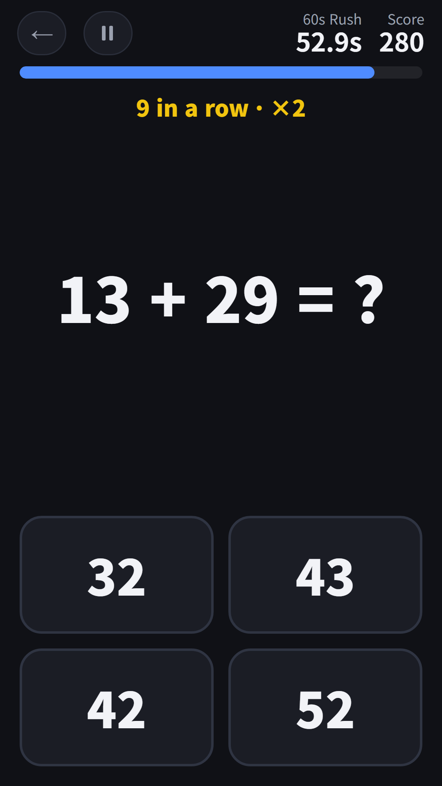
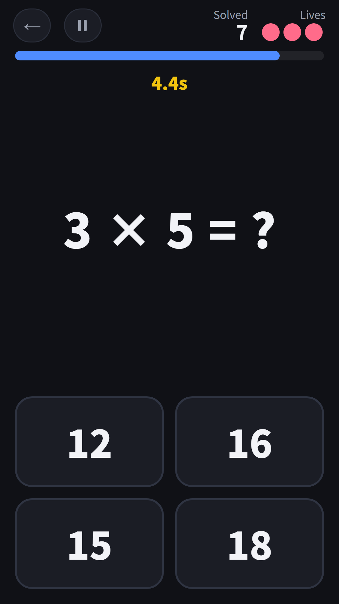
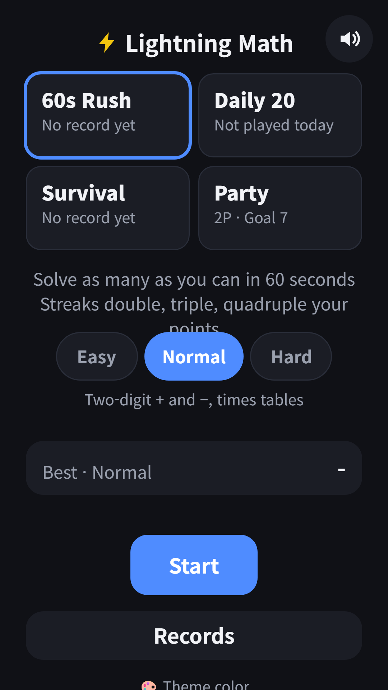
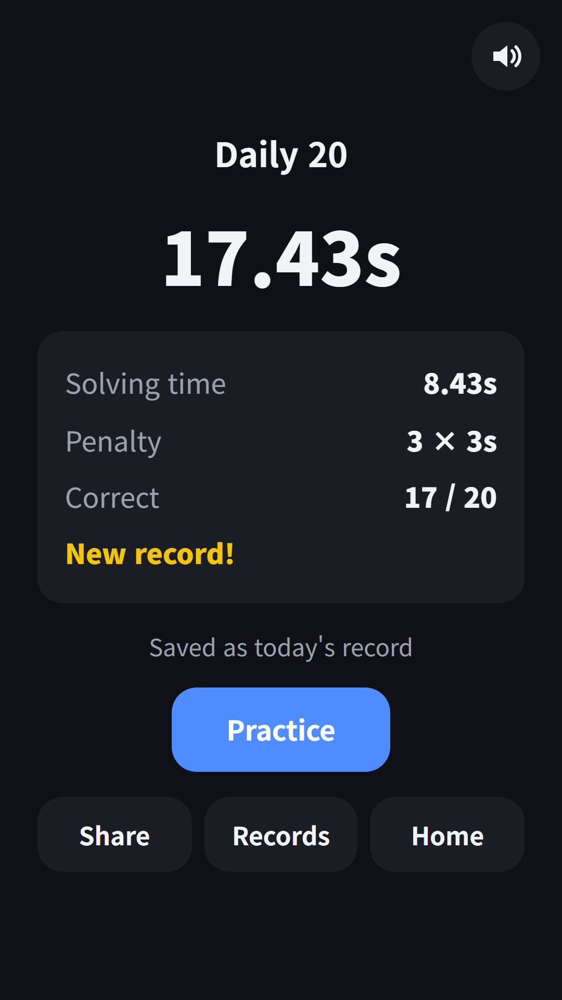
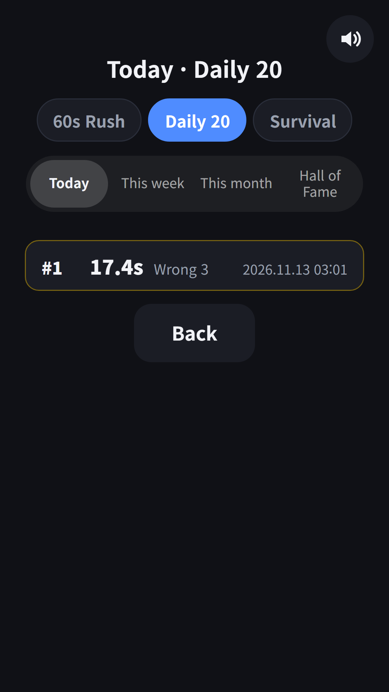

## Info
> **Lightning Math** — A mental math game where you pick the answer from four choices, fast. Free on Google Play, with ads. On Toss, play it inside [FDK Brain Age](/posts/hub-brain/).
{: .prompt-info }

## About the Game
Solve as fast as you can. Every question has four big answer buttons, so there is no typing, only quick thinking. Numbers are large, and the wrong choices are the mistakes people really make, like forgetting to carry. There are no lessons or hints, just speed.

## How to Play
- Solo: pick a mode and a difficulty, then tap the right answer among four
- Multiplayer: choose 2 to 4 players on one phone and the screen splits so everyone faces their own side. The first right answer scores a point, and a wrong answer locks you out until that question ends. First to the target score (5, 7 or 10) wins
- There is a pause button, and the run pauses when the app goes to the background

## Features
- 3 solo modes
  - 60-second Rush with combo multipliers (x2 at 5 in a row, x3 at 10, x4 from 15). A wrong answer costs 2 seconds
  - Today's 20 Questions: everyone gets the same 20 questions each day. Your result is your time plus 3 seconds per wrong answer, and only your first run of the day is recorded
  - Survival: 3 lives and a timer that shrinks as you answer
- 3 difficulty levels: single-digit sums, then two-digit sums and times tables, then multiplication, three-term sums and division
- Big readable numbers, sound and vibration feedback, TOP 10 records by day, week and month for each difficulty
- Each new run uses 1 heart. You get 5 hearts a day, and when they run out you can watch an ad to get 5 more
- Plays in 9 languages, no sign-up needed

Contains ads (banner and rewarded).

{: w="360" }
{: w="360" }
{: w="360" }
{: w="360" }
{: w="360" }

## Gameplay Video


## Download
- Google Play: <https://play.google.com/store/apps/details?id=com.fadongkwon.mental_math>
- Toss: Lightning Math inside [FDK Brain Age](/posts/hub-brain/)

{: w="200" .normal }

## You May Also Like
- [FDK Brain Age](/posts/hub-brain/) — a brain hub that checks vocabulary, memory, sequence, reaction, focus and calculation
- [Math Monsters](/posts/math-monsters/) — practice arithmetic by catching monsters

Follow updates on this blog and on [Instagram (@fadongkwon.soft)](https://www.instagram.com/fadongkwon.soft/).
