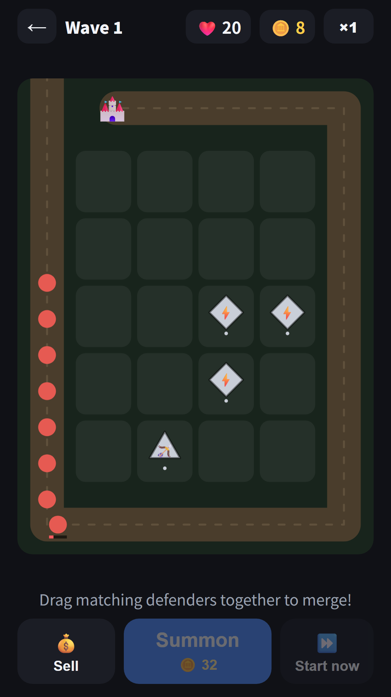
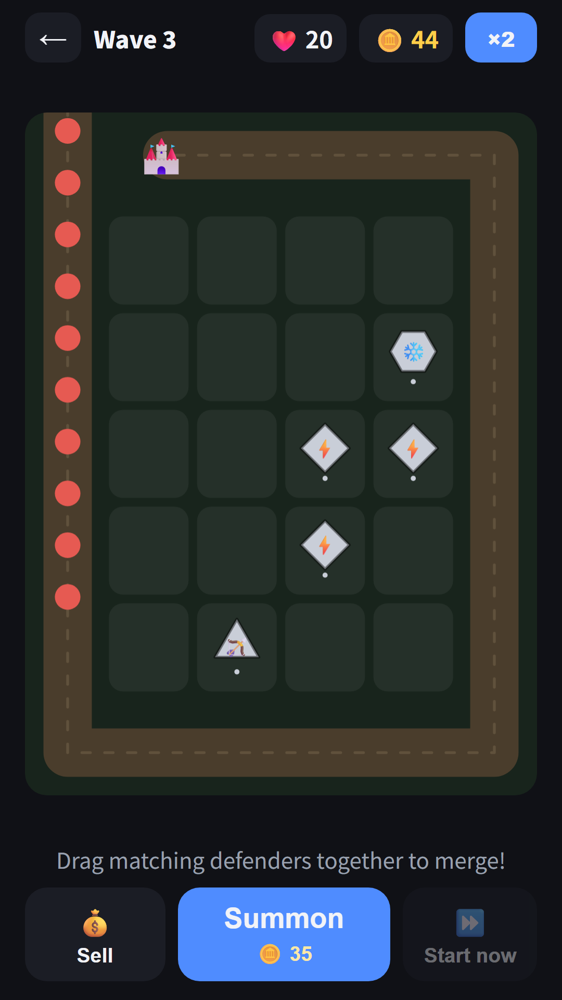
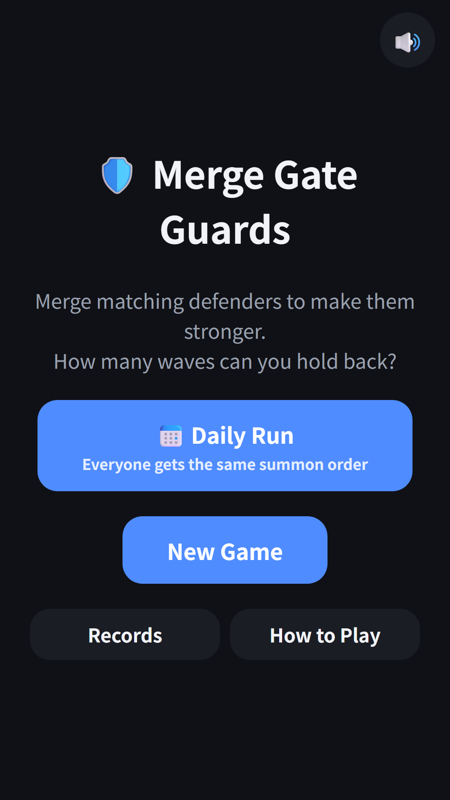
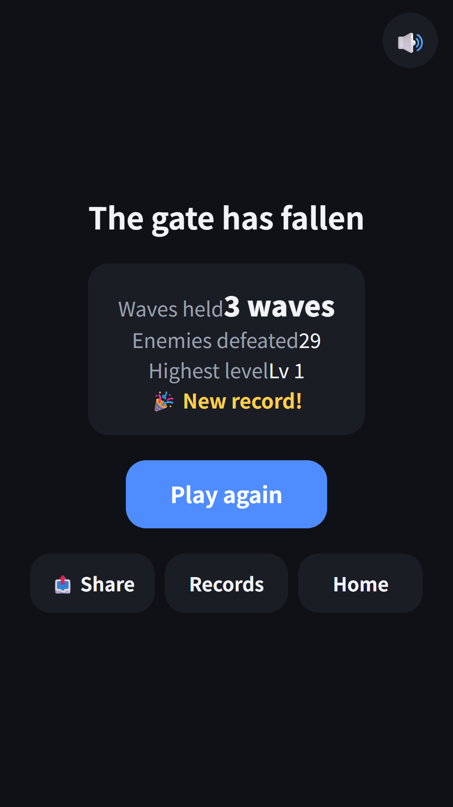
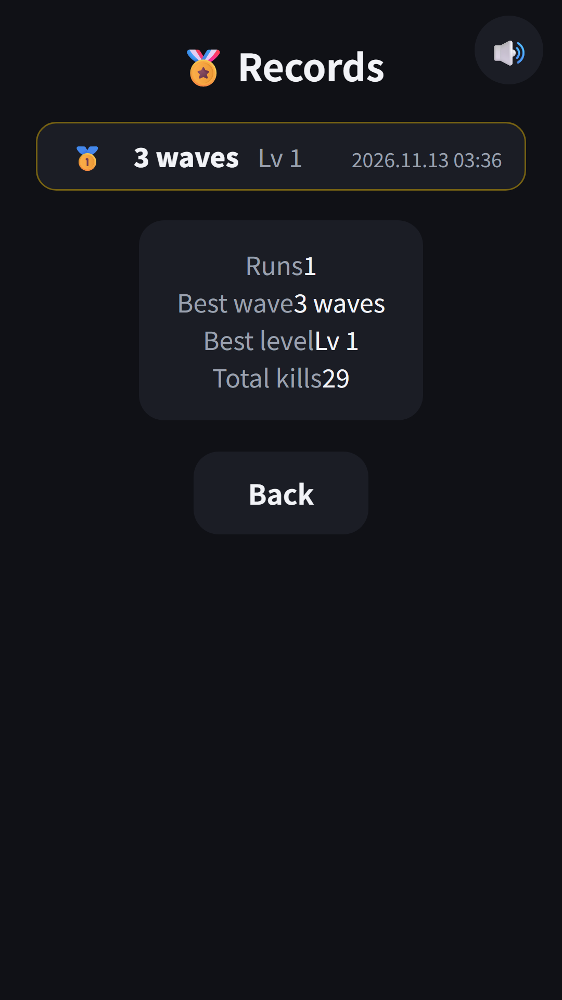

## Info
> **Merge Gate Guards** — Merge matching guards to level them up and defend the castle gate from enemies on a winding road. Free on Google Play, with ads. On Toss, play it inside [FDK Arcade](/posts/hub-arcade/).
{: .prompt-info }

## About the Game
Merge meets tower defense. Spend coins to summon a guard onto the board, then drag identical guards of the same level together to merge them into a stronger one. Enemies march along the road toward the gate, and your record is how many waves you hold.

## How to Play
- Spend coins to summon a random level 1 guard onto a free tile
- Drag a guard onto an identical one of the same level to merge it. Guards go up to level 7
- Drop one on a different guard to swap places, on an empty tile to move it, or on the sell button to sell it for coins
- Tap a guard to see its range
- Enemies that reach the gate cost you lives. You have 20, and a boss that reaches the gate takes 6 at once
- If you fall, you can watch an optional ad to replay the wave from its start, once per run

## Features
- 4 guard types: Archer for fast single shots, Cannon with splash damage, Ice to slow enemies, and Lightning that chains between enemies
- Normal, fast and tank enemies, plus a boss every 10 waves
- Endless waves: your record is how many waves you hold. Speed up with x2
- Today's Run: everyone gets the same summon order on the same day
- Continue where you left off and a Top 10 of your best records
- Plays in 9 languages, no sign-up needed

Contains ads (banner and rewarded).

{: w="360" }
{: w="360" }
{: w="360" }
{: w="360" }
{: w="360" }

## Gameplay Video


## Download
- Google Play: <https://play.google.com/store/apps/details?id=com.fadongkwon.merge_defense>
- Toss: Merge Gate Guards inside [FDK Arcade](/posts/hub-arcade/)

{: w="200" .normal }

## You May Also Like
- [FDK Arcade](/posts/hub-arcade/) — Brick Breaker, Snake, Whack-a-Mole, Merge Gate Guards and more quick arcade games in one hub
- [Merge Pop](/posts/merge-pop/) — drop and merge matching balls into bigger ones

Follow updates on this blog and on [Instagram (@fadongkwon.soft)](https://www.instagram.com/fadongkwon.soft/).
