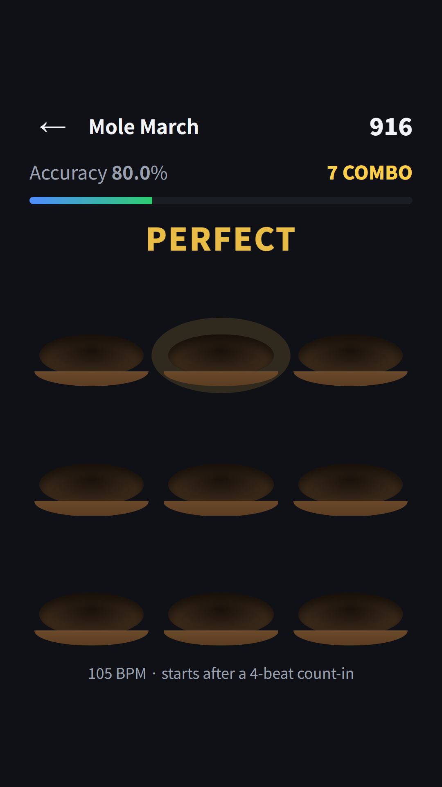
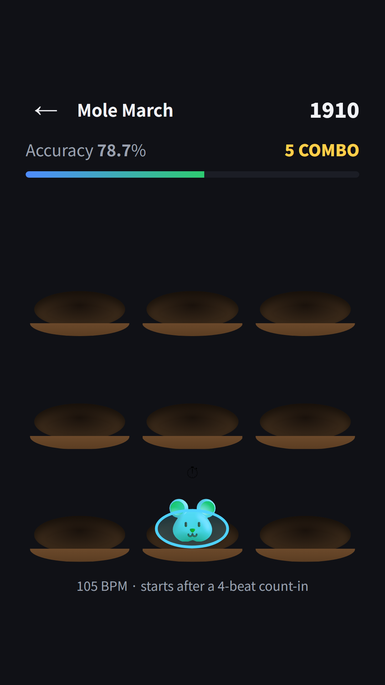
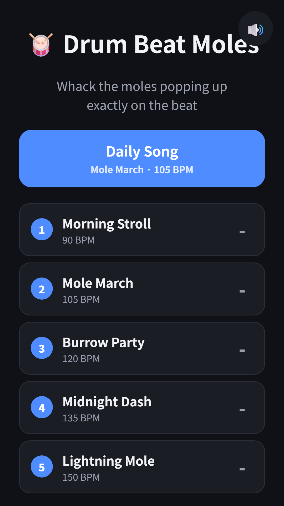
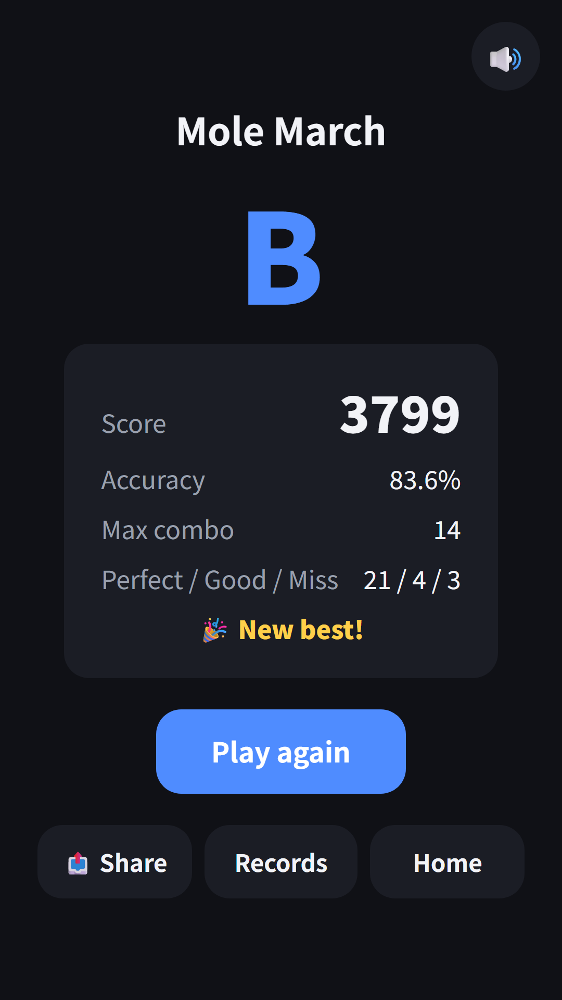
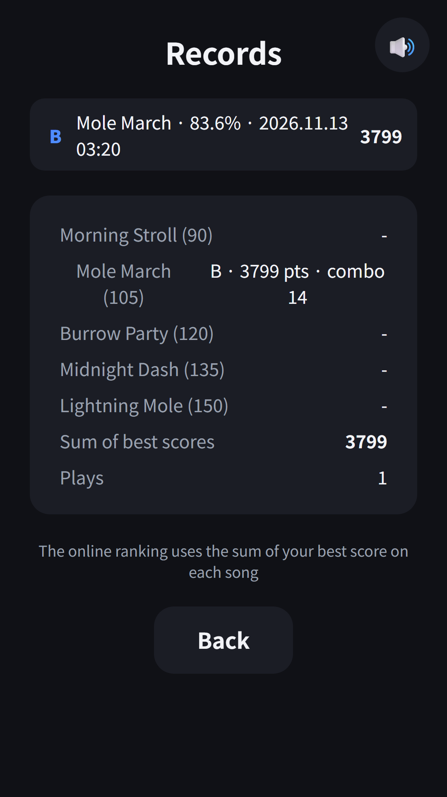

## Info
> **Drum Beat Moles** — A rhythm game where you whack moles right on the beat. Free on Google Play, with ads. On Toss, play it inside [FDK Arcade](/posts/hub-arcade/).
{: .prompt-info }

## About the Game
Moles pop out of a 3 by 3 field of holes, and you tap them in time with the music. A ring around each hole shrinks, and the beat lands the moment it fits the hole exactly. Tap then for the best score. The 5 songs are original tracks synthesized in code, from a relaxed 90 BPM walk to a 150 BPM sprint.

## How to Play
- Moles start popping up after a 4-beat count-in
- Tap a hole when its ring fits exactly. Perfect is within 50 ms, Good within 110 ms, and anything further off is a Miss
- Golden moles are worth triple. Hold moles ask you to keep pressing and release two beats later for double. From the fourth song, two moles come at once
- Combos raise your score multiplier, up to 2x
- Grades: S at 95% accuracy or more, A at 85%, B at 70%, and C below that
- After a C grade you can watch an optional ad to replay the same song right away, once per play

## Features
- Five original songs: Morning Stroll (90 BPM), Mole March (105), Burrow Party (120), Midnight Dash (135) and Lightning Mole (150)
- Today's Pick chooses the song and pattern for the day
- Beat calibration: tap 8 times along with the sound and the app measures your device's audio delay. Run it again if you switch earphones
- Best result per song, a Top 10, and your total across all five songs
- You get 3 hearts a day to start new songs, and you can watch an ad to refill them
- Plays in 9 languages, no sign-up needed

Contains ads (banner and rewarded).

{: w="360" }
{: w="360" }
{: w="360" }
{: w="360" }
{: w="360" }

## Download
- Google Play: <https://play.google.com/store/apps/details?id=com.fadongkwon.rhythm_mole>
- Toss: Drum Beat Moles inside [FDK Arcade](/posts/hub-arcade/)

{: w="200" .normal }

## You Might Also Like
- [FDK Arcade](/posts/hub-arcade/) — Brick Breaker, Snake, Whack-a-Mole, Drum Beat Moles and more quick arcade games in one hub
- [Whack-a-Mole](/posts/whack-a-mole/) — classic arcade mole whacking

Follow along on this blog and on [Instagram (@fadongkwon.soft)](https://www.instagram.com/fadongkwon.soft/).
