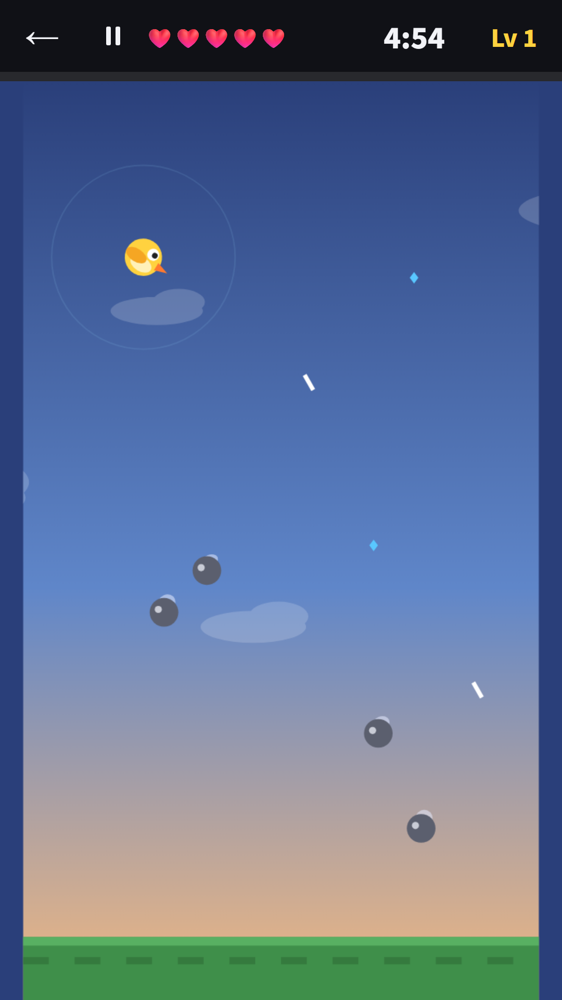
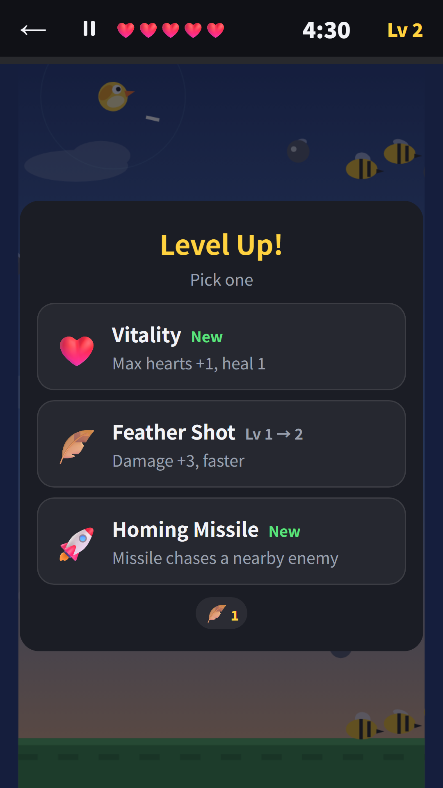
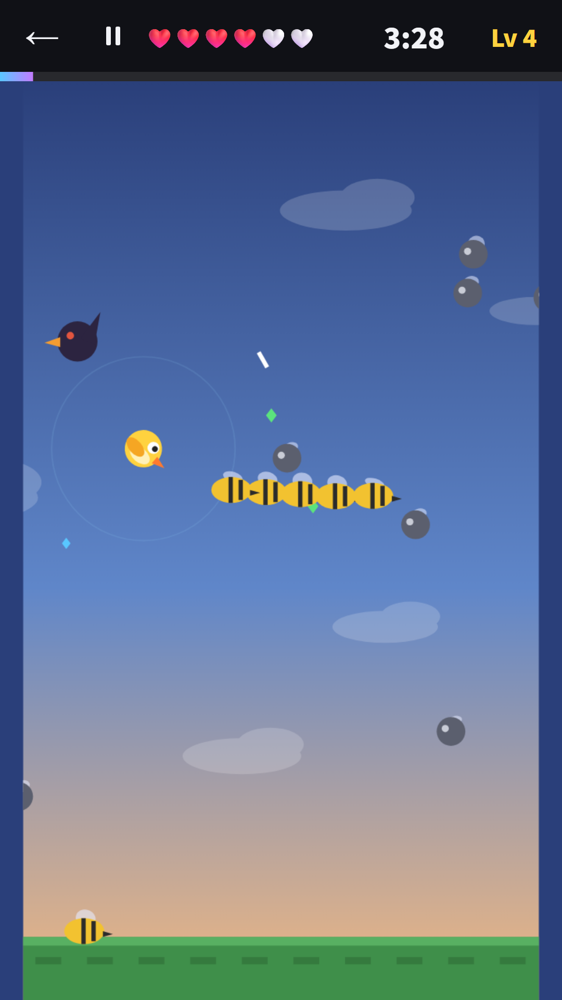
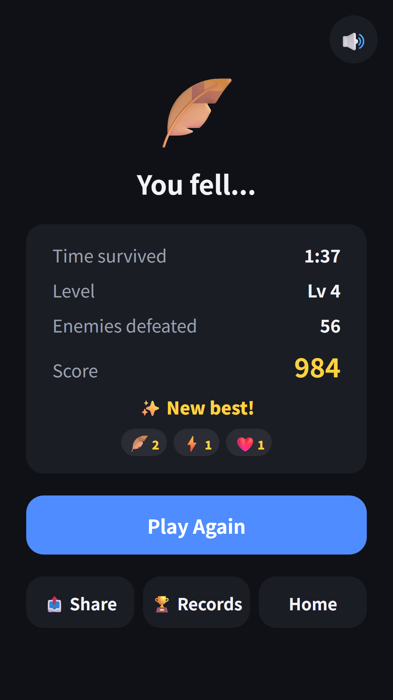
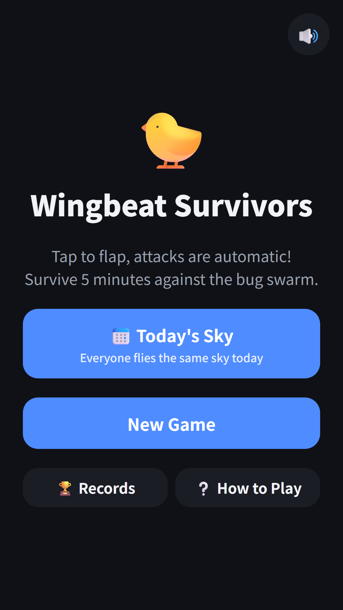

## Info
> **Wingbeat Survivors** — A survivor game where you tap to flap and your attacks fire automatically. Free on Google Play, with ads. On Toss, play it inside [FDK Arcade](/posts/hub-arcade/).
{: .prompt-info }

## About the Game
One-button flying meets the survivor genre. Your bird stays at the left of the screen and you only control its height. Weapons fire automatically while bug swarms pour in from the right. Defeated enemies drop gems that drift left with the sky, so you have to line up your height to grab them. Dodge, collect, power up.

## How to Play
- Tap to flap, hold to keep flapping. Your first tap starts the run
- The ceiling is blocked, and touching the ground costs you a heart. Eat a fruit to heal one
- Collect gems to level up, and the game pauses so you can pick 1 of 3 upgrades
- A Storm Eagle boss appears at 4:30. Last 5 minutes or defeat the boss to win
- Before a run starts, you can watch an optional ad to pick 1 of 3 upgrades to start with, once per run

## Features
- 8 upgrades, each up to level 5: Feather Shot, Spin Shield, Lightning and Homing Missile, plus Magnet, Vitality, Haste and Might
- 4 enemy types (fly, wasp, crow, balloon bug) and the Storm Eagle boss. They come thicker and tougher as time passes
- The upgrades you pick change a run a lot
- Today's Sky: everyone gets the same sky on the same day
- Resume a run, and a TOP 10 of your records
- Plays in 9 languages

Contains ads (banner and rewarded).

{: w="360" }
{: w="360" }
{: w="360" }
{: w="360" }
{: w="360" }

## Download
- Google Play: <https://play.google.com/store/apps/details?id=com.fadongkwon.survivor_bird>
- Toss: Wingbeat Survivors inside [FDK Arcade](/posts/hub-arcade/)

{: w="200" .normal }

## You May Also Like
- [FDK Arcade](/posts/hub-arcade/) — Brick Breaker, Snake, Doubling Snake, Wingbeat Survivors and more quick arcade games in one hub
- [Tap Bird](/posts/tap-bird/) — classic one-button flying through gaps

Follow updates on this blog and on [Instagram (@fadongkwon.soft)](https://www.instagram.com/fadongkwon.soft/).
