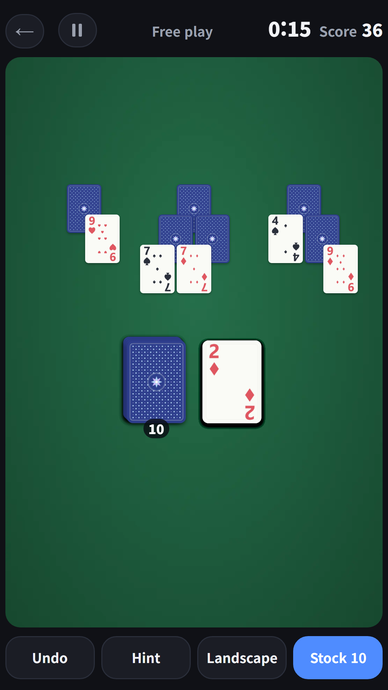
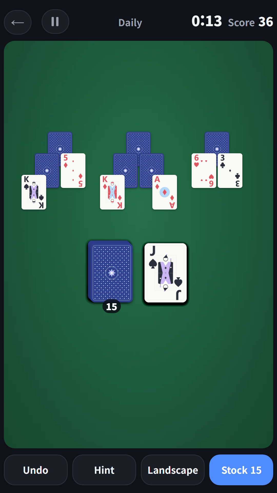
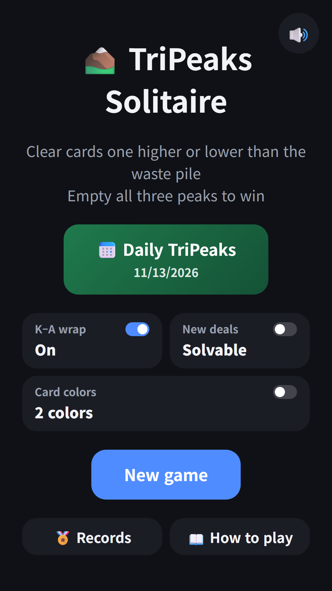
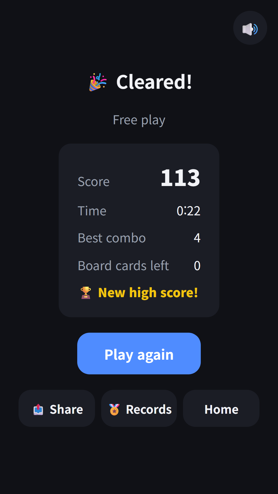
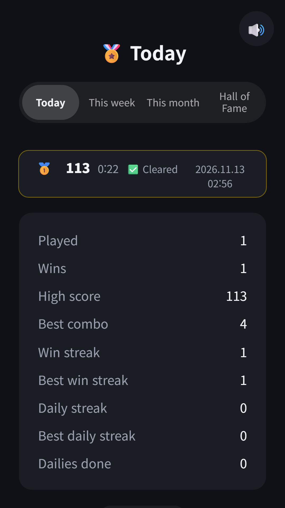

## Info
> **TriPeaks Solitaire** — Clear three peaks of cards by chaining cards one rank up or down. Free on Google Play, with ads.
{: .prompt-info }

## About the Game
Twenty-eight cards are stacked into three peaks, with one draw pile beside them. Tap a card that is one rank above or below the top of the discard pile and it moves up. Suits do not matter. The longer your chain, the bigger the combo and the score, so choosing which peak to open first is the fun part.

## How to Play
- Only the 10 cards on the bottom row start face up. A card above turns face up once the two cards covering it are cleared
- A face-up card one rank away from the discard pile top moves with a single tap
- If nothing fits, tap the draw pile to flip one card. The pile is never recycled
- Kings and Aces wrap around by default (an Ace after a King). You can turn this off in the options on the home screen
- Clear all 28 cards to win. When you are stuck, choose between undo, checking your score and a new deal

## Features
- Combo scoring: each card in a row scores one more point than the last, and flipping the draw pile restarts the combo. Clearing a peak top gives a bonus, and clearing all 28 adds points for every card left in the pile
- Winnable deals only: Daily Deal and new games use deals the solver confirmed can be cleared. You can switch to random deals
- Daily Deal: everyone gets the same board on the same day. Only a cleared board counts as complete, so your streak builds on wins
- Hints and undo, three free uses of each per game, then they cost a heart
- Score ranking, and stats for win streaks, best score and best combo, plus continue where you left off
- Clear card art, an optional four-colour deck, and portrait or landscape play
- 9 languages, no sign-up needed

Contains ads (banner and rewarded).

{: w="360" }
{: w="360" }
{: w="360" }
{: w="360" }
{: w="360" }

## Download
- Google Play: <https://play.google.com/store/apps/details?id=com.fadongkwon.tripeaks>

{: w="200" .normal }

## You Might Also Like
- [Golf Solitaire](/posts/golf-solitaire/) — clear 35 cards one rank up or down
- [FDK Card Games](/posts/hub-card/) — Klondike, Spider, FreeCell, TriPeaks and more solitaire games in one hub

News comes through this blog and [Instagram (@fadongkwon.soft)](https://www.instagram.com/fadongkwon.soft/).
