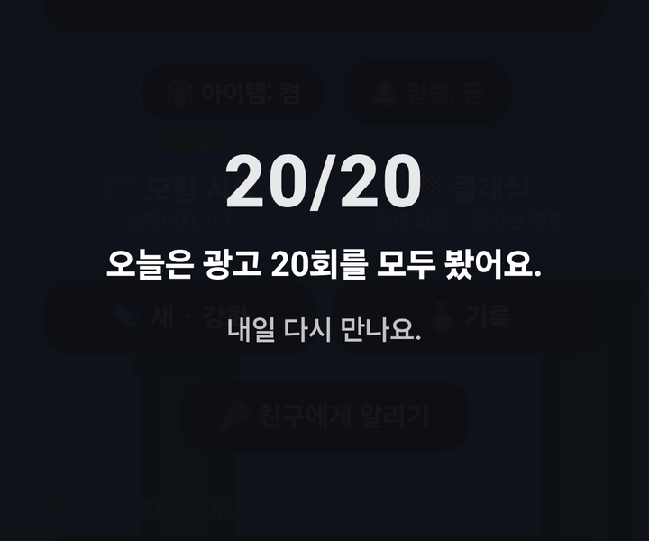
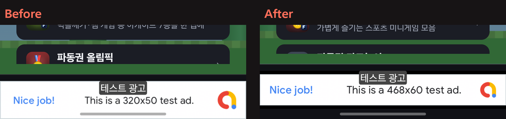

> **Update, November 19** — The appeal was rejected. At 1:04 p.m. on November 19, fifteen hours after the acknowledgment email, a reply arrived with no reasoning: the account will not be reinstated, there will be no further payments, and no new account is allowed. The result and what follows from it are in [the follow-up post](/posts/google-ads-appeal-rejected/).
{: .prompt-info }

> **This post has no ending yet.** I filed the appeal on the night of November 18, and as I write this there is no answer. The acknowledgment email said processing may take a week or more. Every cause below is my own estimate from my own data, and I do not know whether the account will be restored.
{: .prompt-warning }

At 8:03 a.m. on November 18, two emails arrived at the same minute. One said "Your Google publisher account has been disabled." The other said the payments account tied to it had been closed. The reason: **invalid traffic or other activity that violates the publisher policies or terms of service**. Ad serving stopped across every product linked to the account, AdMob included, and a 30-day payment hold was placed while the final payout is calculated.

This is the second time my ad account has stopped. The first suspension, on August 26, lifted after 29 days, and the cause was my own development phone. That story is in [the first suspension post](/posts/invalid-traffic-suspension/). Since then, debug builds use only test ads, development devices are registered as test devices, release builds request only sample ads on emulators, rooted or debuggable environments, and a gate stops any release build that contains a test ID. It stopped anyway.

Two things are different from the first time. First, this is not a fixed-length suspension but a "disabled" account. Second, **there is an appeal form.** The email asks me to fix my apps to comply, then submit the form with "a comprehensive analysis of the traffic believed to have caused the invalid activity and any other causes." It also says that specific account activity cannot be shared because it could be used to get around the detection systems. They will not tell me the cause, and they want my analysis of the cause.

So I spent that day investigating. This post is the record of that investigation and the appeal. No amounts. The only numbers are impression and click counts and app counts.

## First wall: the API closed

Normally I pull daily per-app impressions and clicks from the AdMob Reporting API into a CSV ledger. On the day of the suspension, the same API returned **HTTP 401** at the account-list step, saying the publisher could not be authenticated. The console was locked as well.

All I had was the ledger. The last successful pull was at 0:44 a.m. on November 18, seven hours before the suspension, so data through November 17 is there. But the ledger has only two dimensions: **date × app**. I had never stored country, OS version, app version or ad format (banner, interstitial, rewarded). That turned out to be the most painful gap in this investigation, and I come back to it at the end.

## The anomaly in the ledger

After merging rows where the same app on the same date appeared twice under names that differed only by spacing, I split the period from September 27, when ads came back after the August suspension, into segments and computed daily averages. I cut the segments at dates when I changed something on my side.

| Period | What changed | Impr./day | Clicks/day | CTR | Apps with impr./day |
|---|---|---:|---:|---:|---:|
| 9/27–10/23 | Ads resumed | 349 | 8.3 | 2.36% | 17.4 |
| 10/24–11/02 | In-app per-user ad caps removed | 718 | 10.1 | 1.41% | 29.2 |
| 11/03–11/05 | Development PC replaced | 885 | 9.7 | 1.09% | 29.7 |
| 11/06–11/13 | Several new apps launched | 909 | 14.2 | 1.57% | 31.8 |
| **11/14–11/17** | **Nothing changed** | **1,797** | **84.0** | **4.68%** | **87.5** |

In the first four segments impressions grow gently as apps are added, and CTR stays in the 1–2% range. Only the last segment looks different. Daily figures make it clearer.

| Date | 11/10 | 11/11 | 11/12 | 11/13 | 11/14 | 11/15 | 11/16 | 11/17 |
|---|---:|---:|---:|---:|---:|---:|---:|---:|
| Impressions | 871 | 1,279 | 1,019 | 722 | 1,547 | 1,149 | 2,336 | 2,155 |
| Clicks | 7 | 15 | 23 | 7 | 72 | 98 | 69 | 97 |
| Apps with impressions | 32 | 32 | 34 | 39 | 85 | 77 | 91 | 97 |

On November 14 the number of apps with impressions went from 39 to 85 in a single day. Over the next four days clicks ran six to eight times the usual level. Those four days are unconfirmed estimates pulled before the suspension and may still change, but probably not enough to change the shape.

I pulled three signals out of this.

**1. Dormant apps waking up.** 106 apps had impressions during November 14–17. **36 of them had no impressions at all in the week of November 7–13.** Some had last shown an ad in early October. It is hard to believe that real users opened dozens of dormant apps on the same day.

**2. Clicks at or above impressions.** During November 14–17 there were 7 app-days where clicks equaled or exceeded impressions. One small app had 14 impressions and 15 clicks in a day; another had 11 impressions and 13 clicks. Since September 27 there had been 10 such app-days in total, and 7 of them fell in these four days.

**3. It did not stop after a day.** There had been days before when one app's CTR spiked: September 27, the first day ads resumed, and October 21, for example. Each was one app for one day, back to normal the next. **Many apps at once, four days in a row** had never happened before.

## Five hypotheses I raised and ruled out

To find what caused the anomaly, I suspected my own side first. The first suspension was my own device, after all. There were five suspects, and I ruled each out with evidence.

| Hypothesis | Why I suspected it | Why I ruled it out |
|---|---|---|
| ① An emulator on the new PC | I replaced my development PC on November 3. Its emulator might not be registered as a test device | The new PC has no emulator. Zero AVD definitions, zero system images, zero traces of use. Even if there were one, release builds request only sample ads when they detect an emulator |
| ② Work moved to another AI tool | I had moved some repetitive work to another AI coding tool, and its agent might have done something wrong | I went through that tool's 21 conversation logs, with timestamps. The only pages it opened in a browser were consoles and social media management screens. Zero records of opening an app or site with ads, zero ad clicks. It only read the ad code. The point where I switched models inside that tool (11/16) also came after the anomaly began (11/14) |
| ③ The development phone | It was the cause last time | The phone's advertising ID matches the test device value registered in the AdMob console. Only 10 of my apps ran on it during 11/14–17, mostly debug builds |
| ④ Weakened safeguards | Several sessions editing the same repository can drop something | I checked the test device list, environment detection and release gate in git history. No weakening changes since September |
| ⑤ Removing the ad caps on 10/24 | That day I removed the in-app per-user daily ad caps (10 rewarded, 8 interstitial) | CTR actually fell after the change, from 2.36% to 1.41%. The anomaly began three weeks later |

A little more on ②. An AI agent does console work in my browser, so I seriously considered whether it could have clicked ads. What I could check was the tool-call record it left (page navigations, click targets), so the conclusion is "unrelated, within the records." But because those records existed, I could rule it out within a day.

I checked ③ against data one more time. Several of the apps with the largest anomaly had **exactly one installed device** according to Play Console statistics, and that device was my development phone. The phone's usage history showed two of those apps were last launched on November 7 and October 10. Those apps logged impressions and clicks on November 14–17, while the only device they were installed on did not open them during that period.

## The remaining estimate: devices not counted as Play installs

With my own side ruled out, one question remained. **Which devices produced those impressions and clicks?**

I went back to Play Console statistics. At the time, new installs were tallied through November 15 and installed users through November 14.

- All 14 apps I examined had 0–2 new installs on November 14–15, a normal level.
- Five of the dormant apps that woke up had zero new installs over November 10–15.
- Account-wide, daily new installs stayed in the 18–37 range with nothing unusual.

Ad activity jumped across dozens of apps at once while Play installs stayed flat. My estimate:

> **Devices that are not counted as Play installs ran release builds of many of my apps and produced the impressions and clicks.**

A Play APK can be extracted from a device or downloaded from outside sites and installed elsewhere, and those devices never show up in Play statistics. Beyond that I could not go. Whether this traffic came from Google's own automated checks (review or security scanning devices) or from a third party's automation that harvests app catalogs, **I could not tell.** The country, OS version and device distribution that could separate the two were not in my ledger, and the API was closed.

## Writing the appeal

The form was the shared AdSense and AdMob appeal form linked from the AdSense help page on invalid traffic. The suspension email itself had no link to the form, so I found it through the help pages.

I first wrote long drafts for each question in Korean and English. When I opened the actual form, though, **each field was capped at 1,000 characters**, and the "additional information" field my draft assumed did not exist. I cut the drafts down to fit. Here are the fields and what went into each.

| Field | What I wrote |
|---|---|
| How users arrive and how I promote | Solo developer, about 97 apps on Play. Most users come from Play search and recommendations. Promotion is limited to organic posts on my blog, Instagram, Shorts and Threads plus cross-promotion between my own apps. Never used paid ads, purchased traffic or incentivized installs |
| Previous violations | The 29-day suspension starting August 26, its cause (self-impressions from my development device), and the five measures added afterward |
| Cause | The figures from November 14, flat Play installs, the evidence that it was not my device, the estimated conclusion, and a disclosure of my own change |
| Changes | Measures already in place plus four planned ones |
| Logs and reports | Daily average table by period, daily figures for the most affected app, the Play install comparison, and the fact that country, IP and OS could not be checked because of the API 401 |

This is the English text that actually went into the "cause" field. The sentences are short because of the 1,000-character limit.

```text
My best estimate from the data available to me:
1. The pattern changed abruptly on Nov 14. Apps with impressions per day:
   39 on Nov 13, then 85, 77, 91, 97 on Nov 14-17; 36 of them had no
   impressions since before Nov 7. Daily clicks: average 8-14 before,
   then 72, 98, 69, 97. CTR: 1.57% to 4.68%. Some small apps had more
   clicks than impressions.
2. Play installs did not change: 0-2 new installs per app on Nov 14-15,
   zero for the dormant apps.
3. It was not my device. ...
4. Conclusion: automated traffic from devices not counted as Play
   installs, running release builds across about 90 of my apps.
5. Disclosure: on Oct 24 I removed in-app daily ad caps. CTR then fell;
   the anomaly began 3 weeks later.
```

I held to four rules while writing it.

1. **Call an estimate an estimate.** The first line says this is my best estimate from the data available to me. If I claimed to know the source and it contradicted Google's logs, everything else in the appeal would be doubted too.
2. **Disclose unfavorable changes first.** I did not have to mention removing the ad caps on October 24. But "I changed things so each user sees more ads" is something that could show up in their logs, so I stated it myself and attached the figure showing CTR fell afterward.
3. **Write what is not done yet as "I will."** I had already changed the code for some of the fixes that night, but until a new version is on Play it has no effect on anyone's phone. That is exactly what I learned during the first suspension. So everything is written as "I will."
4. **Leave out promises I cannot keep.** I wanted to say I would send more data once Play statistics for November 16–17 were final, but the form has no way to add material later. That sentence came out.

I also weighed when to submit: wait two more days for Play statistics, or file now. Because the text is written "as of statistics tallied through November 15," filing immediately does not make anything in it untrue. I saw no reason to drag it out and filed that night. I got the confirmation screen and the acknowledgment email.

## The four promised fixes, and where they stand

These are the four items in the "changes" field and their status as I write this.

| Promise | What it means | Status now |
|---|---|---|
| (a) Sample ads only outside Play installs | If the install source is not the Play Store, request Google sample ads instead of live ads | In code, **not released** |
| (b) A daily cap of 20 | 20 ads per user per day (rewarded plus interstitial), shown on screen as n/20; at 20, play stops for the day. Play builds only | In code, **not released** |
| (c) Banner placement review | Check every app so banners do not invite accidental clicks | Full audit done, wrapper fixes in code, **not released** |
| (d) Daily per-dimension collection and alerts | Collect daily down to country, OS version and ad format; alert when app count, clicks or CTR shift sharply, then analyze | Collection and detection scripts written. With the account disabled, **never run on real data** |

(a) adds one install-source check to the existing environment detection.

```kotlin
fun untrustedReason(context: Context): String? {
    if (isDebuggable(context)) return "debuggable"
    if (isEmulator()) return "emulator"
    if (isRooted(context)) return "rooted"
    // Runs not installed by the Play Store (adb, sideloaded APK, other stores) never request live ads
    val installer = installerPackage(context)
    if (installer != PLAY_STORE_INSTALLER) return "installer=${installer ?: "unknown"}"
    return null   // null means an ordinary user device
}
```

When this function returns a reason, that run uses only Google sample ad units. If my estimate is right, this one check would have blocked the November 14–17 traffic. If it is wrong, it would not have. Either way, it closes the path by which an APK spread outside Play can pile impressions onto my account.

For (b), instead of "bringing back" the old caps, I set a single number and made it visible. This is the screen when the cap is reached (debug build on the development phone, test ads).


_Once today's count hits 20, ads and play both stop for the day_

The Apps in Toss builds on Toss do not get this cap. This incident concerns the AdMob account, and Toss ads sit under a separate platform's policy, so I limited the change to Play builds.

## What the audit of 125 banner builds found

For (c) I started with an audit. I opened the source of all 125 Android build variants (flavors) that carry live ads and measured, for each gameplay screen, **what the player presses right above the banner** and how far away it is.

| Risk | Count | Typical shape |
|---|---:|---|
| High | 20 | A canvas or touch area runs to the bottom edge, 0px from the banner, or a button pressed continuously sits within 9–16px of it |
| Medium | 49 | Toolbars, tab bars or pinned bottom buttons near the banner, but not pressed often |
| Low | 52 | Enough bottom margin, or nothing to press at the bottom |
| No banner | 4 | The siege games (interstitial and rewarded only) |

I also confirmed a structural problem. The wrapper creates the banner once at launch and **keeps it on every screen**, gameplay included, and the web side had no way to hide it per screen. As I read them, AdMob's banner guidelines list banners on gameplay screens where users interact continuously, and banners right next to buttons or navigation, as discouraged implementations. Every game app had a structure that could fall under that.

One item I could not settle from source alone was confirmed on a real device right away. **The banner overlapped the gesture navigation bar.** With targetSdk 36 the app draws under the system bars, and the wrapper's root had no bottom inset handling. A finger swiping up from the bottom to go home passed right over the banner.


_Left, the gesture bar sits on the banner; right, the banner sits above the bar (debug build, test ad)_

During the first suspension in August I fixed a banner drawn over content. This time it was the system bar. I could not confirm how long it had been like this. Three changes went into the wrapper:

- A bottom inset equal to the system navigation bar, lifting the banner above it
- A **10dp spacer strip** between the web view and the banner that does nothing when tapped (with a 1dp divider on top)
- The banner's height reserved before it loads, so the screen does not jump at load time and cause a mis-tap

Still, this audit does not let me say banner placement was the cause. The ledger's impressions and clicks combine banner, interstitial and rewarded, so formats cannot be separated, and apps with no banner at all have shown big CTR spikes on small samples. Several "high" risk apps also had average CTR. The banner review is not an explanation of the cause. It found defects worth fixing whatever the cause turns out to be.

## What I read in Google's documentation

After filing, I reread the AdSense and AdMob help pages on invalid traffic. As I read them, this is what they say. These are my summaries, not their wording.

- **Traffic created by third parties is still the publisher's responsibility.** Whoever generated it, invalid traffic on the account is something the publisher must manage. "It was not me" is a starting point, not an excuse.
- **If an appeal is denied, the decision is final.** So it had to be the most accurate thing I could send in one shot.
- **They recommend breaking reports down by app, ad unit and country.** Had I been looking at it that way, I would have seen this anomaly in one day, not four.

## The part that hurt most: I never stored the dimensions

Nearly every limit in this investigation came from one thing: **I never routinely stored country, OS version, device or ad format.**

With those dimensions I could have answered:

- Did OS versions cluster on one or two values? → automated devices or people
- Which countries? → Google's own infrastructure or somewhere else
- Banner clicks, or interstitial and rewarded clicks? → whether banner placement matters

I needed all of it only after the suspension, and by then the API was closed. If you wait until something breaks to collect data, it is already too late. So the collection script for (d) pulls country, OS version and ad format combinations daily on top of date × app, and raises an alert when apps with impressions, clicks or CTR jump well above the trailing baseline. Running it over the old ledger with November 17 as the reference day produced an alert (97 apps with impressions against a 28-day baseline of 30). It also flagged the August development-phone incident only at "warning" level, which confirmed the detector does not catch every pattern, especially small self-impressions.

Looking at the ledger now, things went wrong on November 14, and I found out on the morning of the 18th when the email arrived. For four days nobody looked at the ledger.

## What remains

- **The appeal result.** The acknowledgment email said it could take a week or more. Restored or denied, I will add the result to this post.
- **Releasing (a), (b) and (c).** The code is changed, but it does nothing until new versions are on Play. With ads stopped, releasing now protects nothing, but if the account is restored, the release must be done before ads start serving again. That is exactly the ordering I failed to account for last time.
- **Finding the source.** If the account is restored, on day one I plan to backfill per-dimension data from November 10. It will be the first chance to see the country and OS distribution of the November 14–17 traffic.

## Lessons you can reuse

1. **Do not store ad reports by date × app only; keep country, OS version and ad format too.** When the account is suspended the API closes, and then it is too late.
2. **Watch the number of apps with impressions.** This anomaly showed first, and most clearly, in how many apps had impressions, before clicks. For a developer with many apps it is the cheapest alarm there is.
3. **Check the install source.** A Play APK can spread outside Play. There is no reason for a run that was not installed by Play to request live ads.
4. **Check banners on a real device with gesture navigation.** Source reading and emulators did not show the system bar overlap.
5. **In an appeal, call estimates estimates, disclose unfavorable changes first, and write unfinished work as "I will."** They have the logs; you do not.
6. **If an AI agent drives your browser, keep its tool-call records.** I could rule out one suspicion within a day only because those records existed.

This post has no ending. I do not know the cause or whether the account will come back. But I thought it was right to write down now what I looked at, what I ruled out and what I submitted. The other incidents I hit while shipping are collected in [the 21 launch incidents retrospective](/posts/launch-incidents/).

My apps are listed under [GAMES](/ko/games/) and [APPS](/ko/apps/), and some can be played [right in the browser](/play/). Updates go out on this blog and on [Instagram (@fadongkwon.soft)](https://www.instagram.com/fadongkwon.soft/).

> The platform does not disclose the grounds for invalid traffic decisions. The analysis in this post is my estimate from my account's ledger and Play statistics, and does not represent Google's judgment or the outcome of the appeal.
{: .prompt-info }
