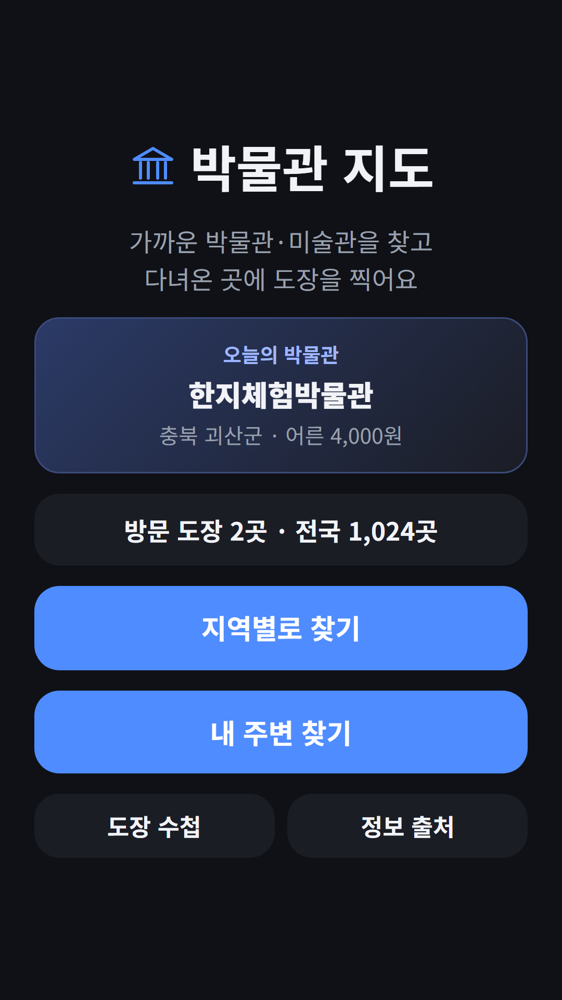
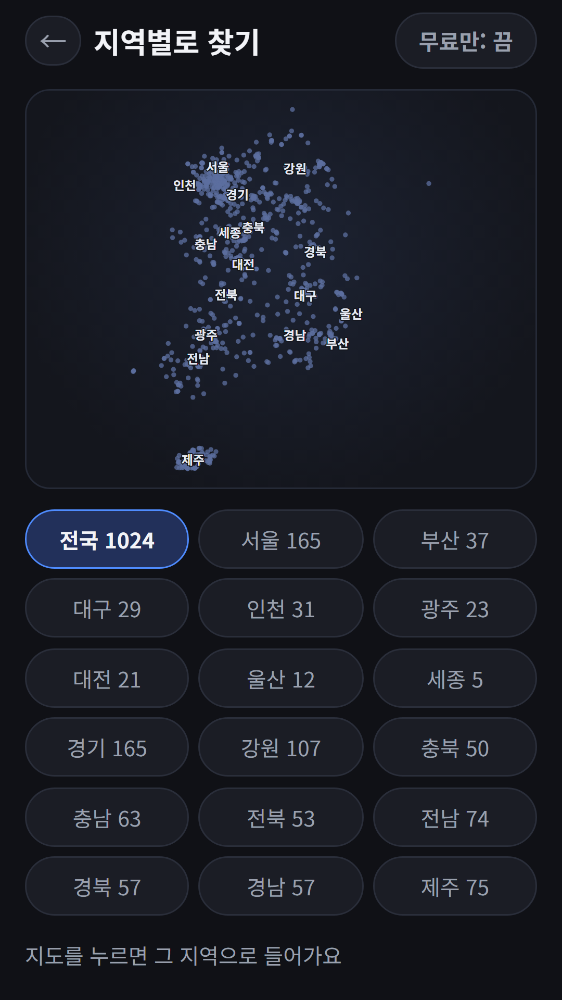
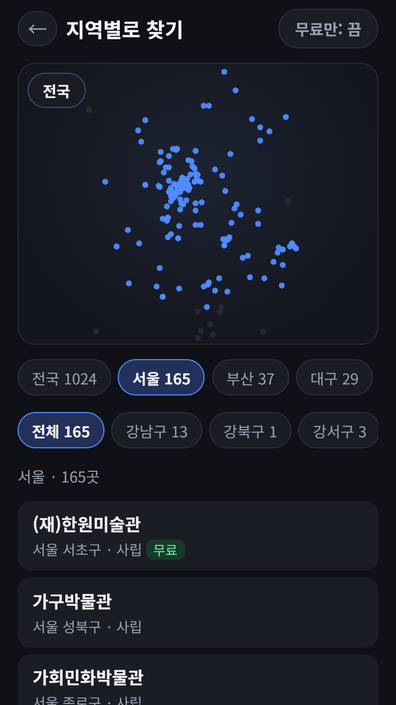
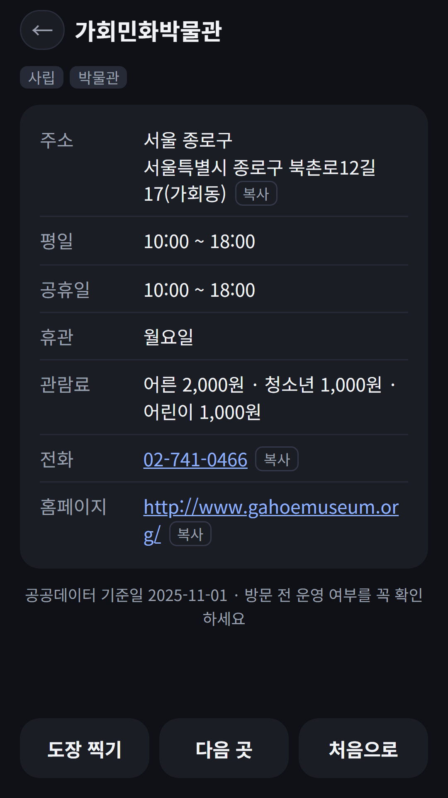
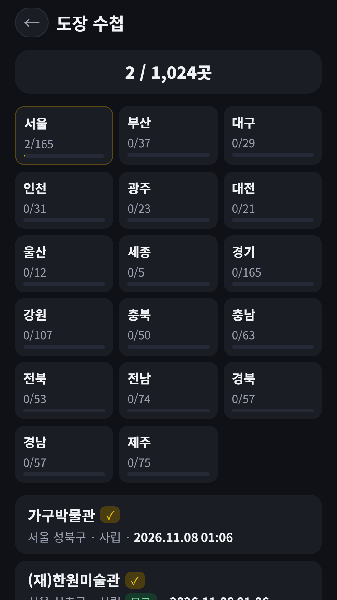

## Info
> **Korea Museum Map** — find museums and galleries across Korea by region or near you, check address, hours and admission, and stamp the places you visit. Free on Google Play, with ads. On Toss it lives inside [Weekend Life](/posts/hub-weekend/).
{: .prompt-info }

## What it is
It carries the Korean government's "National Museum and Art Gallery Standard Data" from data.go.kr: 1,070 records merged into 1,024 places. Each place shows its address, opening hours, closing days and admission, and you can filter for the 571 that list free admission. The map uses no external map service: every place is a dot, and together the dots draw the shape of the country.

## How it works
- Browse by region: tap a province on the map to go in, then narrow to a city or district
- Museums near you: location is requested only when you tap the button, and the nearest places are listed by distance. It is used on the device only for the distance calculation and is never stored or sent
- Details: type, address, weekday and holiday hours, closing days, admission and fee notes, facilities, transit, phone and website
- Stamp book: stamp a place you have visited, the date is kept, and the book collects them
- Museum of the day: one recommended place per date
- The Next button on the detail screen steps through the list you were browsing

## Good to know
- The place data is bundled in the app, so the first screen appears right away
- Each place shows the date its data was recorded and a reminder to check before you go
- Current exhibitions and facility descriptions are not included
- The app text, place names and addresses are in Korean. No sign-up needed
- A Museum of the Day reminder can be turned on

The app contains ads (banner and interstitial). All information is available without watching an ad.

{: w="360" }
{: w="360" }
{: w="360" }
{: w="360" }
{: w="360" }

## Gameplay Video


## Download
- Google Play: <https://play.google.com/store/apps/details?id=com.fadongkwon.museum_map>
- Toss: 'Museum Map' inside [Weekend Life](/posts/hub-weekend/)

{: w="200" .normal }

## Data source
Data.go.kr "National Museum and Art Gallery Standard Data" (provided by local governments, downloaded November 2026). Reference dates differ by facility, so hours, closing days and fees may have changed.

## You might also like
- [Weekend Life](/posts/hub-weekend/) — a hub of travel timing, museum and home-workout tools in one app

Follow along on this blog and on [Instagram (@fadongkwon.soft)](https://www.instagram.com/fadongkwon.soft/).
