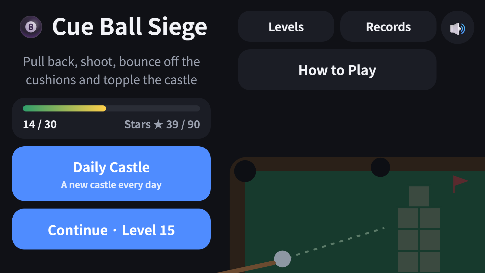
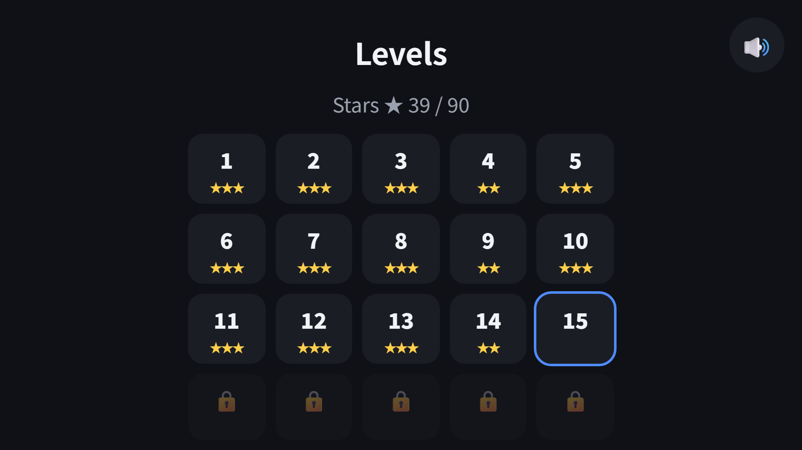
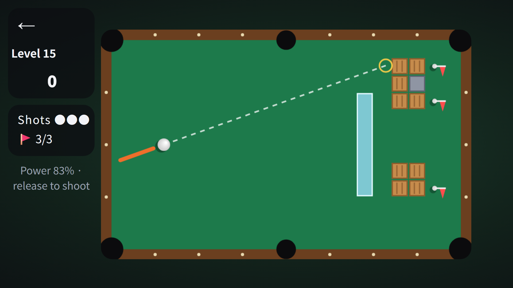
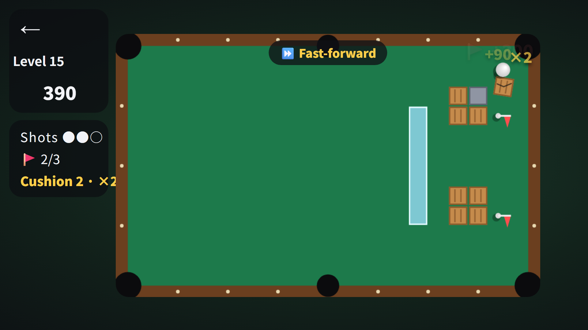
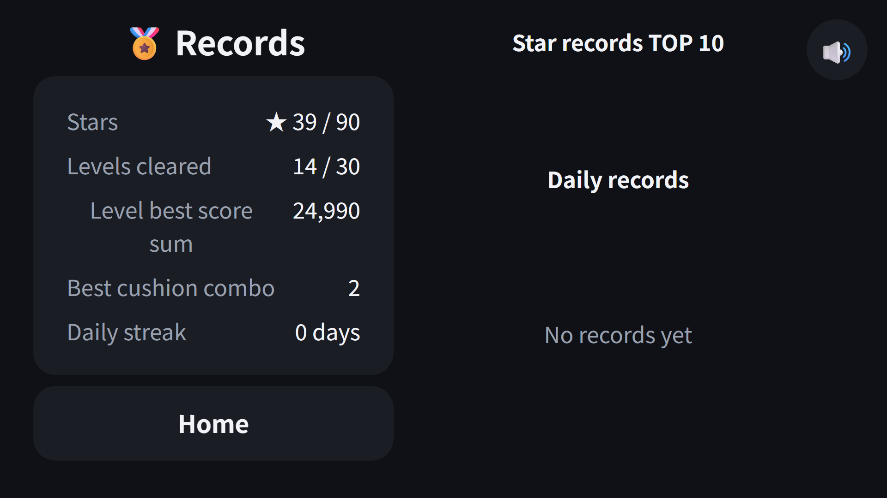
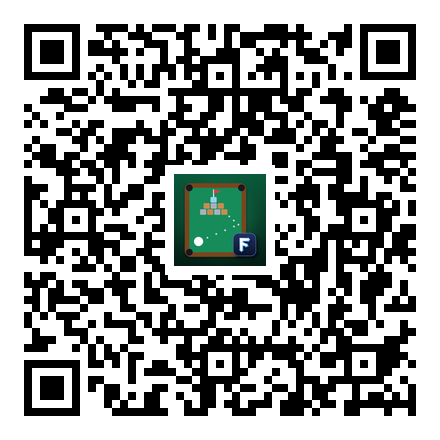

## Info
> **Cue Ball Siege** — a landscape physics puzzle where you bank the cue ball off cushions to knock down block castles and their flags. Free on Google Play, with ads (no banner ads).
{: .prompt-info }

## What it is
Part billiards bank-shot puzzle, part castle-toppling physics game. Each cushion rebound boosts your shot multiplier, and landing a three-cushion shot awards an extra ball.

## How to play
- Press and pull back to aim; a longer pull shoots harder, and the aim line bends once off the first cushion
- Glass, wood, and stone break differently, grey pillars never break, and blocks knocked into pockets score too
- Every cushion hit in a single shot raises your multiplier up to x3—three cushions in one shot earn an extra shot
- 30 levels (up to 3 stars each) plus a Daily Castle

## Good to know
- Optional rewarded ads grant one extra shot per level if you want another try
- Also included inside the [FDK Siege](/posts/hub-siege/) hub app
- Plays in 9 languages with no bottom banner covering the landscape view

Free to play. Contains ads, including optional rewarded ads.

{: w="560" }
{: w="560" }
{: w="560" }
{: w="560" }
{: w="560" }

## Download
- Google Play: <https://play.google.com/store/apps/details?id=com.fadongkwon.billiards_castle>

{: w="200" .normal }

Follow along on this blog and on [Instagram (@fadongkwon.soft)](https://www.instagram.com/fadongkwon.soft/).
