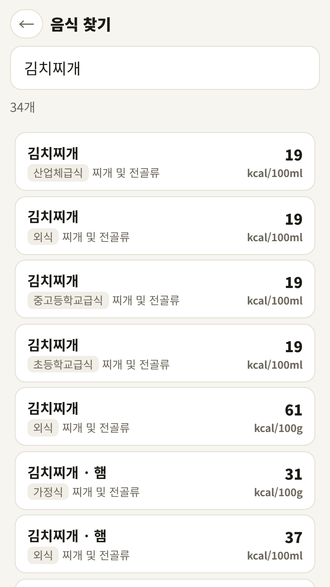
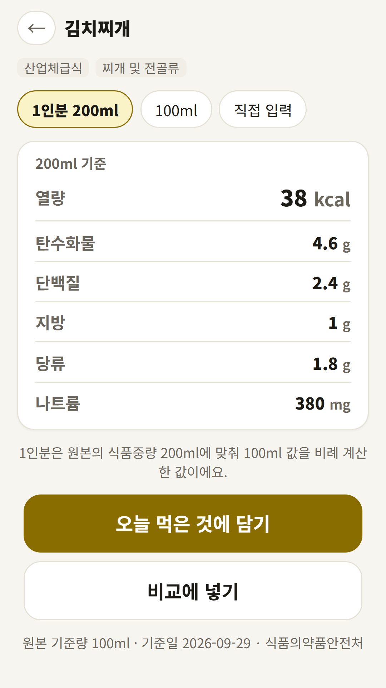
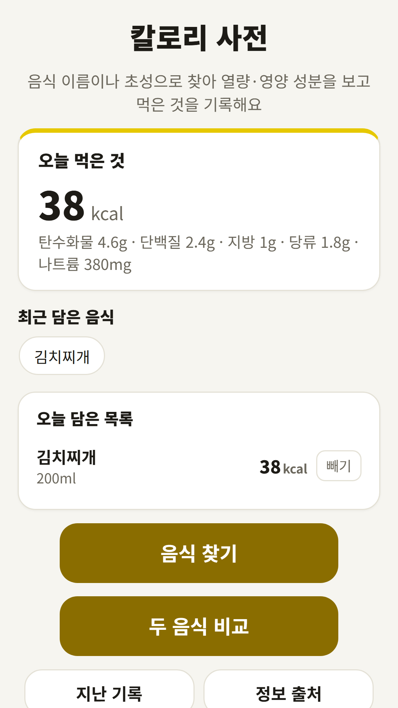
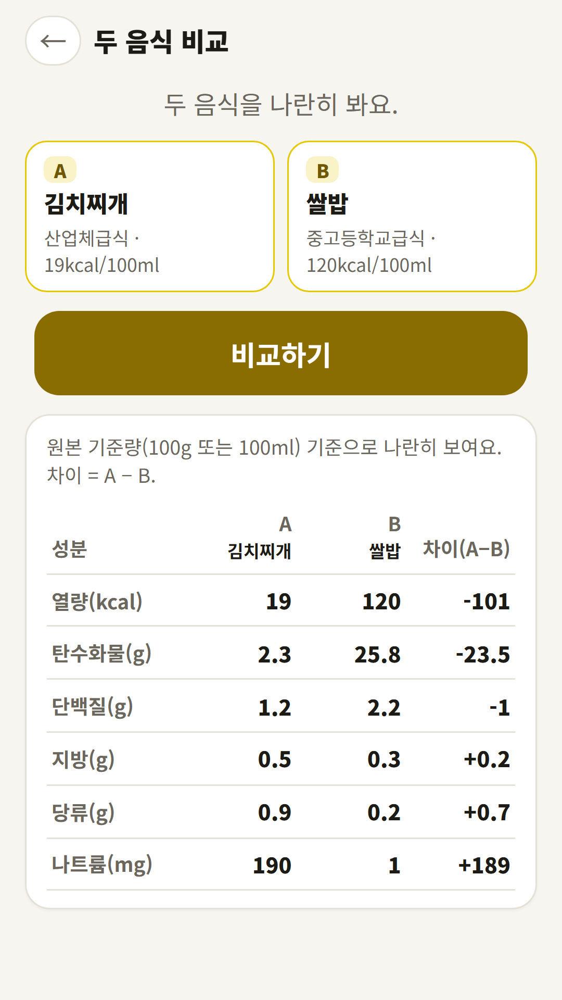

## Info
> **Korean Food Calorie Guide** — search 4,344 everyday Korean foods by name or Hangul initial consonants, inspect calories and nutrients, compare two foods, and keep a daily intake total. Free on Google Play, with ads (banner and optional rewarded ads).
{: .prompt-info }

## What it is
Built from the Korean Ministry of Food and Drug Safety (MFDS) standard food nutrition dataset on data.go.kr (excluding franchise brand menus), the app bundles 4,344 foods locally so search results appear instantly by Korean name or Hangul initials (choseong).

## How it works
- **Instant search**: Look up calories, carbohydrates, protein, fat, sugar, and sodium across 4,344 foods
- **Portion toggle**: Switch between per serving (from dataset food weight), per 100g/100ml, or custom grams
- **Side-by-side comparison**: Compare two foods directly across all 6 nutrients
- **Daily log & history**: Track today's total, streak counter, and recent 30-day history saved only on your device

## Good to know
- The entire app interface and food database are in Korean. No sign-up needed
- Your meal logs stay on your device and are never sent to a server
- Nutrition figures are reference values from public data and may vary depending on recipes and portions. This app is not a medical device and is not intended to diagnose, treat, cure, or prevent any disease

Contains ads (banner and optional rewarded ads). Search, nutrition details, and daily logging work without watching a rewarded ad.

{: w="360" }
{: w="360" }
{: w="360" }
{: w="360" }

## Gameplay Video


## Download
- Google Play: <https://play.google.com/store/apps/details?id=com.fadongkwon.food_calorie>

{: w="200" .normal }

## Data source
Data.go.kr "National Integrated Food Nutrition Information (Food) Standard Data" (provided by MFDS, downloaded November 2026).

## You might also like
- [Health Life](/posts/hub-health/) — Home Workout Counter, Stretch Routine, and Korean Food Calorie Guide in one hub
- [Stretch Routine](/posts/stretch-routine/) — 3-to-5-minute guided stretches with pose art and voice cues

Follow along on this blog and on [Instagram (@fadongkwon.soft)](https://www.instagram.com/fadongkwon.soft/).
