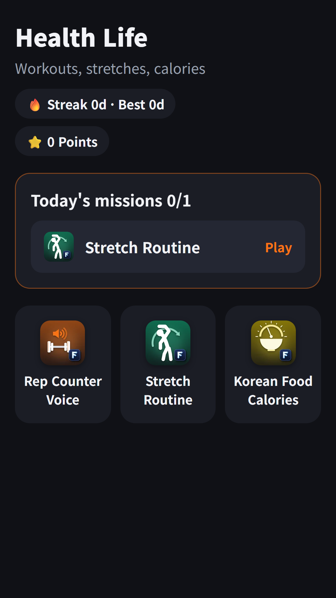
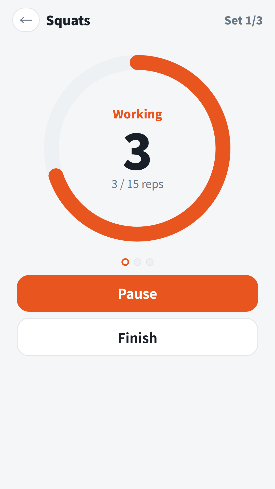
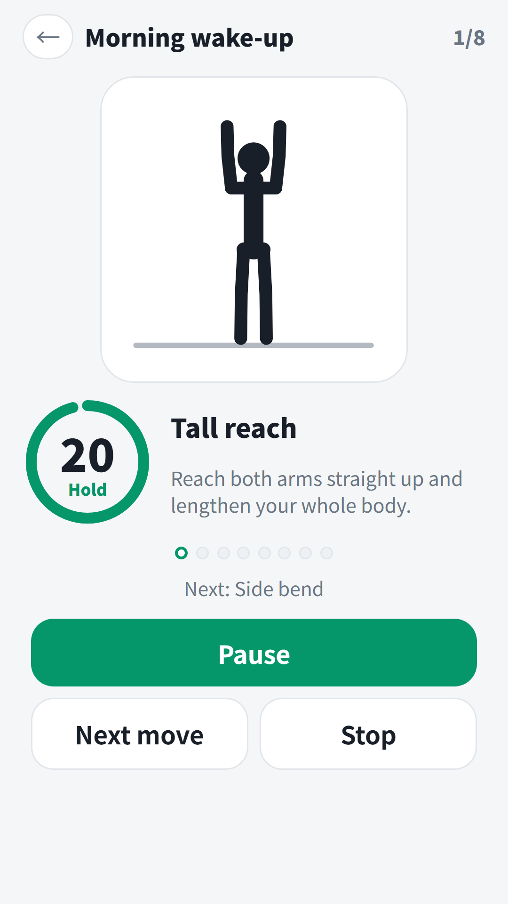
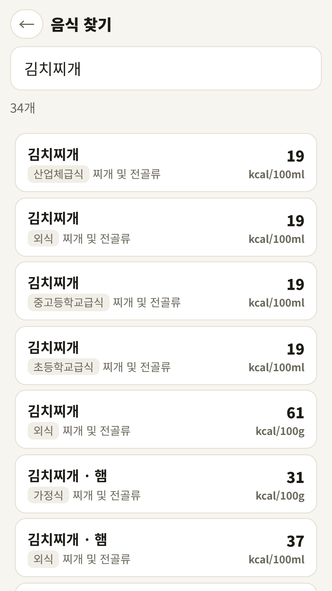

## Info
> **Health Life: Workouts & Food** — three everyday tools for moving your body and tracking what you eat in a single hub app. Free on Google Play, with ads (banner and optional rewarded ads).
{: .prompt-info }

## What it is
Health Life brings three everyday tools together under one roof so you can launch any of them from the home screen, step back to the hub anytime, and finish one daily task each day to build a streak.

## Three Tools Included
- **[Rep Counter Voice](/posts/exercise-count/)**: Counts your reps, sets, and rest time out loud across 9 exercises in 9 languages
- **[Stretch Routine](/posts/stretch-routine/)**: Follow 14 guided 3-to-5-minute stretching routines across 6 body areas with pose illustrations and voice cues (Korean & English)
- **[Korean Food Calorie Guide](/posts/food-calorie/)**: Search 4,344 Korean foods by name or Hangul initials to check calories and nutrients, compare two foods, and log your daily total (interface and database are in Korean)

## Good to know
- Complete one daily task each day to build your streak and points
- Free to use with no sign-up required; all logs stay on your device
- This app is not a medical device and is not intended to diagnose, treat, cure, or prevent any disease. Nutrition figures are reference values from public data and may differ depending on recipes and portions

Contains ads (banner and optional rewarded ads).

{: w="360" }
{: w="360" }
{: w="360" }
{: w="360" }

## Download
- Google Play: <https://play.google.com/store/apps/details?id=com.fadongkwon.hub_health>

{: w="200" .normal }

## You might also like
- [Weekend Life](/posts/hub-weekend/) — Travel timing, Korea Museum Map, and Rep Counter Voice in one hub

Follow along on this blog and on [Instagram (@fadongkwon.soft)](https://www.instagram.com/fadongkwon.soft/).
