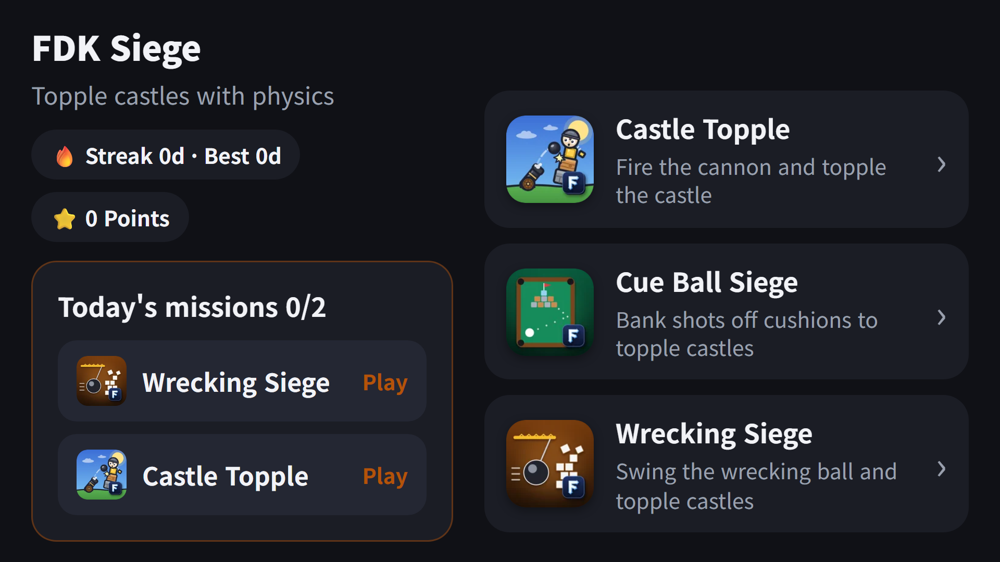
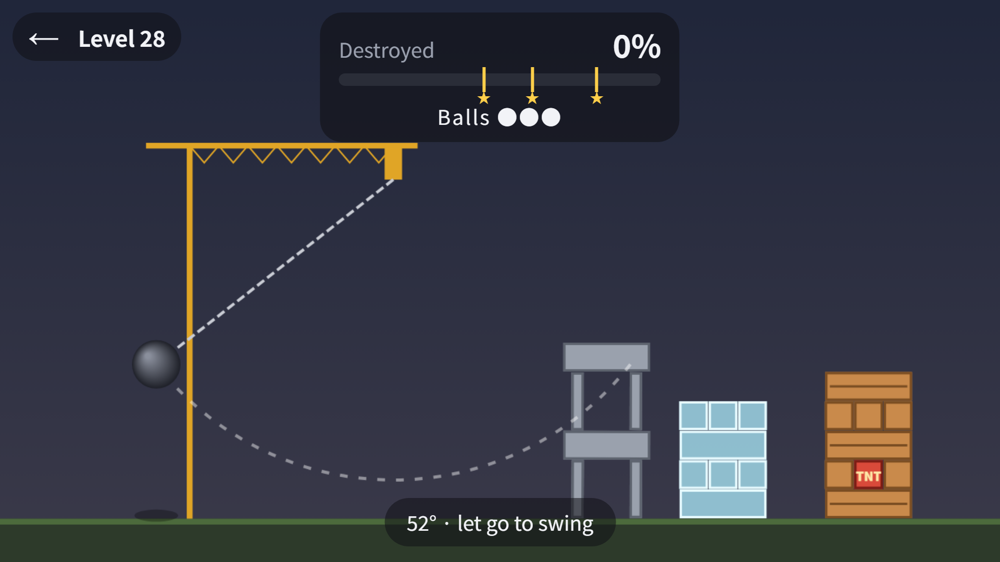
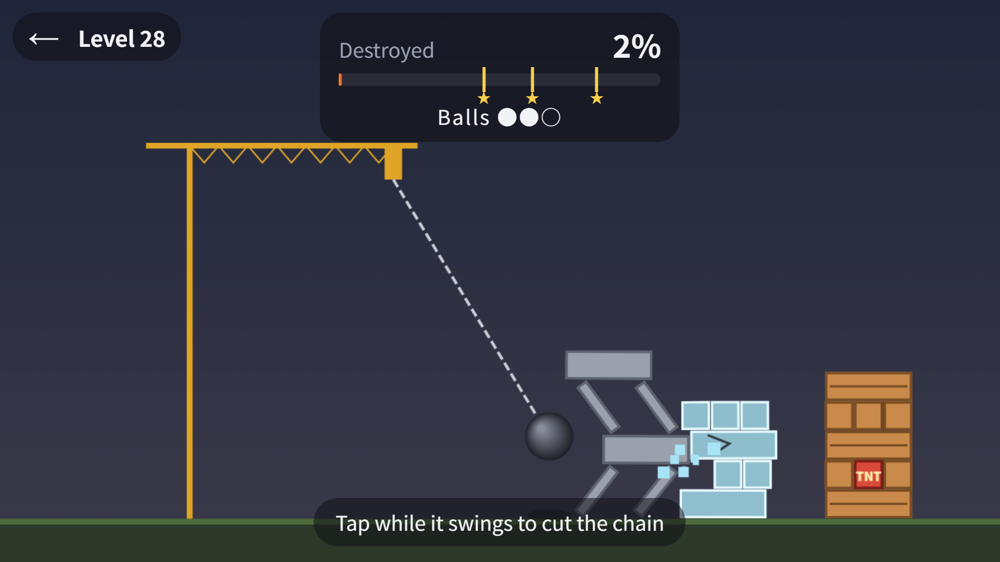
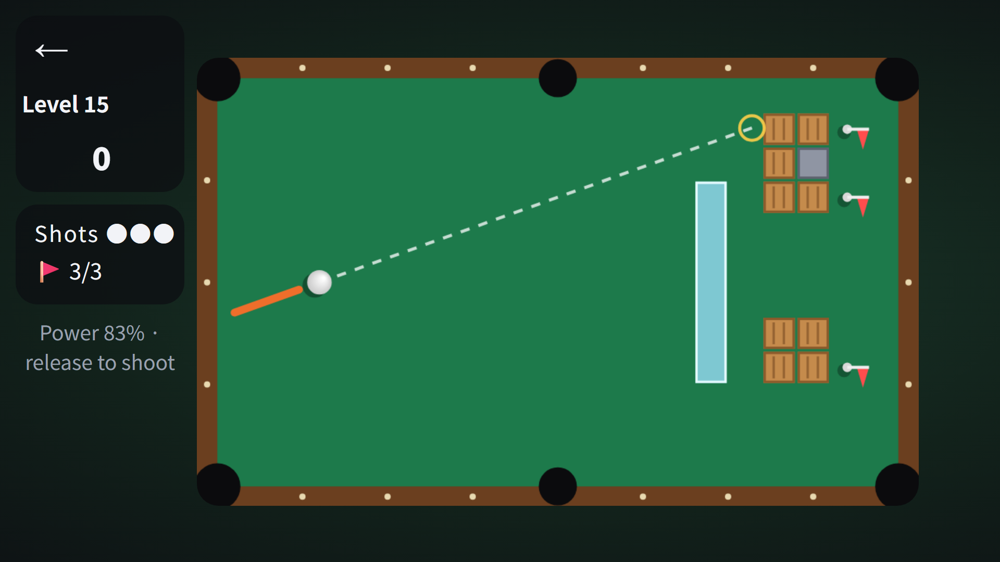

## Info
> **FDK Siege** — three landscape castle-toppling physics games (cannon, cue ball, and wrecking ball) collected in a single hub app. Free on Google Play, with ads (no banner ads).
{: .prompt-info }

## Three Games Included
- **Castle Topple**: Aim the cannon and bring down towers and walls made of wood, stone, ice, and TNT
- **[Cue Ball Siege](/posts/billiards-castle/)**: Pull back the cue ball, bank it off cushions, and knock down block castles and their flags
- **[Wrecking Siege](/posts/wrecking-siege/)**: Swing a crane wrecking ball, cut the chain mid-swing, and raise the destruction rate

## Good to know
- Two games are chosen as daily missions every day—finishing them builds your streak
- Built for wide landscape play with no bottom banner covering the screen
- Plays in 9 languages with no sign-up needed

Free to play. Contains ads, including optional rewarded ads.

{: w="560" }
{: w="560" }
{: w="560" }
{: w="560" }

## Download
- Google Play: <https://play.google.com/store/apps/details?id=com.fadongkwon.hub_siege>

{: w="200" .normal }

Follow along on this blog and on [Instagram (@fadongkwon.soft)](https://www.instagram.com/fadongkwon.soft/).
