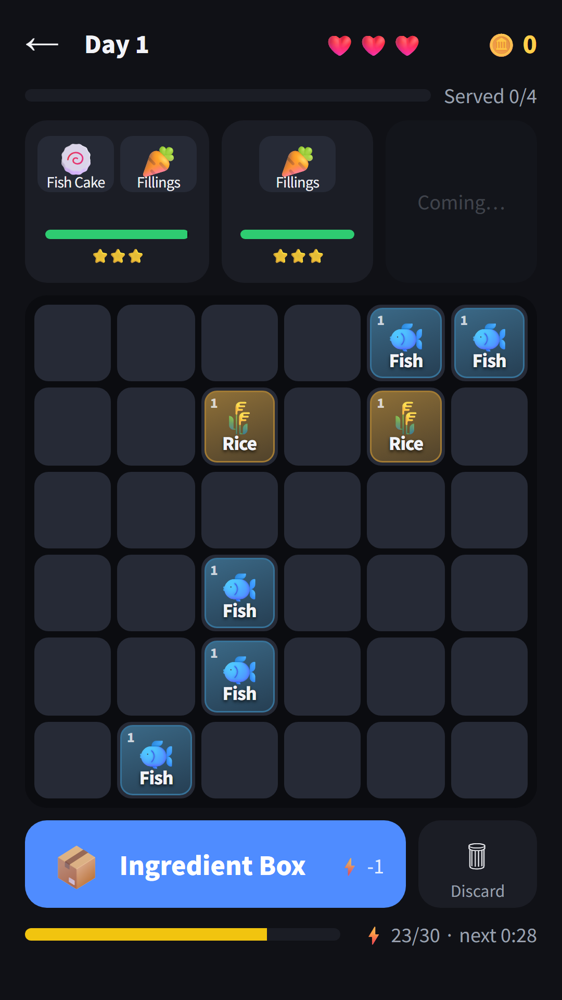
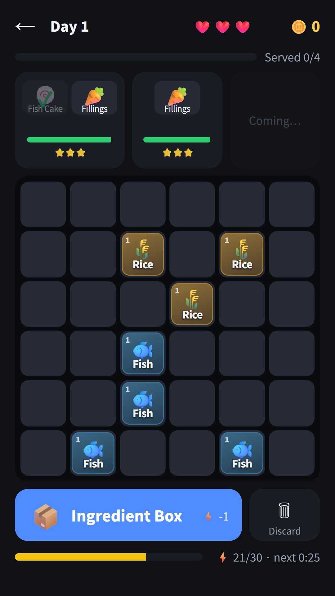
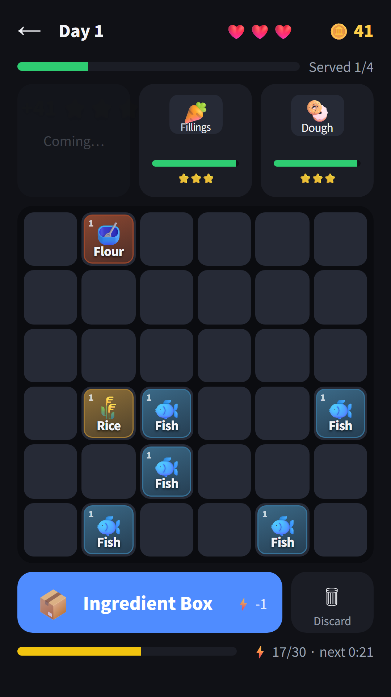
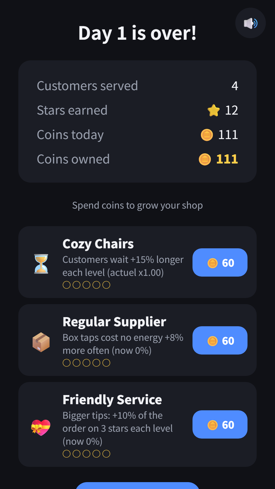

## Info
> **Bunsik Snack Merge** — run a Korean snack shop by merging ingredients on a 6x6 board and serving customers across 8 business days. Free on Google Play, with ads.
{: .prompt-info }

## What it is
A casual merge-and-serve game themed around a Korean bunsik snack shop. Combine basic ingredients into higher-tier dishes and keep the queue happy before patience runs out.

## How to play
- Tap the ingredient box and merge two identical items on the 6x6 board across four chains: rice, flour, egg, and fish
- Drag finished dishes to the customer who ordered them—more remaining patience earns more stars and tips
- Energy refills over time; if customers wait too long they leave, and losing all 3 hearts closes the shop
- Spend coins on shop upgrades between days

## Good to know
- Includes a Daily Shop mode and TOP 10 score board
- Optional rewarded ads refill extra energy when you want a boost
- Plays in 9 languages with no sign-up needed

Free to play. Contains ads (a banner and optional rewarded ads).

{: w="360" }
{: w="360" }
{: w="360" }
{: w="360" }

## Download
- Google Play: <https://play.google.com/store/apps/details?id=com.fadongkwon.merge_diner>

{: w="200" .normal }

Follow along on this blog and on [Instagram (@fadongkwon.soft)](https://www.instagram.com/fadongkwon.soft/).
