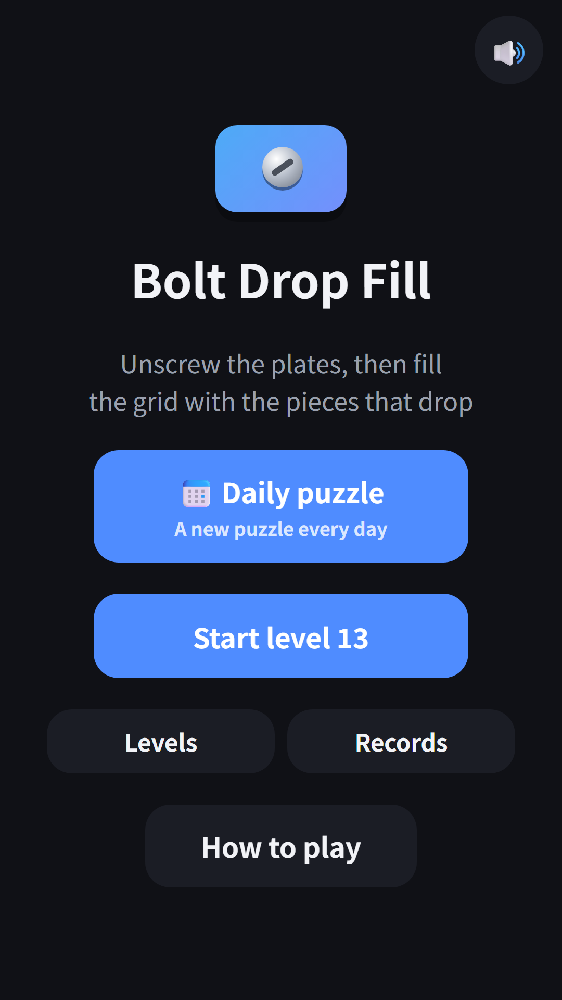
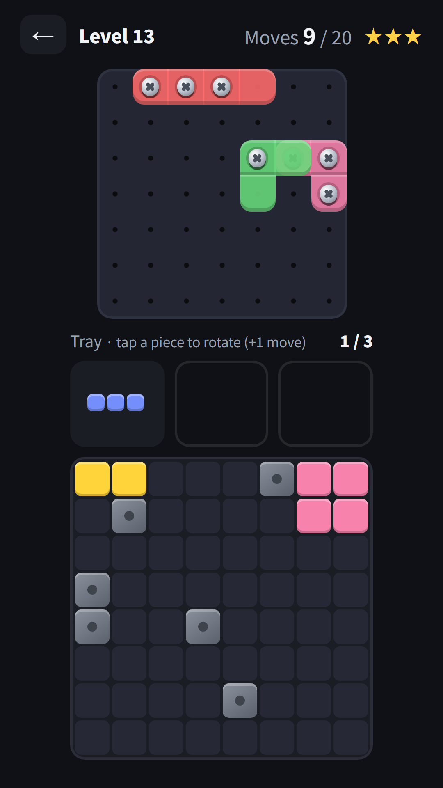
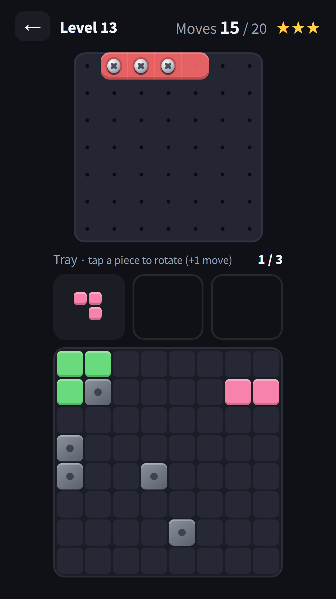
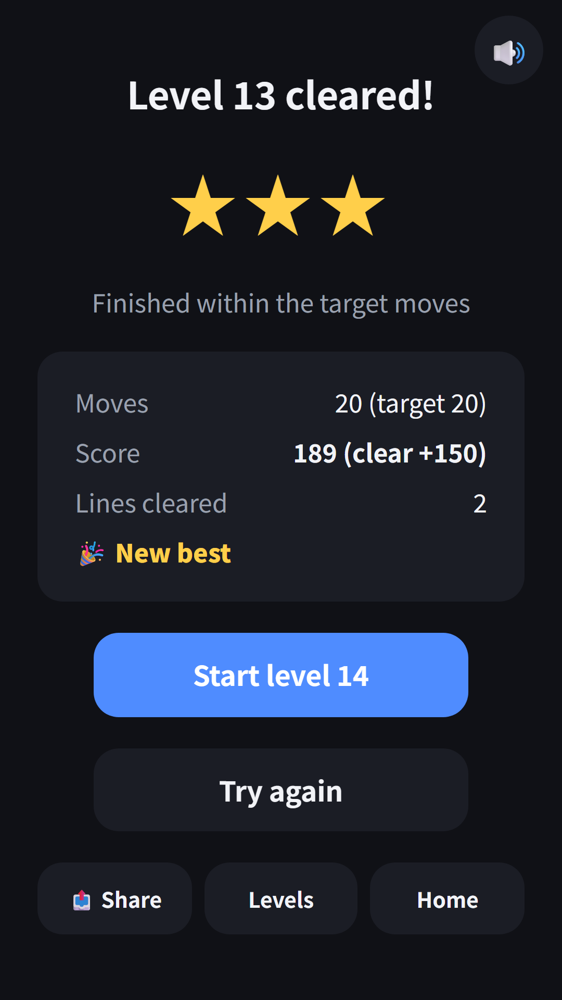

## Info
> **Bolt Drop Fill** — unscrew layered plates and place the falling pieces onto an 8x8 grid to clear full rows and columns. Free on Google Play, with ads.
{: .prompt-info }

## What it is
Bolt Drop Fill combines a bolt-unscrewing puzzle with an 8x8 line-clearing block board. Clear the covering plates first so their bolts can be removed, then drop the freed pieces onto the grid below.

## How to play
- Remove every bolt from a plate to drop it into the 3-slot tray; a plate covering a bolt has to come off first
- Drag pieces onto the 8x8 grid and tap a piece to rotate it
- Full rows and columns clear automatically
- 60 levels (up to 3 stars each) plus a daily puzzle; later levels introduce steel blocks

## Good to know
- Optional rewarded ads give a hint or rescue you when no piece fits (once per puzzle each)
- Plays in 9 languages with no sign-up required

Free to play. Contains ads (a banner and optional rewarded ads).

{: w="360" }
{: w="360" }
{: w="360" }
{: w="360" }

## Download
- Google Play: <https://play.google.com/store/apps/details?id=com.fadongkwon.screw_fill>

{: w="200" .normal }

Follow along on this blog and on [Instagram (@fadongkwon.soft)](https://www.instagram.com/fadongkwon.soft/).
